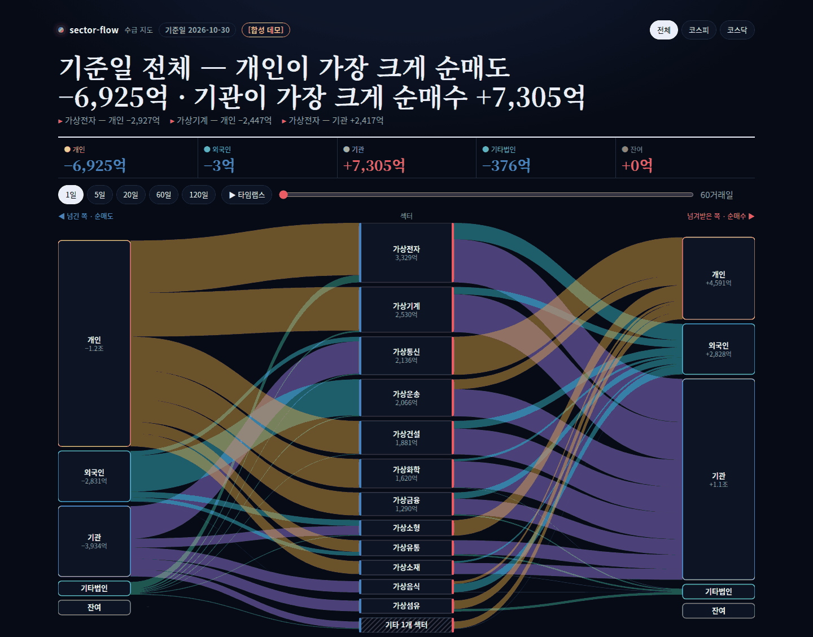
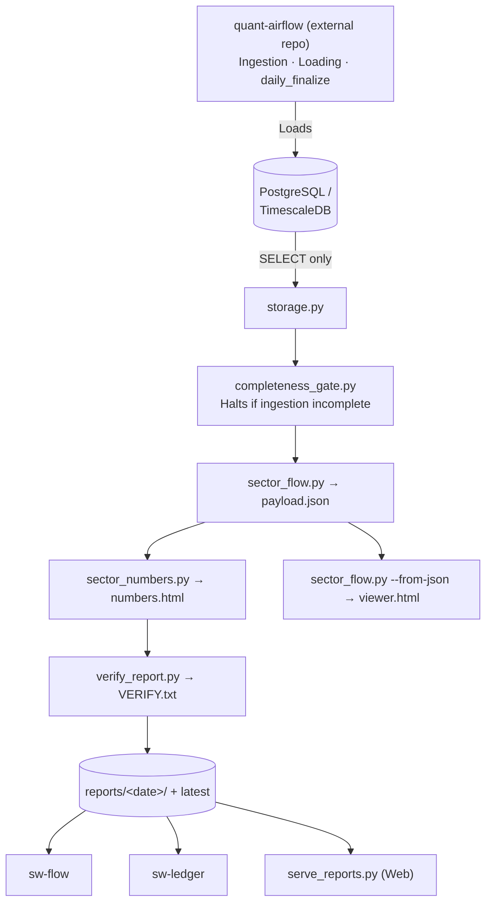
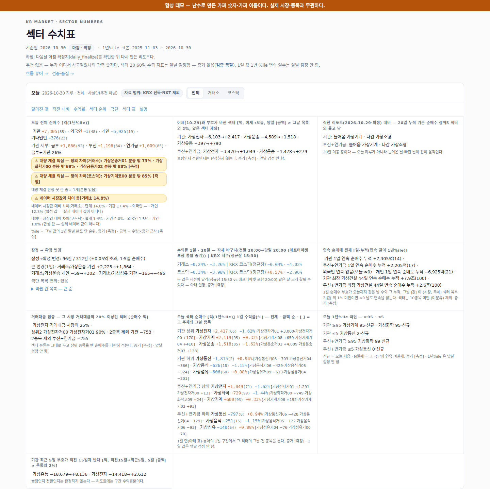
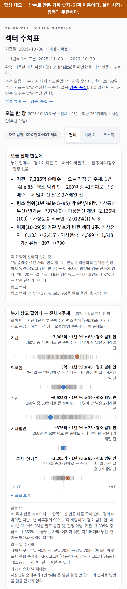
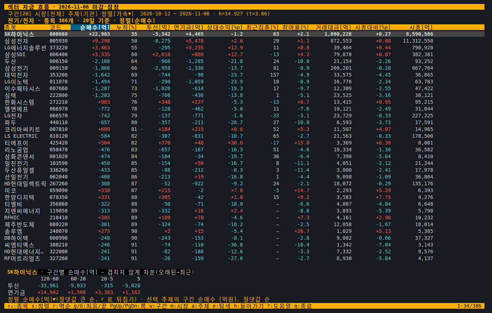
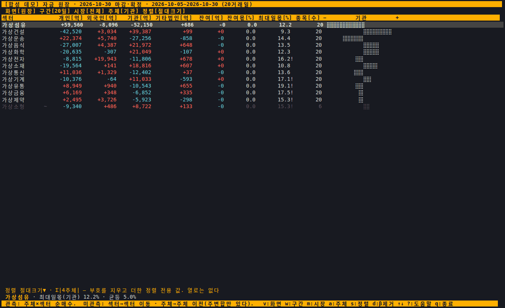

<picture>
  <source media="(prefers-color-scheme: dark)" srcset="docs/images/brand/wordmark-dark.svg">
  
</picture>

[한국어](README.md) | **English**

**See which KOSPI · KOSDAQ sectors attracted whose money today, in your terminal (`sw-flow` · `sw-ledger`) and in the browser.**

[](https://github.com/younghwan91/sector-flow/actions/workflows/ci.yml)
[](https://www.python.org/)
[](LICENSE)
[](https://www.linkedin.com/in/younghwan-chae/)

- **Acceleration sorting + 1-year %ile context:** Ranks sectors not by raw won amount, but by acceleration (cumulative net buy ÷ sector market cap), and frames today's net flow and streak length as percentiles within the trailing 1-year (260-trading-day) distribution.
- **Offline report folders + self-verification:** The daily batch builds a report folder from the flow DB and passes 11 layers of self-verification (`verify_report.py`) right after saving. Viewers (`sw-flow` · `sw-ledger` · web) only read the folder, so they launch over SSH with no DB.
- **Contemporaneous measurement, not prediction:** This does not claim that sectors receiving inflows will outperform going forward ([§8](#8-caution--these-numbers-are-not-predictions)).

## Quick start

```bash
uv sync
uv run sw-flow --demo      # Sector money flow — launches immediately with no DB or data
uv run sw-ledger --demo    # Money ledger — same synthetic demo
uv run sector-flow-demo --out ~/sf-demo && uv run python scripts/serve_reports.py --root ~/sf-demo   # Same demo in browser — http://127.0.0.1:8765/
```

**All numbers and names in `--demo` are random.** They are unrelated to actual markets or stocks, and `[합성 데모]` (synthetic demo) is always prefixed to the title bar and top of the web page.
The first run takes tens of seconds to generate into `~/.cache/sector-flow/demo`; subsequent runs open instantaneously.

There are two ways to view real reports:

```bash
uv run sw-flow --dir <report-folder>   # Received folder (no DB required, §4.3)
scripts/daily_report.sh                # Build directly if you have access to the flow DB (§4.1) → uv run sw-flow
```

> **Do not share report folders with third parties.** They contain actual per-stock investor flow and cannot be redistributed under
> KRX · Kiwoom data usage terms. Transfer only between your own devices, and use the synthetic demo when showing others (§4.3).
> The same applies to charts and cards rendered from sector totals—every public image in this repo is a synthetic demo.

> **Where does the data come from?** The daily batch only reads from the DB populated by
> [quant-airflow](https://github.com/younghwan91/quant-airflow). `src/sectorflow/collect/` (`sector-flow-collect`) is a BYO collector
> that populates SQLite using your own Kiwoom API keys; it currently only fetches a small slice of a few sectors and is not used by the daily batch ([`docs/byo/`](docs/byo/)).

## Flow Map



Visualizes **who net-sold and net-bought which sectors** over a day (or 5 · 20 · 60 · 120 trading days) in a single chart. Each ribbon is one `(investor, sector)` cell.
Clicking an investor box filters down to that investor's sector net buys/sells, and Institutions can be expanded into Investment Trusts, Pension Funds, etc. Time-lapse steps day-by-day over the trailing 60 trading days.
Sectors are never linked to sectors, and investors are never linked to investors—the data does not say who handed money to whom ([definition](docs/formulas.md#8-수급-지도--sectorflowflowmap)).

```bash
uv run python scripts/sector_map.py --payload <report-folder>/payload.json --html map.html   # Open in browser
```

The daily batch does not yet generate `map.html`. Real-data maps follow the same rule as report folders—view only on your own devices.

## Contents

- §1 [What It Does](#1-what-it-does) · [How It Differs from Other Sources](#11-how-it-differs-from-other-sources)
- §2 [Architecture](#2-architecture)
- §3 [Daily Batch — Schedule & Pipeline](#3-daily-batch--schedule--pipeline) · [Incident Response (Operations Runbook)](docs/runbook.md)
- §4 [Installation & Usage](#4-installation--usage) · [Transferring Report Folders](#43-transferring-report-folders) · [Viewing on the Web](#44-viewing-on-the-web)
- §5 [Reading the Screens](#5-reading-the-screens) · [Flow Observation Reading Guide](docs/reading-guide.md) · [Glossary](docs/glossary.md)
- §6 [Money Ledger — `sw-ledger`](#6-money-ledger--sw-ledger)
- §7 [Metric Definitions](#7-metric-definitions)
- §8 [Caution — These Numbers Are Not Predictions](#8-caution--these-numbers-are-not-predictions)
- §9 [Self-Verifying Reports](#9-self-verifying-reports)
- §10 [Development](#10-development)
- §11 [Documentation](#11-documentation)

---

## 1. What It Does

| Command | Role | DB |
|---|---|---|
| `sw-flow` | Opening screen is **Today's Flow** — who bought/sold where and how unusually on the reference date. Press any key to enter the table of 27 sector buckets (26 vendor classifications + Unclassified) × 5 windows (1 · 5 · 20 · 60 · 120 trading days) × 3 markets × 4 investor groups. Default sort is **Acceleration** (cumulative net buy ÷ sector market cap), not raw amount, so sectors with mega-cap stocks don't automatically top the list. Press `Enter` on a sector to drill down to the constituent stocks | None |
| `sw-ledger` | Accounting view of the same report. Shows who transferred how much and how much remained unclassified, strictly in raw amounts and residual | None |
| Web | Serves the numerical table (`numbers.html`, with **Today at a Glance** at the top) and flow viewer (`viewer.html`) over Tailscale | None |
| `scripts/daily_report.sh` | Builds the report folder from the DB and runs self-verification immediately after saving | Read-only |


*`sw-flow` opening screen (160×45, **synthetic demo** — all figures and names in this document are randomly generated). States only facts with no scores, rankings, or recommendations. Press any key to go to the table.*


*Sector table (20 trading days · All Markets · Institutions, 160×45, synthetic demo). Each row is one sector.*

### 1.1 How It Differs from Other Sources

**The raw data is not exclusive to this repo, nor does this repo hold better data.** Plenty of places already show it for free.
The table below reflects public pages checked on 2026-11-08–09:

| Source | What was observed | How this repo differs |
|---|---|---|
| Kiwoom HTS [0789] Cumulative Net Buy by Investor | Pick one industry to view cumulative trends for sub-groups like Investment Trusts and Pension Funds | Same kind of trend. To compare sub-groups side by side across industries, you have to switch industries one by one |
| Kiwoom HTS [0797] Net Buy by Industry & Investor | Pick a market to see industry × investor net buys on one screen | Viewing industries side by side is not unique to this tool |
| Kiwoom HTS [1051] Stock Investor Trading Trend (Provisional) | Up to 5 intraday provisional snapshots, per stock | This repo has no intraday data |
| MoneyRecipe Industry Investor Flow Analysis | KRX/WICS mid-level × Foreign, Institution, Retail, Financial Inv, IT, Pension, Private Equity; 12M–1M cumulative; weekdays 16:10 provisional / 21:30 final | Provisional posting is earlier than here (18:10) and uses WICS classification. Has Top 3 bullish/bearish today, but no 1-year %ile was found |
| KoScanner `/flow` | KRX+NXT combined per-stock flow 1·3·7D, finalized after 20:00 | No sector aggregation found. This repo is KRX-only, so numbers differ |
| KRX Information Data System | Market- and stock-level trading results by investor. Whether an industry (index) view exists is **unverified** | Anonymous programmatic queries to the same stats were rejected with `400 LOGOUT` (2026-11-09, `scripts/krx_truth.py`). Logged-in queries were not tested |
| Naver Finance | Programmatically fetched market-level Retail, Foreign, Institution net buys (2026-11-09, internal cross-check). Whether a sector-level view exists is **unverified** | Used here only for market-total cross-checks — disabled by default since terms are unverified |

**Within that survey, three things were not found elsewhere** (meaning not found, not proven nonexistent):

1. Framing today's net buy as a **1-year (260-trading-day) %ile** within that sector's own distribution.
2. **Streak length and its 1-year %ile** — how many consecutive days in the same direction, and how rare that streak length is over the past year (raw streak length alone also exists on StockHub and DaramTickers).
3. **Drilling straight from sector to that day's stocks per investor** — `[ ]` on the opening screen lists top stocks for that investor on that day, and `Enter` opens all stocks.

Everything else is not unique, but establishes trust in the numbers: net buy, market cap, and returns are measured over the **exact same stock basket** so the numerator and denominator of acceleration never mismatch, and every report self-verifies ([§9](#9-self-verifying-reports)). Verification logs are not published externally yet.

**What it cannot do:**

- **Amounts are approximations and market totals exclude part of the market.** The DB only provides net **share** volume, which is converted via `volume × close`, and ~139 codes (preferred shares, REITs, etc.) lack investor flow data and are excluded from totals. The median daily difference vs. Naver market totals is 5.7% on KOSPI and 5.5% on KOSDAQ (48 days, internal check — raw KRX tables not cross-checked, [`docs/validation/2026-11-09-market-total-vs-published.md`](docs/validation/2026-11-09-market-total-vs-published.md)).
- **KRX trades only.** Nextrade (NXT) trades are excluded — labeled `자료 범위: KRX 단독·NXT 제외` on line 2 of the opening screen and in the web 'Today' panel header.
- **Not real-time intraday.** Built from provisional data at 18:10 on weekdays, then rebuilt with finalized data the next morning (§3).
- **Sectors are not official KRX industry index classifications.** Uses vendor master sector names with only 4 banks overridden to Finance (`sectorflow/sector_override.py`). Numbers will differ from KRX industry-index investor tables of the same name.
- **No forward predictive evidence.** Sector flow metrics were tested against forward sector returns and showed no evidence ([§8](#8-caution--these-numbers-are-not-predictions)).

## 2. Architecture



```
src/sectorflow/
├── storage.py              # Read-only DB access — only what reports need
├── demo.py                 # Synthetic demo report (not real data) — sw-flow --demo · sector-flow-demo
├── collect/                # BYO collector sector-flow-collect — own Kiwoom keys → sqlite (unused by daily batch)
└── tui/                    # sw-flow · sw-ledger — renderers (*_view.py) are pure functions; curses only in *_app.py
scripts/
├── daily_report.sh         # Batch entry point — gate → build → verify → atomic latest swap
├── cron_run.sh             # Cron wrapper — alerts on abnormal exit
├── _env.sh · _ledger.sh    # Load uv/.env · ops incident logging — shared preamble
├── completeness_gate.py    # Ingestion completeness gate
├── finalize_done.py        # 08:20 finalization mode — confirms daily_finalize succeeded
├── sector_flow.py          # DB → payload.json (+ viewer.html)
├── sector_numbers.py       # payload → numbers.html (templates/)
├── sector_map.py           # payload → map.html flow map (templates/, outside batch — built manually)
├── verify_report.py        # Report self-verification (§9)
├── krx_truth.py            # Cross-check market totals vs. Naver (internal only)
├── demo_shots.py           # Regenerate README screenshots & examples from synthetic demo
├── krx_calendar.py         # KRX holiday calendar — trading-day check & SLO denominator
├── digest.py               # (Optional) Digest prose & card — written only to folder
├── trust_page.py           # Verification & quality page trust.html
├── rebuild_history.py      # Rebuild multiple past reference dates
├── seed_revisions.py       # Seed provisional→final revision magnitudes
├── ops_ledger.py           # Ops incident ledger stats (docs/slo.md)
├── freshness_check.{sh,py} # 20:30 freshness check
├── serve.sh · serve_reports.py  # Web server (§4.4)
├── web_smoke.py            # Real-browser smoke check of both web pages (§10)
├── ledger_numbers.py       # Reproduce empirical figures for sw-ledger Limitations screen
├── verify_merge.py         # Pre-merge check — real-data render, pty, mutations (§10)
├── rehearse_merge.py       # Sequentially merge pending branches into temp clone & run full gate (docs/merge-rehearsal.md)
├── mutation_sample.py      # Measure test strength via mutation sampling (docs/validation)
├── memcap.py               # Memory cap for pytest & mutation processes (§10)
├── ci_plan.py              # Determines mutation scope for current commit in CI
├── diff_coverage.py        # Changed-line coverage gate (CI)
└── docs_refs.py            # Check & --fix `file:line` citations in docs/formulas.md (§10)
deploy/crontab.simnode      # Canonical crontab
tests/conftest.py           # Session time/memory limits; fails overlapping pytest --cov runs (they clobber each other)
docs/                       # See §11 table
research/validation/        # Reproduction scripts for docs/validation results (outside CI)
```

## 3. Daily Batch — Schedule & Pipeline

Report folders are built by [`scripts/daily_report.sh`](scripts/daily_report.sh), invoked by cron ([`deploy/crontab.simnode`](deploy/crontab.simnode)). If a report for the reference date already exists, it is skipped.

| Time (KST) | Task |
|---|---|
| Weekdays 18:10 | If ingestion is complete, build report and link as `latest` |
| Weekdays 19:10 | Retry if 18:10 failed to build |
| Tue–Sat 08:20 | **Finalization mode** (`KR_QUANT_FINAL=1`). Once `daily_finalize` is confirmed to have overwritten finalized values (`scripts/finalize_done.py`), rebuilds the prior day's report—title becomes `마감·확정` with `FINAL.txt` in the folder. If not yet confirmed, leaves the provisional report and exits with warning (75) |
| Tue–Sat 10:20 | Finalization retry. Automatically finalizes days when `daily_finalize` finished late. Skips if `FINAL.txt` already exists. Rebuilds failed-verification finals, and chains provisional→final history only when the first finalization's record is trustworthy (recounts only the 1D cell if values changed again) |
| Weekdays 20:30 | Freshness check (`scripts/freshness_check.py`). Errors if today's flow arrived but `latest` isn't today, or if today is a trading day per calendar (`scripts/krx_calendar.py`) with no flow; warns on failed-verification publish, unfinalized prior trading day, unpublished report, ledger gap, silent probe, delayed deploy, or missing alert webhook. Sends heartbeat when report, flow, finalization, and ledger are all clean |
| Every 5 min | Restarts web server (§4.4) if down or `/healthz` fails to respond |

Caps: 40-min batch `timeout`, 10s DB connect timeout, 10-min `statement_timeout`. Overlapping runs fail to acquire `reports/.report.lock` and back off with warning (75).

**Completeness gate runs before building** ([`scripts/completeness_gate.py`](scripts/completeness_gate.py)). Per market, the reference date's stock count with investor flow and stock count with market cap must each be ≥ 97% of the trailing 5-trading-day median, stocks with adjusted close (`daily_bars_adjusted`) must be ≥ 97% of that day's flow stock count, and total market cap must be > 0. Row counts seen by the gate are recorded in `GATE.txt`, and evening retries rebuild even if a report exists whenever more ingestion rows arrived later.

| Marker in folder | Meaning | Screen |
|---|---|---|
| `INCOMPLETE.txt` only | Not built due to incomplete ingestion. `latest` stays on the prior day and the next cron retries | Prior report title shows `⚠ MM-DD 수집 미완` |
| `VERIFY_FAILED.txt` | Built, but failed self-verification (§9). Next attempt rebuilds. If a verified edition is already linked, it stays linked and the rejected build is moved to `reports/.rejected/` | Title shows `⚠ 검증 실패`, HTML shows top banner |
| `FINAL.txt` | Rebuilt with finalized values by 08:20 finalization mode | Title shows `마감·확정` |

Titles with `마감·잠정` indicate provisional reports built on that evening. `G` in provisional reports often shifts upon finalization (37.5% of days missed the `ρ ≥ 0.95` and `pass-change ≤ 1` bar between provisional and final, [`docs/validation/`](docs/validation/)).

Exit code 75 is a warning; any other non-zero exit is reported as an error by [`scripts/cron_run.sh`](scripts/cron_run.sh) (124 = timeout).
If the reference date is not today and is still incomplete, it exits 1 instead of 75.

**When an alert fires**, [`docs/runbook.md`](docs/runbook.md) lists causes and actions per alert message, along with the ops incident ledger and Naver cross-check notes.

**On disk loss or a new machine**, follow the [recovery procedure](docs/runbook.md#디스크-소실새-머신-복구) in the runbook.

## 4. Installation & Usage

**Requirements:** Python 3.11+, [uv](https://docs.astral.sh/uv/), Linux/macOS terminal (`curses`). Install with `uv sync`.
Viewing screens requires no DB (`--demo`, §4.2). Building reports directly requires PostgreSQL/TimescaleDB credentials: `cp .env.example .env` and fill `KR_QUANT_DB` (unnecessary if a sibling `quant-airflow` checkout exists, as its `.env` is sourced automatically).

### 4.1 Building Reports (DB Required)

```bash
scripts/daily_report.sh                      # <repo>/reports/<date> + latest symlink (override via KR_QUANT_REPORTS)
KR_QUANT_FORCE=1 scripts/daily_report.sh     # Rebuild even if same date exists (~5–6 min)
```

Folder names use the data reference date (`MAX(date)` of `supply_demand`), not the execution date. Built in a staging directory and swapped atomically at the end, so failures never corrupt existing reports. Opening an older report after a schema/format update shows `—` for new columns and `옛 리포트(새 열 없음)` in the title—rebuild with `KR_QUANT_FORCE=1`.

Unrolling the batch manually:

```bash
set -a; . ~/git/quant-airflow/.env; set +a   # Uses this repo's .env if present — same precedence as batch
uv run --extra pg python scripts/sector_flow.py --days 260 --json payload.json
uv run python scripts/sector_flow.py    --from-json payload.json --html viewer.html
uv run python scripts/sector_numbers.py --payload payload.json --html numbers.html
uv run --extra pg python scripts/verify_report.py --dir <report-folder> --db-check
```

### 4.2 Viewing Screens (No DB Required)

```bash
uv run sw-flow --demo                   # Synthetic data (not real) — launches with no folder
uv run sw-flow                          # Opens <repo>/reports/latest
uv run sw-flow --dir <report-folder>    # Report for a specific date
uv run sw-ledger                        # Money ledger (§6)
uv run sw-ledger --dump --width 100     # Plain text without colors — for pipes/redirects
uv run sector-flow-demo --out <folder>  # Generate synthetic demo folder only — open in browser or via --dir
```

Works down to 40×10 terminal size. When width is tight, columns are dropped wholesale at boundaries (never truncated mid-digit).
The ledger table alone is omitted below 71 columns with a notice—the 4 investor groups and residual form a single accounting identity, so partial display would look broken. Respects `NO_COLOR`.

### 4.3 Transferring Report Folders

**The receiving machine needs neither a DB nor an ingestion pipeline.** The builder archives and transfers the folder.

> ⚠️ **Do not share with third parties.** Folders contain actual per-stock investor flow and cannot be redistributed under KRX · Kiwoom data usage terms.
> Transfer only between your own devices. Use the synthetic demo when showing others.

```bash
tar czf sector-flow-2026-11-06.tar.gz -C <repo>/reports 2026-11-06               # Sender
mkdir -p ~/reports && tar xzf sector-flow-2026-11-06.tar.gz -C ~/reports         # Receiver
uv run sw-flow --dir ~/reports/2026-11-06
```

| File | If missing |
|---|---|
| `numbers.html` | `sw-flow` will not launch. Opening it in a browser shows the numerical table itself |
| `payload.json` | `sw-ledger` will not launch |
| `viewer.html` | Browser chart viewer. Terminal screens work without it |
| `VERIFY.txt` | Verification result (§9). Screens still open, but you cannot tell if the numbers passed checks |

⚠️ If `VERIFY_FAILED.txt` is present, **that report failed verification.** Do not strip it and send it.
Received folders are a snapshot of that day. After 4+ days past the reference date, both TUI and HTML warn `⚠ N일 지난 리포트`.

### 4.4 Viewing on the Web

The builder server also serves reports over Tailscale for phone and desktop browsers:

```
http://<server-tailscale-addr>:8765/                    # Date index — shows latest, finalized, failed-verification, incomplete
http://<server-tailscale-addr>:8765/latest/numbers.html  # Bookmark — always latest numerical table
http://<server-tailscale-addr>:8765/latest/viewer.html   #          — always latest flow viewer
```

`/latest/trust.html` is the verification & quality page (first-publish results, revision magnitudes, metric test outcomes, known limitations), with copies of supporting docs under `/latest/validation/`.
`/latest/digest.md` and `/latest/digest.png` hold that day's flow digest—readable only on this private web server with no external export path.

[`scripts/serve_reports.py`](scripts/serve_reports.py) is a read-only stdlib-only server. It serves only rendered pages, doc copies, and verification logs (`payload.json` and `cron.log` are never exposed), bound exclusively to Tailscale. Run `scripts/serve.sh` manually, or `python3 scripts/serve_reports.py` (`127.0.0.1`) for local-only viewing.

At the top of the numerical table, **Today at a Glance** reads top to bottom: summary sentences (who/how much · unusual spots · what changed vs. yesterday, identical to `sw-flow` opening screen and digest) + 'What this summary does not say' → 4 market investor groups plotted as today's dot over the past 1-year daily range (gray band = normal 5–95%ile), with `%ile`, `Nth of 260 days`, `larger day K days ago` → sector × investor 1-year %ile grid (click a sector for that day's stock bars and 20D cumulative line) → streak bars and sectors flipping sign vs. yesterday. Watchlist sectors starred with `☆` persist in that browser and add a line to the summary. The legacy 'Today' numbers remain below under **Detailed Numbers**, and window tables, exploration, and glossary are collapsed under **Sector Tables** (expanded automatically via anchor links).

| Desktop | Mobile |
|---|---|
|  |  |

## 5. Reading the Screens

> For the order in which to read who bought/sold where, see the [Flow Observation Reading Guide](docs/reading-guide.md). Unfamiliar terms are in the [Glossary](docs/glossary.md).
> It does not tell you what to pick—statistical tests found no evidence for that on these screens ([§8](#8-caution--these-numbers-are-not-predictions)).
> In-app help (`?`) is the canonical source for all column definitions and limitations; below is a summary.

### 5.1 Keys

| Key | Action |
|---|---|
| `↑` `↓` `j` `k` | Move one row. `g`·Home top · `G`·End bottom · PgUp/PgDn page |
| `Enter` `l` `→` | Drill down into all stocks for that sector |
| `h` `←` `Esc` | Exit drilldown |
| `w` `W` | Cycle windows 1 · 5 · 20 · 60 · 120 (plus Combined in Explore mode). Uppercase reverses |
| `1` | Jump straight to 1-day window (or that day's stocks in drilldown) |
| `o` | Reopen opening screen (Today's Flow). Scroll with `↑` `↓` `PgUp` `PgDn`; at the end, `PgDn`/`Space`/other keys enter the table |
| `m` `M` | Market: All · KOSPI · KOSDAQ |
| `a` `A` | Investor: Institution · Foreign · Retail · Other Corp |
| `s` `S` | Change sort column (sorts stocks in drilldown) |
| `r` | Reverse sort order. Toggle this to see top net-sell sectors |
| `e` | Toggle Explore mode — reveals Unrealized, Unwind Accel, dW/dt, G, Stock Score, Combined, All Stocks (Product). Off by default; displays an Explore banner in the title while active (abbreviated as width narrows down to `[탐색]`) |
| `t` | Explore mode only — All Stocks view (Product = Sector G × Stock Score). Return with `t`·`h`·`←`·`Esc` |
| `?` `F1` | Help — definitions, formulas, and evidence tags for all columns |
| `q` | Quit (closes help if inside help) |

Cursor stays on the same sector when switching windows, markets, or investors. Korean Dubeolsik keyboard layout is supported seamlessly even in Korean IME mode (note: only `q·w·e·r·t` have distinct shifted Korean characters, so `W` is the only uppercase reverse key in Korean mode; `M·A·S` and ledger's `V` fall back to lowercase forward). Same in `sw-ledger`.

**Opening screen — Today's Flow.** Lists facts for the reference date in this order. Any key enters the table; `q` quits immediately; `?` opens help.

- Data scope line — `KRX 단독·NXT 제외` (rationale at end of help). Same chip appears in the web 'Today' panel header.
- **At a Glance** — Same summary sentence as web 'Today at a Glance' and digest: largest investor group that day and its 1Y %ile, `평소 범위 안/밖` (verbalization of 5–95%ile, not a judgment), `Nth largest net sell in 260D · larger sell K trading days ago`, longest market streak (≥ 2D) and `M streaks of ≥ L days in same direction`, count of out-of-range sector×investor cells (excluding < 10 stocks), and sectors where Institutional sign flipped vs. yesterday. Defined in [docs/formulas.md §2.25](docs/formulas.md).
- Market 4-group net flows & 1Y %iles, plus Institutional breakdown (Financial Investment, Investment Trusts, Pension Funds, `FinInv÷Inst` omitted if Institutions < 10% of 4-group gross).
- ⚠ Warnings — `분봉 밖 거래 큼` (stocks with ≥ 50% volume outside minute bars and amount ≥ 1% of market; lists names, flags likely block/off-hours trades and potential definition mismatch vs. Naver market totals), `네이버 시장값과 차이 큼` (only when cross-check is enabled—off by default; > 5% vs. Naver, KRX raw table unverified, figures omitted), `종가·VWAP 환산 차 큼` (internal consistency check).
- **What Changed Today** — Sectors flipping sign vs. yesterday (both days `|amount|` ≥ 2% of list), entries/exits in 20D cumulative net-buy top 5 vs. prior trading day's report (notes if prior was provisional/failed), and for finalized reports `잠정→확정 변경: N칸` plus top 3 shifted 1D cells and %ile extreme entries/exits.
- Market returns 1D · 20D — Custom basket alongside KRX composite index (regular session) ([§8](#8-caution--these-numbers-are-not-predictions)). Last day of provisional reports is labeled differently (prior 20:00 → collection time during aftermarket). Notes count of remaining `(미분류)` stocks if any.
- For provisional reports: recent finalized days' provisional→final revision magnitude (median % of 1D sector cells, sign flips) and `(잠정)` tag on %ile extremes.
- Consecutive streaks — e.g. `기관 9일 연속 순매수 누적 +2.2조(69)` (consecutive days of same sign up to today, cumulative amount, and 1Y %ile of streak length in parentheses). Lists 4 market totals first, then longest sector streaks for Institutions, IT+Pension, and the day's largest net-flow group. Days with `|amount|` < 1% of list total break the streak. Descriptive only; forward relation untested.
- Turnover concentration — Top-2 stock share and net flow ex-top-2 [100M KRW] for sectors ≥ 20% of market turnover.
- Top/bottom 3 sectors by net buy for Institutions, IT+Pension (and the day's largest market `|net flow|` group if different), with 1Y %ile, sector return, top 1–2 stocks for that group, and sectors with 1Y %ile ≥ 95 or ≤ 5 (`신규` = first day, `N일째` = consecutive days in extreme).
- Sectors whose trailing 5D sign opposes the prior 15D sign (labeled inconclusive; only when 5D `|amount|` ≥ 2% of list).

Older reports without `today` fall back to 20D top/bottom. Reopen anytime with `o`; the bottom disclaimer line stays pinned at any terminal height.
Collapsed **Detailed Numbers** in the web numerical table follows the exact same order, with in-page jump links when expanded.

### 5.2 Sector Table Columns

Displayed left to right; rightmost columns drop wholesale when width is narrow (Sector, Marker, Acceleration, Impulse remain even at 40 columns).
Columns marked **Explore mode only** require `e`. In the 1-day window, only that day's facts (net flow, 1Y %ile, return, turnover) are populated; acceleration, sparkline, and explore columns show `—`.

| Column | Meaning |
|---|---|
| Sector (`섹터`) | 27 buckets: 26 vendor classifications (`stocks.sector`) + `(미분류)`. Differs from KRX industry classification; only 4 banks missing vendor sector are overridden to Finance (`src/sectorflow/sector_override.py`) |
| (Marker) | `~` indicates < 10 traded stocks in the window — grayed out, pinned at bottom regardless of sort (small denominator makes acceleration noisy). In Explore mode, `*` marks G-gate pass |
| Acceleration (`가속[%p]`) | Impulse ÷ window-end sector market cap × 100. Default sort column |
| Impulse (`임펄스[억]`) | Window cumulative net buy = Σ(net shares × daily close) |
| 1Y %ile (`1년[%ile]`) | Percentile of that group's rolling N-day net buy within the trailing 1-year distribution. 100 = 1-year max buy. Only time-series context in this table |
| Trend (`추이[8]`) | Cumulative net-buy path over the window. Normalized per row—not comparable across rows |
| Return (`수익률[%]`) | Window return of that sector's own basket, prior-day market-cap weighted (not KRX industry index). 1D is prior 20:00 → today 20:00 (§8), or up to collection time on provisional reports |
| IT+Pension 5D (`투신+연기금5일[억]`) | **Trailing 5-day** net buy of Investment Trusts + Pension Funds for that sector's stocks. Impulse is window-cumulative, so it doesn't say whether money is *still* entering |
| IT+Pension (`투신+연기금[억]`) | Same sum over **this window** (equals that day for 1D) |
| Stocks (`종목[수]`) | Number of traded stocks in that `(market, sector)` during the window. Matches the length of the `Enter` drilldown list (differs from listed count) |
| Unrealized (`미실현[%p]`) | **Explore mode only.** `(k×Accel + b) − Actual Return`, residual from fitted line. No forward evidence — practically sector 20D reversal (ρ 0.82–0.93), zero-sum across fitted sectors |
| Unwind Accel (`풀림가속[%p/일²]`) | **Explore mode only.** Second difference of `x` (`ẍ`, sign-flipped). Splits window into thirds for central difference; noisy on short windows |
| dW/dt (`dW/dt[%p/일]`) | **Explore mode only.** Difference in `W = Accel × Return` between second and first half of the window, divided by trading days |
| G | **Explore mode only.** Average rank across sectors passing all gates (not thin, Accel > 0, Unrealized > 0, Unwind Accel > 0). `—` if failed; 0.5 if only 1 sector passes. Inconclusive (underpowered) |
| Top Buy/Sell (`순매수/순매도상위[억]`) | Stock most bought/sold by the **selected investor** in that sector. 1 each in table, 3 each in bottom panel |

The bottom panel shows 4-group net flow for the selected sector (`개인 -116 · 외국인 -80 · 기관 +214 · 기타법인 -21 [억]`) and top 3 buys/sells. Because the 4 groups sum to 0, this line shows who took the other side. The hint bar below defines the currently sorted column.

### 5.3 Stock Drilldown Columns (`Enter`)



*`Enter` drilldown (160×45, synthetic demo). Rows above the `-` marker next to `Cumul[%]` account for 80% of that sector's net flow.*

| Column | Meaning |
|---|---|
| Name · Code (`종목 · 코드`) | Stock name and 6-digit code |
| Score (`선정`) | **Explore mode only** (right of code). Average rank within sector. `—` if failing gates (within top 80% cumul, net buy > 0, IT ≥ 0, Pension ≥ 0, turnover ≥ 10B KRW, all metrics present); no score if only 1 candidate (none in 5D). `rank(IT+Pension)` axis has the **opposite** sign of the validation test (§8) |
| Net Buy (`순매수[억]`) | Selected investor's net buy over the window. Default sort is by `|net buy|`, bringing both largest buys and largest sells to the top |
| Cumul% (`누적[%]`) | Cumulative contribution scanning by `|net buy|` descending. `-` marker marks 80%. Populated only when sorted by Net Buy |
| IT · Pension (`투신[억] · 연기금[억]`) | Window net buy of Investment Trusts & Pension Funds. Always institutional breakdown regardless of selected investor—same institutional total driven by IT+Pension vs. Financial Investment (hedging/arb) tells a different story ([guide](docs/reading-guide.md)) |
| Rel Return (`상대수익[%p]`) | Stock window return − sector window return (same baseline as sector table `Return[%]`) |
| Recent Conc (`최근집중[%]`) | 5D net buy ÷ window net buy × 100. In 20D view: ~25 = steady, ~100 = concentrated in last 5D, >100 = sold earlier then flipped. Blank if denominator < 100M KRW, in 1D/5D windows, or < 0.5% of list `Σ|net buy|`. Clamped display `>999`/`<-999` |
| Participation · Turnover (`참여율[%] · 거래대금[억]`) | Net buy ÷ stock turnover × 100 and its denominator. Shown/hidden **together**—participation alone makes a 300M SPAC look identical to a 4T large cap |
| %MCap · MCap (`시총대비[%p] · 시총[억]`) | Net buy ÷ stock market cap × 100 and its denominator |

Drilling down from the `Combined` (`종합`) view (Explore mode) uses the 20D window and titles the screen `20일 기준(종합)`.

### 5.4 `Combined` (`종합`) Window (Explore Mode)

Cycling `w` to the end in Explore mode opens `Combined` (`종합`), averaging `G` across 20D, 60D, and 120D **only over windows that passed the gate**. Hence 1/3 pass can rank above 3/3 pass, so check `통과[구간]` (`n/m`) alongside. 5D is excluded because unwind (`ẍ`) is undefined under 9 trading days. Sorting is fixed descending by `Combined G` (`정렬없음[G 순]`).

![Combined window screen. Explore banner in title, narrow table with Combined G, per-window G (20D/60D), Passed[windows], and stock count per sector.](docs/images/kqflow-combined.png)

## 6. Money Ledger — `sw-ledger`

While `sw-flow` shows sector dynamics (impulse, acceleration, 1Y %ile), `sw-ledger` shows accounting. Only net-buy amounts by `(date, market, sector, investor)` are observed, and the 4-group zero-sum identity provides investor-level counterparties. Thus it renders a bipartite `investor ↔ sector` graph where every edge is directly measured. Three things are intentionally **not** drawn:

| Not drawn | Reason |
|---|---|
| Sector → Sector transfer | Money has no serial numbers. `-100B` in A and `+100B` in B on the same day is not proof the same money moved |
| Investor → Investor transfer | Marginals give 3 independent equations for 6 pairwise flows—underidentified with a 3D null space |
| Pro-rating residual across 4 groups | Unmeasured participants would wear measured participants' clothes. `Residual = −Σ4groups` is kept as its own column |

The first point is also empirically falsified: the fraction of negative-correlation sector pairs for Retail, Institutions, and Foreigners is lower than the circular-shift null (~50%)—sectors tend to move together rather than opposite. Why is not measured, nor does it prove rotation doesn't exist; it simply means sector-to-sector Sankey diagrams are not supported by this data.
The `Concurrency` (`동시성`) screen re-measures this ratio on annual reports (`d` toggles β-removal, producing combinations indistinguishable from null); reproduction script is [`scripts/ledger_numbers.py`](scripts/ledger_numbers.py).

Keys: `v` `V` cycle Ledger · Breakdown · Concurrency · Limitations, `d` toggle β-removal (Concurrency), `w` `W` cycle 5 · 20 · 60 · 120 · 260 trading days (no 1D—use `sw-flow` opening/1D), `s` `S` sort by `|size|`, selected investor, sector name, max-day share, stock count (no `r` reverse—only sector name sorts ascending); `m`, `a`, and navigation keys match `sw-flow`.



*`sw-ledger` Ledger screen (20 trading days · All Markets · Institutions, 160×45, synthetic demo). `Residual%` and `MaxDay%` are blank when denominator (window gross) < 100M KRW to avoid blowups near zero.*

## 7. Metric Definitions

Market observables are mapped to physics quantities by analogy. Dimensional consistency separates sheer size from price impact, forcing acceleration over impulse. Physics terms are metaphors, not governing equations. Canonical formulas, code locations, and evidence levels live in [`docs/formulas.md`](docs/formulas.md).

| Symbol | Definition | Unit |
|---|---|---|
| `m` (mass) | Window-end sector market cap = raw close × that day's shares outstanding (recomputed after splits/merges/reductions) | 100M KRW |
| `F` (force) | Daily net shares by investor × close | 100M KRW |
| `J` (impulse) | `∫F dt`, window cumulative net buy | 100M KRW |
| `a` (acceleration) | `J / m × 100` | %p |
| `Δv` (return) | Window return of sector's own basket, prior-day market-cap weighted. Stock return uses adjusted close ratio (`daily_bars_adjusted`) | % |
| Today %ile | Rank of today's net buy among trailing 260 trading days (incl. today). Missing if > 75% of days are 0 | 0–100 |
| Diff vs. Naver market total | Per-market `Σ|approx − Naver| ÷ Σ|Naver|` (Retail · Foreign · Institution) | % |
| Close vs. VWAP diff | Per-market `|Σ n·close − Σ n·VWAP| ÷ Σ n·VWAP`, `n` = stock's 4-group `Σ|net shares|`. Internal check only, not true error | % |
| `k` (stiffness) | Cross-sectional OLS slope of `a → Δv` (with intercept) in that block. Excludes sectors with < 10 stocks | %/%p |
| `x` (unrealized) | `(k·a + b) − Δv` | %p |
| `dW/dt` (power) | Change in `W = a·Δv` across first vs. second half of window | %p/day |
| `ẋ`, `ẍ` (unwind) | Split window into 3 equal chunks and take central difference of `x` (sign-flipped). Drops oldest remainder days if not divisible by 3 (20D → 6·6·6) | %p/day, %p/day² |
| `G` (Explore mode) | Mean rank of `a`, `x`, `ẍ` across sectors where all three > 0 (≥ 10 stocks). 0.5 if only 1 passes. `Combined G` = mean over passing windows; Combined `*` = passed all evaluated windows | 0–1 |

## 8. Caution — These Numbers Are Not Predictions

> **Not investment advice.** Displayed numbers are contemporaneous observations, not predictions. Data is subject to each provider's terms of use; rights-holder inquiries are handled promptly via GitHub Issues — [Disclaimer](DISCLAIMER.md) · [Security Policy](SECURITY.md).

**Limitations are shown alongside every metric.** In-app help (`?`) attaches an `evidence` tag to every column, and both web pages display the same tags below column headers and in the legend, based on the 2026-11-08 pre-registered validation ([`docs/validation/`](docs/validation/)).

| Tag | Meaning | Columns |
|---|---|---|
| `[측정]` (Measured) | Measures current/past window; makes no forward claim (untested forward) | 1Y %ile · Trend · Return · Unwind Accel · dW/dt · Top Buy/Sell · Stocks · IT+Pension (5D & window amount — `only ÷MCap tested (S1)`) · Cumul% · Recent Conc · Rel Return · Participation · Turnover · MCap · Retail · Other Corp · Stock Net Buy amount (`only ÷MCap tested (K1/K2/K3)`) · Stock IT/Pension (individual amounts — `only (IT+Pension)÷MCap tested (K1)`) |
| `[앞날 증거 없음]` (No Forward Evidence) | Tested rank correlation vs. forward 5D/20D sector returns — no evidence | Acceleration (Inst 20·60D · Foreign 20D) · Impulse (Inst 20D) — **All Markets only**. Other windows: `[측정] · 앞날 검정은 N일만`; KOSPI/KOSDAQ: `[측정] · 전체 시장만 검정` · Stock %MCap (Inst 20D — K2 unconfirmed · Foreign 20D — K3 rejected; other windows: `[측정] · 앞날 검정은 20일만`) |
| `[판정 불가: G]` (Inconclusive: G) | Only 2–7 sectors pass gates per day — underpowered | G · Combined G · Passed[windows] · Product · Sector G |
| `[≈섹터 20일 반전: x]` | `x` correlates ρ 0.82–0.93 with negative 20D sector return (`-Δv`). No forward evidence either (All · 20D tested) | Unrealized |
| `[음의 순위 정보·쓸 수 없음]` (Negative Rank Info · Unusable) | Stock 20D `(IT+Pension)÷MCap` showed confirmed negative within-sector rank IC (K1). Yet "avoid top net buys" backfired in the confirmation split | Stock Score (Explore mode — that sum is one axis) |

- **Screen values are observations.** That is why Unrealized, G, Stock Score, Product, and Combined live exclusively in `e`-toggled Explore mode, while the opening screen is a factual summary.
- **Validation tests are descriptive statistics** (no costs or execution). Alpha screening belongs to `swing-it`. Its prior verdict, [Inst Flow Accel VERDICT](https://github.com/younghwan91/swing-it/blob/main/research/logs/inst_flow_accel/VERDICT.md), is NO-GO for monthly-rebalanced long-only top-10% 20D acceleration change.
- **`k` is an estimate.** It varies by window and day. That day's `k` and `t` are shown as `[측정]` in the Explore (`e`) header and web Explore panel (contemporaneous fit; `|t| < 2` on 42–47% of days for 20D·All, 60–70% for KOSDAQ — Q3c initial run). KOSDAQ-only fits are weak.
- **Amounts are close-price approximations and market totals exclude preferred shares & REITs.** DB gives share counts only (true value requires investor-specific execution prices). KOSDAQ is noisy at the sector level (only 71% of 48 days within 5% median relative diff). Opening screen and web Today panel flag high off-minute-bar volume and (when enabled) Naver market-total diffs.
- **Returns are not regular-session returns.** Since 2026-09-14, daily closes include KRX aftermarket (16:00–20:00), so 1D return is **prior 20:00 → today 20:00**. KRX indices use regular-session (15:30) closes and diverge on the same day (e.g., 11-06 KOSPI basket −4.37% vs. KOSPI −6.02%), which is why `KRX 지수(정규장)` is shown side by side. Dates before 09-14 use regular-session closes.
- **Zero means zero or unreported, not neutral.** Collectors emit 0 on parse failures.
- **Sectors with < 10 traded stocks in a window are not read as sectors** (`~` marker, grayed, pinned to bottom, excluded from G ranks). Some vendor labels are effectively single-stock (Real Estate 3, Publishing/Media 2).
- **`Residual%`, `MaxDay%`, and `Recent Conc` go blank where they lose meaning** (denominator < 100M KRW or tiny share). Blank cells are not bugs.

## 9. Self-Verifying Reports

**Silently wrong reports accumulating is worse than failing loudly.** The batch verifies every folder immediately after saving ([`scripts/verify_report.py`](scripts/verify_report.py)) and writes `VERIFY_FAILED.txt` on failure, preceded by the ingestion completeness gate (§3).

| Layer | Checks |
|---|---|
| **A. Formulas** | Table values satisfy defined identities (`x = expected Δv − Δv`, G range & gates). Re-fits in full precision (verifying with 3-decimal `k` causes false failures) |
| **A3. Derived** | Recomputing window returns, `ẋ`, `ẍ`, 1Y %ile, and `dW/dt` from daily payload arrays without calling `sector_numbers` matches |
| **B. Data** | Reference date = DB latest date, array lengths, 4-group sum ≈ 0, `(code, date)` uniqueness, units |
| **C. Computation** | Column definitions = cell count, no duplicate sectors, no Inf/NaN, no leftover template placeholders |
| **D. Alignment** | Paired inputs come from the exact same set, timestamp, and parameters (no denominator mismatch or label/calc mismatch) |
| **E. Screen** | **Rendered text** at widths 80, 120, and 200 matches column definitions |
| **F. Independent** | Re-aggregating raw DB tables via SQL without calling any `scripts/` function matches (`--db-check`, always on in batch) |
| **G. Ledger** | `sw-ledger` screen numbers/bars are valid and agree with `sw-flow` |
| **H. Screen · Keys** | Handled keys (exercising `handle_key`) match footer and help text |
| **T. Today** | Recomputing `today`, `change`, and `final_diff` 1D values, 1Y %iles, market totals, and prior-report diffs from daily arrays matches |
| **W. Web** | **Rendered values** on both web pages (main table, 'Today' panel, viewer table, KPIs, rankings, evidence tags) match payload and TUI character-for-character |

Only wrong values fail. When an empirical claim cited in Help/Limitations drifts against today's data, it is logged to `CLAIMS.txt` rather than failing the build. KRX index comparison on finalized reports is `SKIP`ped if regular-session closes aren't populated yet; **3 consecutive** `SKIP`s across adjacent folders emit `[WARN]` (not a failure), which the evening freshness check alerts on.

**Tests themselves are tested.** [`tests/mutations.toml`](tests/mutations.toml) pairs each check with a concrete mutation bug, and [`scripts/verify_merge.py`](scripts/verify_merge.py) injects them into source to confirm declared tests turn red. PRs run touched mutations; `main` pushes run all (skipped on doc-only changes). Deployments pull only when `main` HEAD is green.

## 10. Development

```bash
uv run --extra dev pytest -q                  # No network or DB required
uv run --extra dev ruff check src/ tests/ scripts/ research/
uv run python -m compileall -q research    # Research scripts require DB to run, so syntax-check only
uv run python scripts/verify_merge.py <worktree> --only render,pty   # After TUI edits — real-data render & pty (a few min)
uv run python scripts/verify_merge.py <worktree> --scope changed     # Include mutations touching changed files
uv run python scripts/verify_merge.py <worktree>                     # All mutations (23–47 min depending on load)
```

`pytest` and mutation runs execute under a per-process 6 GiB `RLIMIT_DATA` cap so runaway mutations cannot OOM the host's live DB (`scripts/memcap.py`).

Renderers are pure functions (`flow_view.py`, `ledger_view.py`), unit-tested without curses. Both web pages are also checked in a real browser—`uv run --with playwright python scripts/web_smoke.py --dir <report-folder>` checks console errors, horizontal overflow, and the 'Today' panel at 1440px and 390px widths (weekly `harness-selftest` workflow; non-blocking on deploy). New checks should add a matching mutation in `tests/mutations.toml`. `tests/test_docs_refs.py` verifies `file:line` citations in `docs/formulas.md` against current code; `uv run python scripts/docs_refs.py --fix` diffs from `refs-verified-at` to update them automatically and reports only ambiguous cases.

## 11. Documentation

| Document | Contents |
|---|---|
| [`docs/reading-guide.md`](docs/reading-guide.md) | Flow Observation Reading Guide — order and examples for reading who bought/sold where (no stock-picking advice) |
| [`docs/glossary.md`](docs/glossary.md) | Glossary — investor names, symbols, test names, screen tags |
| [`docs/formulas.md`](docs/formulas.md) | **Canonical formulas.** Exact equations, code locations, and evidence levels for every column and display |
| [`docs/validation/`](docs/validation/) | Metric validation and flow-utility tests — pre-registrations and results. Reproduction scripts in [`research/validation/`](research/validation/) |
| [`docs/runbook.md`](docs/runbook.md) | Operations runbook — causes/actions per alert, ops incident ledger |
| [`docs/slo.md`](docs/slo.md) | Publication deadline definitions and measurement |
| [`docs/byo/`](docs/byo/) | Equivalence measurements for the BYO Kiwoom-key collector slice |

## Sponsor

`sector-flow` is MIT open-source. If the code and maintenance are useful to you, you can sponsor via [GitHub Sponsors](https://github.com/younghwan91).
Sponsorship supports code and maintenance with no perks—no extra numbers, screens, or data are gated behind it. Data and report folders are never sold.

## License

MIT

## Author

**Younghwan Chae (채영환)** · [GitHub @younghwan91](https://github.com/younghwan91) · [LinkedIn](https://www.linkedin.com/in/younghwan-chae/)

View the full open-source quant stack on my [profile](https://github.com/younghwan91).

## Contributing & Issues

- 🐛 Bug reports, questions, feature requests: [GitHub Issues](https://github.com/younghwan91/sector-flow/issues)
- 🔒 Security issues & rights-holder inquiries: [SECURITY.md](SECURITY.md) · [Disclaimer](DISCLAIMER.md)
- 📈 Updates: [Follow @younghwan91](https://github.com/younghwan91)
