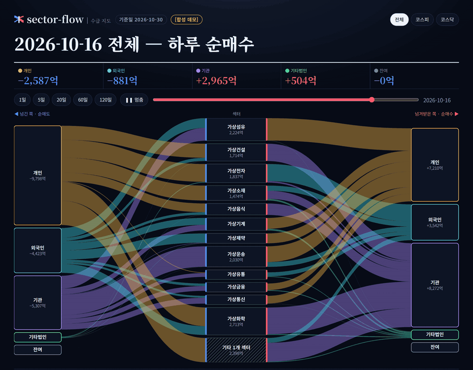
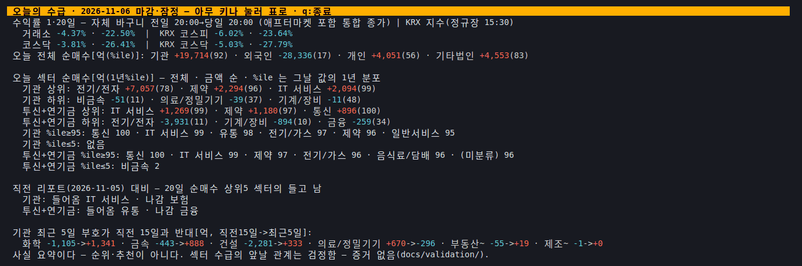
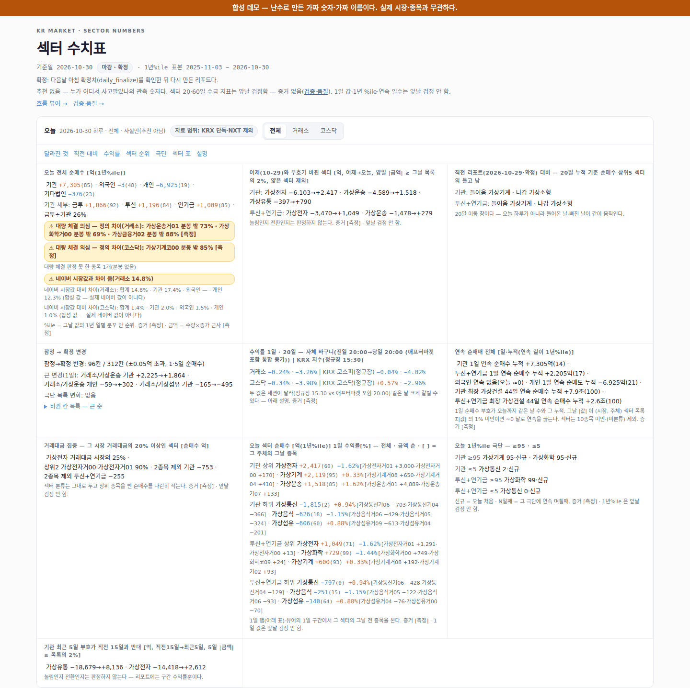

<div align="center">

<picture>
  <source media="(prefers-color-scheme: dark)" srcset="docs/brand/logo-dark.svg">
  
</picture>

# sector-flow

**오늘 누가 어느 섹터를 넘기고 넘겨받았는지, 투자 주체별 순매매를 한 장의 지도로 본다.**

코스피·코스닥 섹터 수급을 터미널과 브라우저에서 본다. 동시기 관측이며 예측이 아니다.

[](https://github.com/younghwan91/sector-flow/releases)
[](https://www.python.org/)
[](LICENSE)

[데모](https://younghwan91.github.io/sector-flow/) · [가이드](docs/guide.md) · [증권사 키로 시작하기](docs/byo/quickstart.md) · [English](README.en.md) · [후원](https://github.com/sponsors/younghwan91)

</div>



<p align="center"><sub>수급 지도 타임랩스, <b>합성 데모</b> — 이 문서의 그림은 전부 난수로 만든 가짜 숫자·가짜 이름이다.<br>
띠 하나가 (주체, 섹터) 한 칸이고 굵기는 금액이다. 섹터끼리·주체끼리는 잇지 않는다(<a href="docs/formulas.md#8-수급-지도--sectorflowflowmap">정의</a>).</sub></p>

## Quick start

```bash
uv sync
uv run sw-flow --demo      # 터미널 — DB·데이터 없이 바로 뜬다
uv run sector-flow-demo --out ~/sf-demo && uv run python scripts/serve_reports.py --root ~/sf-demo   # 수급 지도·수치표를 웹으로 — http://127.0.0.1:8765/
```

키도 데이터도 필요 없다. 처음 한 번 수십 초 걸려 합성 데모를 짓고 그 뒤로는 바로 뜬다. 화면마다 `[합성 데모]` 가 붙는다.

## 무엇을 보나

- **수급 지도** `map.html` — 넘긴 쪽 주체 → 섹터 → 넘겨받은 쪽 주체. 주체를 누르면 그 주체만 보이고 '시간 흐름' 보기는 날짜축에 쌓는다.
- **터미널** `sw-flow` — 첫 화면은 오늘의 수급 요약이다. 키를 누르면 27개 섹터 × 5개 구간 × 3개 시장 × 4개 주체 표로 넘어가고 `Enter` 로 종목까지 간다.
- **자금 원장** `sw-ledger` — 누가 얼마를 넘겼고 얼마가 미분류로 남았는지를 원 금액으로 맞춘다.
- **웹 수치표** `numbers.html` — 맨 위 '오늘 한 장'과 섹터 표, 흐름 뷰어 `viewer.html`.

<p align="center">
  
  
</p>

열의 뜻과 키는 [가이드 §5](docs/guide.md#5-화면-읽는-법), 읽는 순서는 [수급 관측 읽기 가이드](docs/reading-guide.md), 낱말은 [용어집](docs/glossary.md)에 있다.

## 왜 sector-flow?

- **본 것만 말한다.** 점수를 매기거나 종목을 고르지 않는다. 누가 어느 섹터를 얼마나 순매수했는지까지만 그린다.
- **얼마나 드문지 함께 본다.** 그날 순매수를 그 섹터의 1년(260거래일) 분포 안 %ile 과 연속 일수로 적는다.
- **섹터에서 종목까지 이어진다.** 첫 화면에 그 주체의 상위 종목이 있고 `Enter` 로 전 종목을 연다.
- **같은 바구니로 잰다.** 순매수·시총·수익률이 같은 종목 묶음에서 나와 분자와 분모가 어긋나지 않는다.
- **스스로 검증한다.** 리포트마다 13개 층이 값을 다시 센다. 검사가 살아 있는지는 변이로 다시 본다.

## 내 데이터로 보기

- **내 증권사 키(BYO)** — 키움 키로 전 종목 목록 → 지도 전용 수집 → `sector-flow-byo map --db data/byo.db --out data/map`.
  한국투자·LS·토스·DB·NH 어댑터(`--broker`)도 있지만 미검증이다. [시작하기](docs/byo/quickstart.md) · [증권사 비교](docs/byo/brokers.md)
- **수급 DB 배치** — DB 에서 리포트 폴더를 만들고 저장 직후 스스로 검증한다(`scripts/daily_report.sh`). [가이드 §3·§4](docs/guide.md#4-설치와-실행)

BYO 수집기 코드는 `src/sectorflow/collect/`(`sector-flow-collect`) 에 있다.

> **리포트 폴더는 제3자에게 넘기지 않는다.** 실제 종목별 수급이 들어 있고 KRX·키움의 데이터 이용 범위상
> 재배포할 수 없다. 본인 기기 사이에서만 옮기고, 남에게 보여 줄 때는 합성 데모를 쓴다([가이드 §4.3](docs/guide.md#43-리포트-폴더를-그대로-주고받는다)).
> 섹터 합계로 그린 그림·카드도 같다 — 이 레포의 공개 그림은 전부 합성 데모다.

## 이 숫자는 예측이 아니다

- **동시기 관측이다.** 섹터 수급 지표와 앞날 수익률의 관계를 사전등록해 검정했고 증거는 없었다([가이드 §8](docs/guide.md#8-주의--이-숫자들은-예측이-아니다)).
- **금액은 근사다.** DB 가 순매매 수량만 줘서 수량 × 종가로 환산한다. 시장 합계엔 우선주·리츠가 없다.
- **KRX 체결만이다.** 넥스트레이드(NXT)는 없고 장중 실시간도 아니다. 평일 18:10 에 잠정치를 내고 다음날 확정한다.

투자 조언이 아니다 — [고지](DISCLAIMER.md).

## 문서

| 문서 | 내용 |
|---|---|
| [가이드](docs/guide.md) | 구조, 일일 배치, 설치와 실행, 화면 읽는 법, 숫자의 정의, 한계, 자기 검증, 개발 |
| [수식 정본](docs/formulas.md) | 모든 열·표시의 식과 코드 위치, 지표별 근거 수준 |
| [검증 기록](docs/validation/) | 지표 검증과 수급 쓸모 검정 — 사전등록과 결과 |
| [운영 런북](docs/runbook.md) | 알림 문구별 원인과 할 일 |
| [BYO](docs/byo/) | 증권사 키 수집기 안내·증권사 비교·실측 |
| [변경 기록](CHANGELOG.md) | 판마다 바뀐 것 |

## 기여 · 후원

- **이슈** — 버그·질문·제안은 [Issues](https://github.com/younghwan91/sector-flow/issues). 실데이터 대신 `--demo` 로 재현해 붙인다.
- **기여** — [CONTRIBUTING.md](CONTRIBUTING.md). 보안 문제·권리자 연락은 [SECURITY.md](SECURITY.md).
- **후원** — 코드가 쓸모 있었다면 [GitHub Sponsors](https://github.com/sponsors/younghwan91). 코드·유지보수에 대한 것이고 혜택은 없다. 데이터는 팔지 않는다.

## 라이선스

MIT · 만든 사람 [채영환 (Younghwan Chae)](https://github.com/younghwan91)
