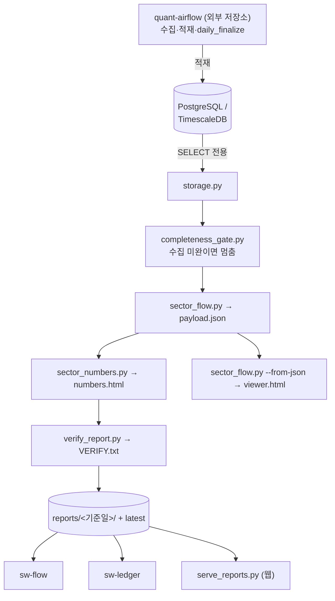
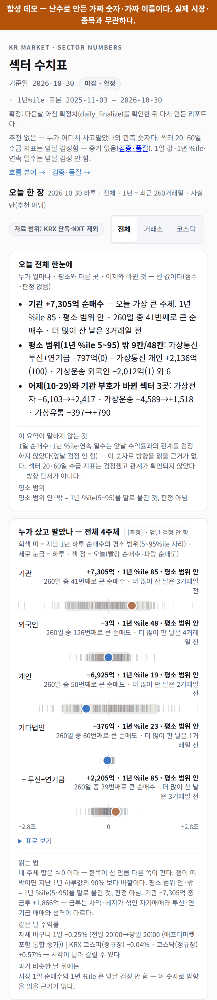

# sector-flow

**오늘 코스피·코스닥 어느 섹터에 누구의 돈이 들어왔는지를 터미널과 브라우저에서 본다.** 일일 배치가
수급 DB 에서 리포트 폴더를 만들고 저장 직후 스스로 검사한다. 화면은 그 폴더만 읽으므로 SSH 에서
바로 뜬다. 숫자는 동시기(同時期) 측정값이고, 돈이 들어온 섹터가 앞으로 오른다는 주장이 아니다([§8](#8-주의--이-숫자들은-예측이-아니다)).

[](https://github.com/younghwan91/sector-flow/actions/workflows/ci.yml)
[](https://www.python.org/)

## Quick start

```bash
uv sync
uv run sw-flow   --dir <리포트 폴더>          # 섹터 자금 흐름
uv run sw-ledger --dir <리포트 폴더>          # 자금 원장
```

**리포트 폴더가 있어야 뜬다.** 만들어 둔 폴더를 받거나(DB 불요, [§4.3](#43-리포트-폴더를-그대로-주고받는다)), 수급 DB 에
접속할 수 있으면 직접 만든다([§4.1](#41-리포트-만들기-db-필요)). 이 저장소에 샘플 데이터는 없다.

> **데이터 수집은 이 저장소에 없다.** 수급·시세 적재는
> [quant-airflow](https://github.com/younghwan91/quant-airflow) 의 몫이고, 여기서는 그 DB 를 읽기만 한다.

## 목차

- §1 [무엇을 하나](#1-무엇을-하나) · [무료 자료와 무엇이 다른가](#11-무료-자료와-무엇이-다른가)
- §2 [구조](#2-구조)
- §3 [일일 배치 — 언제 무엇이 도나](#3-일일-배치--언제-무엇이-도나) · [장애 대응](#31-장애-대응)
- §4 [설치와 실행](#4-설치와-실행) · [리포트 폴더를 그대로 주고받는다](#43-리포트-폴더를-그대로-주고받는다) · [웹으로 보기](#44-웹으로-보기)
- §5 [화면 읽는 법](#5-화면-읽는-법) · [수급 관측 읽기 가이드](docs/trading-guide.md)
- §6 [자금 원장 — `sw-ledger`](#6-자금-원장--sw-ledger)
- §7 [숫자의 정의](#7-숫자의-정의)
- §8 [주의 — 이 숫자들은 예측이 아니다](#8-주의--이-숫자들은-예측이-아니다)
- §9 [리포트를 스스로 검증한다](#9-리포트를-스스로-검증한다)
- §10 [개발](#10-개발)
- §11 [문서](#11-문서)
- §12 [관련 프로젝트](#12-관련-프로젝트--오픈소스-퀀트-스택)

---

## 1. 무엇을 하나

| 명령 | 하는 일 | DB |
|---|---|---|
| `sw-flow` | 첫 화면은 **오늘의 수급** — 기준일 하루 누가 어디서 얼마나 드물게 사고팔았나. 아무 키나 누르면 27개 섹터 × 5개 구간(1·5·20·60·120거래일) × 3개 시장 × 4개 주체의 표로 간다. 기본 정렬은 금액이 아니라 **가속**(누적 순매수 ÷ 섹터 시총)이라 삼성전자가 있는 섹터가 자동으로 1등이 되지 않는다. `Enter` 로 섹터를 열면 그 흐름을 만든 종목이 보인다 | 불요 |
| `sw-ledger` | 같은 리포트의 회계. 누가 얼마를 넘겼고 얼마가 미분류로 남았나를 원 금액과 잔여만으로 | 불요 |
| 웹 | 같은 리포트의 수치표(`numbers.html`, 맨 위 **오늘** 패널)와 흐름 뷰어(`viewer.html`)를 Tailscale 로 연다 | 불요 |
| `scripts/daily_report.sh` | DB 에서 리포트 폴더를 만들고 저장 직후 자기 검증 | 읽기 전용 |


*`sw-flow` 첫 화면(160×45). 점수·순위·추천 없이 사실만 적는다. 아무 키나 누르면 표로 간다.*


*섹터 표(20거래일·전체 시장·기관, 160×45). 한 행이 한 섹터다.*

### 1.1 무료 자료와 무엇이 다른가

**원자료는 무료로 볼 수 있고, 이 저장소가 더 좋은 데이터를 갖고 있지도 않다.** KRX 정보데이터시스템은 지수·종목 단위
투자자별 거래실적을 투신·연기금까지 나눠 날짜별로 주고, 네이버 증권은 시장 단위 투자자별 매매동향을 준다(2026-11 확인).
여기서 더하는 것은 데이터가 아니라 **가공과 확인**이다.

| 여기서 하는 것 | 무료 자료로 같은 걸 하려면 |
|---|---|
| 오늘 순매수를 그 섹터의 **1년(260거래일) 분포 안 %ile** 로 적는다 | 날짜 구간을 내려받아 직접 계산한다 |
| 기관과 별도로 **투신+연기금**을 섹터마다 합쳐 적는다(수급 신뢰 순서상 기관 안에서 먼저 본다) | 지수 표의 두 열을 더한다 — 지수 구성은 이 섹터와 다르다 |
| 섹터 숫자에서 **그 숫자를 만든 종목**으로 바로 내려간다(`Enter`, 첫 화면 `[ ]`) | 지수 표와 종목 표를 따로 조회해 맞춘다 |
| 순매수·시총·수익률을 **같은 종목 바구니**에서 잰다 — 가속(순매수 ÷ 시총)의 분자와 분모가 어긋나지 않는다 | 업종지수 구성과 수급 집계 범위가 같은지 따로 확인해야 한다 |
| 리포트마다 **스스로 검증한다** — DB 에서 다시 집계한 값과 맞추고, 확정 리포트는 자체 바구니(정규장 종가)를 KRX 지수 수익률과 대조한다([§9](#9-리포트를-스스로-검증한다)) | 해당 없음 |
| 터미널 화면이라 **SSH 로 바로** 뜨고, 리포트 폴더째 주고받는다 | 브라우저·HTS 가 있어야 한다 |

**못하는 것도 있다.**

- **금액은 근사다.** DB 가 순매매 **수량**만 줘서 수량 × 종가로 환산한다. 그날 VWAP 환산과의 차이를 첫 화면과 웹 '오늘' 패널이
  재서 5% 를 넘으면 칩으로 띄운다. KRX 의 거래대금 기준 금액과 같은 숫자가 아니다.
- **KRX 체결만이다.** 넥스트레이드(NXT) 체결은 없다 — 첫 화면 둘째 줄과 웹 '오늘' 패널 머리에 `자료 범위: KRX 단독·NXT 제외` 로 적는다.
- **장중 실시간이 아니다.** 평일 18:10 에 그날 잠정값으로 만들고, 다음날 아침 확정치로 다시 만든다(§3).
- **섹터는 KRX 공식 업종지수 분류가 아니다.** 벤더 마스터의 섹터 이름을 쓰고 은행 넷은 금융으로 덮었다
  (`sectorflow/sector_override.py`). 같은 이름의 KRX 업종지수 투자자 표와 숫자가 다를 수 있다.
- **앞날 증거가 없다.** 섹터 수급 지표와 섹터 앞날 수익률의 관계를 검정했고 증거가 없었다([§8](#8-주의--이-숫자들은-예측이-아니다)).

키움 HTS 화면과 머니레시피 sector-flow 도 비교하려 했지만, 공개 문서로 기능을 확인하지 못해 위 표에 넣지 않았다(2026-11).

## 2. 구조



```
src/sectorflow/
├── storage.py              # 읽기 전용 DB 접근 — 리포트가 쓰는 만큼만
└── tui/                    # sw-flow · sw-ledger — 렌더(*_view.py)는 순수함수, curses 는 *_app.py 만
scripts/
├── daily_report.sh         # 배치 입구 — 관문 → 생성 → 검증 → latest 교체
├── cron_run.sh · _env.sh   # 크론 감싸개(이상 종료 알림) · uv·.env 불러오기 공용 머리말
├── completeness_gate.py    # 수집 완전성 관문
├── finalize_done.py        # 08:20 확정 모드 — daily_finalize 성공 확인
├── sector_flow.py          # DB → payload.json (+ viewer.html)
├── sector_numbers.py       # payload → numbers.html (templates/)
├── verify_report.py        # 리포트 자기 검증 (§9)
├── freshness_check.{sh,py} # 20:30 신선도 점검
├── serve.sh · serve_reports.py  # 웹 (§4.4)
├── ledger_numbers.py       # sw-ledger 한계 화면의 실측 재현
├── verify_merge.py         # 병합 전 검증 — 실데이터 렌더·pty·변이 (§10)
└── docs_refs.py            # docs/formulas.md 의 `파일:줄` 인용 검사·--fix (§10)
deploy/crontab.simnode      # 크론 정본
docs/                       # formulas.md(수식 정본) · trading-guide.md · validation/(사전등록·결과)
research/validation/        # docs/validation 결과의 재현 스크립트 (CI 밖)
```

## 3. 일일 배치 — 언제 무엇이 도나

리포트 폴더는 [`scripts/daily_report.sh`](scripts/daily_report.sh) 가 만들고 크론([`deploy/crontab.simnode`](deploy/crontab.simnode))이
같은 명령을 부른다. 그 기준일 리포트가 이미 있으면 건너뛴다.

| 시각 | 하는 일 |
|---|---|
| 평일 18:10 | 수집이 끝났으면 리포트를 만들어 `latest` 로 건다 |
| 평일 19:10 | 18:10 에 못 만든 날을 다시 시도한다 |
| 화~토 08:20 | **확정 모드**(`KR_QUANT_FINAL=1`). 새벽 `daily_finalize` 가 확정치를 덮은 것을 확인하면(`scripts/finalize_done.py`) 전날 리포트를 확정치로 다시 만든다 — 제목이 `마감·확정`, 폴더에 `FINAL.txt`. 확인이 안 되면 잠정 리포트를 두고 경고(75)로 끝난다 |
| 화~토 10:20 | 확정 모드 재시도. `daily_finalize` 가 늦게 끝난 날을 손 없이 확정한다. 이미 `FINAL.txt` 가 있으면 건너뛴다 |
| 평일 20:30 | 신선도 점검(`scripts/freshness_check.py`). 오늘 수급이 왔는데 `latest` 가 오늘이 아니면 오류, 오늘 수급이 없거나 전 거래일이 확정되지 않았거나 알림 웹훅이 비었으면 경고. 리포트·수급·확정이 깨끗하면 하트비트를 보낸다 |
| 5분마다 | 웹 서버(§4.4)가 안 떠 있거나 `/healthz` 에 대답하지 않으면 다시 띄운다 |

상한: 배치 40분(`timeout`), DB 접속 10초, 문장 하나 10분(`statement_timeout`). 두 실행이 겹치면 뒤의 것이
`reports/.report.lock` 을 못 잡고 경고(75)로 물러난다.

**만들기 전에 완전성 관문을 본다**([`scripts/completeness_gate.py`](scripts/completeness_gate.py)). 시장별로 기준일의 수급 종목수와
시총 잡히는 종목수가 직전 5거래일 중앙값의 97% 이상, 조정 종가(`daily_bars_adjusted`)가 있는 종목수가 그날 수급 종목수의
97% 이상이고 시총 합이 0 보다 커야 한다.

| 폴더에 있는 것 | 뜻 | 화면 |
|---|---|---|
| `INCOMPLETE.txt` 만 | 수집 미완이라 안 만들었다. `latest` 는 전날에 머물고 다음 크론이 다시 만든다 | 전날 리포트 제목에 `⚠ MM-DD 수집 미완` |
| `VERIFY_FAILED.txt` | 만들었지만 검사에 걸렸다(§9). 다음 시도가 다시 만든다 | 제목에 `⚠ 검증 실패`, HTML 맨 위에 경고 |
| `FINAL.txt` | 08:20 확정 모드가 확정치로 다시 만들었다 | 제목에 `마감·확정` |

제목의 `마감·잠정` 은 그날 잠정값으로 만든 리포트다. 잠정 리포트의 G 는 확정치에서 자주 바뀐다(게시본과 확정치의
G 순위 ρ≥0.95·통과 변화≤1 기준을 못 넘은 날 37.5%, [`docs/validation/`](docs/validation/)).

(선택) `KR_QUANT_KRX_TRUTH=1` 로 만들면 KRX 정보데이터시스템(data.krx.co.kr)이 공표한 투자자별 **거래대금**(순매수)과 시장 1일
순매수 금액(수량×종가 근사)을 대조해 상대 오차를 `today.krx_truth` 에 적고 공표치를 `krx_truth.json` 으로 재운다
([`scripts/krx_truth.py`](scripts/krx_truth.py)) — **내부 검증용으로만** 받아 기준일당 한 번 캐시하고, 비공개 리포트 밖으로
재배포하지 않는다(이용 범위는 KRX 질의에 포함 — strategy-a-plus `docs/strategy/inquiries/krx_market_data.md`).
실패(망·로그인 장벽)는 SKIP 이다 — 리포트는 그대로 만든다.

종료코드 75 는 경고, 그 밖 비정상은 오류로 [`scripts/cron_run.sh`](scripts/cron_run.sh) 가 알린다(124 는 시간 초과).
기준일이 오늘이 아닌데 아직 미완이면 75 가 아니라 1 로 끝난다.

**운영 사건 원장(`reports/events.jsonl`)** — 폴더 바꿔 끼우기가 INCOMPLETE·검증 실패 흔적과 mtime 을 지우고
크론 로그는 5MB 에서 돌아, "언제 게시됐나·몇 번 막혔나·게시 뒤 숫자가 바뀐 날" 을 나중에 셀 수 없었다. 그래서
실행·잡·웹 프로브·신선도 판정마다 JSON 한 줄을 **덧붙이기만** 한다(자르지 않는다 — 50MB 를 넘으면 `events.jsonl.2` 로
이어 쓴다). 형식·통계는 [`scripts/ops_ledger.py`](scripts/ops_ledger.py)(`uv run python scripts/ops_ledger.py`,
`--days 90`·`--json`·`--errata`), 기한(잠정 18:30 · 확정 다음날 10:40 · 웹 5분 프로브 200)은 [`docs/slo.md`](docs/slo.md) 가
정의하고 20:30 신선도 점검이 전 거래일을 그 기한에 대 본다. 원장 기록 실패는 리포트를 멈추지 않고, 원장은 웹
허용 목록에 없어 밖에 보이지 않는다.

### 3.1 장애 대응

알림 제목은 `<작업> 실패 (rc=N)`·`<작업> 경고 (rc=75)`·`<작업> 시간 초과 (rc=124)` 이고 본문은 로그 꼬리 30줄이다.
작업은 `sector-flow-report`·`sector-flow-fresh`·`sector-flow-web` 이고 아래 표에서는 앞의 `sector-flow-` 를 뗐다. 명령은 저장소 루트
(`~/git/sector-flow`)에서 친다. 기록은 `reports/cron.log`, 웹은 `reports/serve.log`.

| 알림·증상 | 원인 | 할 일 |
|---|---|---|
| `report 경고 (rc=75)`, 본문 `수집 미완` · `[FAIL]` 줄 | 오늘 수집이 아직 안 끝났다. 폴더에 `INCOMPLETE.txt`, `latest` 는 전날. `[FAIL]` 줄이 모자란 것을 말한다(`조정 종가` 면 quant-airflow `daily_price_adjust` 가 아직 안 돌았다, `시장 목록이 비었다` 면 `stocks` 표가 비었다) | 기다린다 — 19:10·다음날 08:20 이 다시 만든다. 수집이 끝났으면 `scripts/daily_report.sh` |
| `report 실패 (rc=1)`, 본문 `오늘이 아닌데 수집 미완` | 지난 기준일이 아직 미완이다. 다음 거래일 수집이 시작되면 기준일이 넘어가 그 날은 영영 안 만들어진다 | quant-airflow 에서 수집을 메운 뒤 바로 `scripts/daily_report.sh` |
| `report 실패 (rc=1)`, 본문 `검증 실패` · `게시했지만 검증에 걸렸다` · 폴더에 `VERIFY_FAILED.txt` | 게시는 됐지만 자기 검증(§9)에 걸렸다. 화면·HTML 에 ⚠ | `grep FAIL reports/latest/VERIFY_FAILED.txt` 로 걸린 검사를 본다. 원인을 고친 뒤 `scripts/daily_report.sh`(검증 실패 폴더는 다시 만든다. 확정 리포트는 확정으로 남는다) |
| `report 실패 (rc=1)`, 본문 `DB 에서 기준일을 못 읽었다` · `fresh 실패 (rc=1)`, 본문 `DB 에서 오늘 수급을 못 셌다` · `report 시간 초과 (rc=124)` · 본문 `statement timeout` | DB 서버가 죽었거나 접속정보가 틀렸거나 락에 걸렸다 | quant-airflow 의 TimescaleDB 를 살핀다. 접속 확인: `set -a; . ~/git/quant-airflow/.env; set +a; uv run --extra pg python -c "import os; from sectorflow.storage import connect; connect(os.environ['KR_QUANT_DB']).close(); print('ok')"`. 복구 뒤 `scripts/daily_report.sh` |
| `report 실패 (rc=1)`, 본문 `기준일이 없다` | 접속은 됐는데 `supply_demand` 가 비었다 — `KR_QUANT_DB` 가 빈 사본이나 다른 DB 를 가리킨다 | `~/git/quant-airflow/.env`(이 레포에 `.env` 가 있으면 그쪽이 먼저다)의 `KR_QUANT_DB` 를 본다 |
| `report 실패 (rc=1)`, 본문 `DB 접속정보가 없다` | `.env` 도 `~/git/quant-airflow/.env` 도 `KR_QUANT_DB` 도 없다 — quant-airflow 체크아웃이 옮겨졌거나 지워졌다 | `ls ~/git/quant-airflow/.env`. 이 레포에 사본을 두지 않는다 — 정본을 되살린다 |
| `report 실패 (rc=127)`·`fresh 실패 (rc=127)`, 본문 `uv 를 찾지 못했다` | 크론 PATH 에 `uv` 가 없고 `~/.local/bin/uv` 도 없다 — uv 를 지웠거나 다른 곳에 깔았다 | `ls ~/.local/bin/uv`. 다시 깔거나 크론 줄에 `KR_QUANT_UV=<경로>` 를 준다 |
| `report 실패 (rc=N)`, 본문 `완전성 관문 오류(rc=N)` | 관문(`scripts/completeness_gate.py`)이 판정 전에 죽었다 — DB 가 끊겼거나 문장 시간 초과거나 코드 오류. 위 꼬리의 `Traceback` 마지막 줄이 원인이다 | `set -a; . ~/git/quant-airflow/.env; set +a; uv run --extra pg python scripts/completeness_gate.py --asof <기준일>` 로 재현한다. 고친 뒤 `scripts/daily_report.sh` |
| `실패 (rc=1)`, 본문에 `Traceback` | 파이썬 스크립트가 예외로 죽었다. 마지막 줄이 예외, 그 위 `File "…/scripts/…", line N` 이 자리다 | 같은 명령을 손으로 돌려 재현한다(DB 가 필요하면 위의 `.env` 불러오기부터). 고친 뒤 `scripts/daily_report.sh` |
| `<작업> 실패 (rc=N)`, 본문 `임시 파일을 못 만들었다` | 알림 꼬리나 DB 오류를 담을 임시 파일을 `reports/` 에도 `/tmp` 에도 못 만들었다 — 디스크가 찼거나(`/tmp` 는 사용자 할당량 tmpfs) 권한이 바뀌었다. 본문이 빠진 알림이라 출력은 크론 로그에 있다 | `df -h ~/git/sector-flow/reports /tmp`, `du -sh /tmp/* 2>/dev/null \| sort -h \| tail`, `ls -ld reports`. 비운 뒤 그 작업을 다시 |
| `report 경고 (rc=75)` 08:20·10:20, 본문 `확정치를 확인하지 못했다` · `[확정치] … 아직 안 돌았거나 도는 중` · `성공으로 끝나지 않았다` | `daily_finalize` 가 늦거나 실패했다. 잠정 리포트는 그대로 둔다. 08:20 이 놓친 날은 10:20 이 한 번 더 본다 | quant-airflow `daily_finalize` 를 본다. 끝났으면 `KR_QUANT_FINAL=1 scripts/daily_report.sh`(10:20 이 이미 돌았거나 기다릴 수 없을 때) |
| `report 경고 (rc=75)` 08:20·10:20, 본문 `[확정치] … 수집 실패가 문턱을 넘었거나 완료 줄이 없다` | `daily_finalize` 의 종목 실패가 1% 를 넘었거나(평소 최대 0.49%, 수집기 종료코드는 20% 까지 0 이다) 기록의 완료 줄 모양이 바뀌었다. 잠정 리포트는 그대로 둔다 | 줄 끝 경로의 기록을 본다. 수집 장애면 quant-airflow 에서 다시 받은 뒤 `KR_QUANT_FINAL=1 scripts/daily_report.sh`. 모양이 바뀌었으면 `finalize_done._DONE_LINE` 을 맞춘다 |
| `report 경고 (rc=75)` 08:20·10:20, 본문 `확정치를 확인하지 못해 잠정치로 만들었다` | 그 기준일 리포트가 아직 없었다(전날 저녁 수집 미완) — 마지막 기회라 잠정치로라도 만들어 걸었다. 확정은 위와 같은 이유로 못 했다 | 위와 같다. 확정이 끝나면 `KR_QUANT_FINAL=1 scripts/daily_report.sh` 가 확정치로 다시 만든다 |
| `freshness 경고 (rc=75)` 20:30, 본문 `[외부 참값] 전 거래일(…) 확정 검증: …` | 확정 리포트의 정규장 종가 대조(자체 바구니 vs KRX 지수)가 3번 연속 건너뛰어졌다 — `regular_close` 가 아직 안 채워졌거나(다음 거래일 수급이 들어와야 채워진다) 그 날 비교 종목에 상장폐지 종목이 끼었다 | 그 날 `VERIFY.txt` 의 `SKIP 정규장 종가 대조` 줄에서 이유를 본다. 데이터 지연이면 다음 확정 실행에서 풀린다. 며칠 이어지면 quant-airflow 의 `regular_close` 뷰를 본다 |
| `report 경고 (rc=75)`, 본문 `[확정치] … 기록이 없다` · `로그 경로 형식이 바뀌었을 수 있다` · `태스크 이름이 바뀐 것이다` | 이쪽이 Airflow 로그를 못 읽는다 — 로그 경로나 `daily_finalize` 태스크 이름이 바뀌었다 | `uv run python scripts/finalize_done.py --asof <기준일>` 로 이유를 본다. `finalize_done.py` 의 경로 규칙·`TASKS` 를 quant-airflow `dags/daily_finalize.py` 에 맞춘다 |
| `report 경고 (rc=75)`, 본문 `[확정치] … 덮지 않는다` | 기준일 뒤의 `daily_finalize` 실행 창이 그날을 덮지 않는다 — 확정 실행을 놓친 지난 날이다 | 그날 확정치는 재수집 없이는 없다. 잠정으로 두거나 quant-airflow 에서 그 날짜를 재수집한 뒤 지난 기준일 재구성 |
| (재구성, 손 실행) `KR_QUANT_ASOF=<날> scripts/daily_report.sh` 가 3 으로 끝남, `거래일이 아니다 … 휴장일이다` | 그날 수급도 업종지수·일봉도 없다 — 휴장일이다. `scripts/rebuild_history.py` 요약에는 `휴장` 으로 남는다 | 할 일 없음 |
| (재구성) rc=1, `수급 수집 공백` | 그날 수급만 비고 업종지수·일봉은 있다 — 휴장이 아니라 수급 수집이 빠졌다. 요약에 `수집 공백` | quant-airflow 에서 그 날짜 수급을 재수집한 뒤 다시 재구성 |
| (재구성) rc=1, `지금 DB 에서도 수집 미완` | 그날 수급이 지금도 완전성 관문 기준에 못 미친다. 원본 폴더는 그대로 두고 요약에 `수집 미완` | 수집을 메운 뒤 `KR_QUANT_ASOF=<날> scripts/daily_report.sh` |
| (재구성) rc=75, `확정치를 확인하지 못해 잠정으로 재구성했다` | daily_finalize 창(3일) 안의 날인데 확정 실행이 아직 그날을 덮지 않았다 — 잠정으로 만들었다(`REBUILT.txt` 의 `finalize: pending`, FINAL.txt 없음) | 확정이 끝난 뒤 같은 명령을 다시 — 확정으로 바뀐다 |
| 웹 목록·칩에 `확정 기록 없음` · `REBUILT.txt` 에 `finalize: unverified` | 창 밖의 지난 날을 재구성했다 — 마감 값으로 만들었지만 그날을 덮은 확정 실행 기록이 없다. 경고가 아니라 사실 표시다(종료코드 0) | 할 일 없음. 확정치가 꼭 필요하면 quant-airflow 에서 그 날짜를 재수집한 뒤 다시 재구성 |
| (다이제스트, `KR_QUANT_DIGEST=1` 일 때만) 본문 `다이제스트를 못 만들었다` | `scripts/digest.py` 가 실패했거나 5분 상한(`KR_QUANT_DIGEST_TIMEOUT`)을 넘겼다 — 금칙어·길이 초과·카드 렌더 실패가 흔한 이유다. 리포트 게시는 그대로 됐다 | `UV_OFFLINE=1 uv run --with 'playwright==1.48.0' python scripts/digest.py --dir reports/latest --out /tmp/digest-재현` 으로 재현한다. stderr 의 `[digest] 만들지 않았다 — <이유>` 가 원인이다 |
| (재구성, 손 실행) `KR_QUANT_ASOF 가 날짜 꼴(YYYY-MM-DD)이 아니다` | 날짜를 잘못 줬다 | `KR_QUANT_ASOF=2026-10-06` 꼴로 다시 |
| `scripts/rebuild_history.py` 가 멈춤, `git 체크아웃이 아니다` · `origin/main 에 없다` · `커밋 안 한 변경` | 재구성은 origin/main 의 깨끗한 체크아웃에서만 돈다 — `REBUILT.txt` 의 `commit:` 을 나중에 다시 볼 수 있어야 한다 | `git -C ~/git/sector-flow pull --ff-only` 뒤 거기서 돌린다. 리허설은 `--allow-unmerged`(sha 뒤에 `-dirty`·`-unmerged` 가 붙는다) |
| `report 경고 (rc=75)`, 본문 `다른 리포트 실행이 돌고 있다` | 손으로 돌린 실행과 크론이 겹쳤다 | 앞 실행이 끝난 뒤 필요하면 같은 명령을 다시 |
| `fresh 실패 (rc=1)`, 본문 `오늘 리포트가 안 걸렸다` | 수급은 들어왔는데 리포트가 없다. 크론 줄이 빠졌거나 배포가 깨졌거나 관문이 막았다 | `grep "$(date +%F)" reports/cron.log`, `crontab -l \| grep sector-flow`. 고친 뒤 `scripts/daily_report.sh` |
| `fresh 경고 (rc=75)`, 본문 `supply_demand 가 비었다` | 장중 틱(`ticks`, scalp-it)은 있는데 수급이 없다 — 수집 실패. 수급·틱이 모두 없는 평일은 휴장으로 보고 알리지 않는다. 본문이 `휴장일이면 무시` 면 틱 표를 못 읽어 못 가른 것이다 | quant-airflow `daily_collection` 을 본다. 휴장일이면 무시한다 |
| `fresh 경고 (rc=75)`, 본문 `전 거래일(…)이 확정되지 않았다` | 그날 08:20·10:20 확정 모드가 안 돌았거나 `daily_finalize` 를 확인하지 못했다. 다음 거래일 수집이 들어와 확정 모드는 그 날을 다시 안 본다 | `uv run python scripts/finalize_done.py --asof <그날>` 로 이유를 본다. 확정이 끝났으면 지난 기준일 재구성으로 그 날을 다시 만든다(`KR_QUANT_ASOF=<그날> scripts/daily_report.sh`, 여러 날은 `scripts/rebuild_history.py`) |
| `fresh 경고 (rc=75)`, 본문 `ALERT_WEBHOOK_URL 이 비었다`(평일마다) · `alert.sh 가 없다` · 크론 로그에 `알림 통로 없음` | 알림 웹훅이 없거나 `~/git/quant-airflow/scripts/alert.sh` 가 없어 위의 모든 알림이 로그에만 남는다 | 웹훅을 만들어 `~/git/quant-airflow/.env` 의 `ALERT_WEBHOOK_URL=` 에 넣는다. `ls -l ~/git/quant-airflow/scripts/alert.sh` |
| 알림이 안 온다 · `alerts.log` 에 `[alert.py] failed` · `fresh 경고`, 본문 `웹훅이 폐기됐거나 틀렸다` · `웹훅이 HTTP N 로 답했다` · `200 으로 답했지만 JSON 이 아니다` · `초 안에 닿지 못했다` | 웹훅 전달 실패 — 채널에서 웹훅이 지워졌거나 주소가 틀렸거나(Discord 웹훅 주소가 아니다) 네트워크가 끊겼다. 알림 본문은 `~/logs/quant-airflow/alerts.log` 에 다 남아 있다 | `grep -A30 'failed' ~/logs/quant-airflow/alerts.log \| tail -n 60` 으로 놓친 알림을 읽는다. 웹훅을 새로 만들어 `ALERT_WEBHOOK_URL=` 을 바꾼다. `닿지 못했다` 가 하루뿐이면 네트워크가 잠깐 끊긴 것이다 |
| `fresh 경고 (rc=75)`, 본문 `[SLO] 전 거래일(…) 잠정 리포트가 기한` | 잠정 리포트가 18:30(KST)을 넘겨 게시됐다 — 18:10 실행이 늦었거나 수집이 늦게 끝나 19:10 재시도가 만들었다. 기한은 `docs/slo.md` | 한 번이면 할 일 없음(이미 게시는 됐다). 이어지면 `grep '생성 시작' reports/cron.log \| tail` 로 시작 시각을, quant-airflow `daily_collection` 의 끝나는 시각을 본다 |
| `fresh 경고 (rc=75)`, 본문 `[SLO] 전 거래일(…) 확정이 기한` | 확정 재생성이 다음날 10:40(KST)을 넘겼다 — 08:20·10:20 둘 다 제때 못 끝냈다(그 뒤 손 실행·재구성으로 확정됐다) | 그날 `reports/cron.log` 의 08:20·10:20 줄과 quant-airflow `daily_finalize` 의 끝나는 시각을 본다. 이어지면 daily_finalize 가 늦어지는 원인을 그쪽에서 고친다 |
| 크론 로그·알림 꼬리에 `[원장] 운영 사건을 기록하지 못했다` · `⚠️ [원장] … 기록하지 못했다` | 운영 사건 원장(`reports/events.jsonl`)에 못 썼다 — 디스크가 찼거나 권한이 바뀌었다. 리포트·점검은 그대로 계속됐다(원장은 리포트를 못 멈춘다) | `df -h ~/git/sector-flow/reports`, `ls -l reports/events.jsonl*`. 그 사이 사건은 비었고 복원하지 않는다 — 통계(`scripts/ops_ledger.py`)에 공백으로 남는다 |
| (외부 감시) 하트비트가 안 왔다는 알림 | 20:30 점검에서 리포트·수급·확정 중 하나가 깨끗하지 않았거나, 정해 둔 알림 웹훅이 죽었거나(그날 경고는 아무에게도 안 갔다), 점검이 아예 안 돌았다 — 머신·크론이 통째로 죽은 날도 여기서 잡힌다 | `tail -n 40 reports/cron.log` 의 `[하트비트]` 줄이 안 보낸 이유다. 켜는 법: 외부 감시(healthchecks.io 등, 평일 20:30 + 유예)를 만들어 `~/git/quant-airflow/.env` 에 `HEARTBEAT_URL=<주소>` 한 줄 — 주소만 넣으면 동작한다. 웹훅 없이 하트비트만 써도 된다 |
| `sector-flow-web 재시작 — /healthz 실패(pid N, 연속 n회)` | 떠 있는 서버가 5초 안에 대답하지 않거나 `/healthz` 가 503(리포트 폴더를 못 읽거나 목록이 안 그려진다)이라 `serve.sh` 가 끄고 다시 띄웠다. 본문이 이유다. 같은 일이 이어지면 5분마다 다시 띄우되 알림은 연속 첫 회와 12회(1시간)마다 | 본문의 이유를 본다. `curl -sS http://$(tailscale ip -4):8765/healthz`, `ls -ld reports`, `tail reports/serve.log` |
| `web 실패 (rc=137)` | `serve.sh` 가 TERM 을 5초 버틴 서버를 KILL 했다 — 그 서버를 띄웠던 래퍼의 알림이다. 위 재시작 알림과 같은 박자(연속 첫 회·12회마다)로만 온다 | 위 재시작 알림의 이유를 본다. 매번 KILL 까지 가면 서버가 TERM 에 끝나지 않는 것이다 — `tail reports/serve.log` |
| `web 실패 (rc=1)`, 본문 `누구인지(.serve.pid) 몰라 못 끈다` | 잠금(`reports/.serve.lock`)을 쥔 프로세스가 `/healthz` 에 대답하지 않는데, `.serve.pid` 가 없거나 그 pid 가 이 서버가 아니라 안전하게 못 끈다. 한 시간 이어질 때 알린다 | `cat reports/.serve.pid`, `fuser -v reports/.serve.lock` 로 잠금 주인을 찾아 끈다. 다음 5분 크론이 다시 띄운다 |
| `web 실패 (rc=1)`, 본문 `Tailscale 주소가 없다` · `에 못 묶었다` · 웹이 안 열린다 | Tailscale 이 없거나 포트가 막힌 채 한 시간이 지났다(`reports/.serve.misses` 가 센다). 서버가 죽었다(rc 가 서버 종료코드) | `tail reports/serve.log`, `tailscale ip -4`, `ss -ltnp \| grep 8765`. 손으로 띄우려면 `scripts/serve.sh`. 대답 없는 서버는 크론이 5분 안에 끄고 다시 띄운다 |
| `report` 로그·본문에 `[KRX 공식 대조] SKIP` | (선택 기능) KRX 공식 거래대금을 못 받았다 — 망·로그인 장벽(`LOGOUT`)·형식 변화·캐시 기준일 불일치. 리포트는 그대로 만들어졌다(실패 아님) | 꼬리의 이유를 본다. `LOGOUT` 이면 KRX 가 익명 조회를 막은 것 — 풀릴 때까지 SKIP 으로 둔다. 받아지면 `KR_QUANT_KRX_TRUTH=1 KR_QUANT_FORCE=1 scripts/daily_report.sh` 로 그 기준일을 다시 만든다 |
| `report` 로그·본문에 `[KRX 공식 대조] 근사 오차 큼` | 수량×종가 근사가 공식 거래대금과 문턱(5%)을 넘게 다르다 — 값의 버그가 아니라 근사의 한계 측정이다(VERIFY 의 재계산이 통과했으면 수치는 맞다) | 그날 금액 해석에 반영한다. 며칠 이어지면 `reports/<기준일>/krx_truth.json` 과 `payload.json` 의 `today.krx_truth` 로 어느 주체·시장인지 본다 |
| `report` 로그에 `[KRX 공식 대조] 내부 오류` | krx_truth 모듈 버그 — 대조만 빠지고 리포트는 그대로 만들어졌다 | `uv run python scripts/krx_truth.py --payload reports/latest/payload.json --fetch` 로 재현해 Traceback 을 본다 |
| `report` 로그에 `krx_truth.json 을 못 재웠다` | 공식값은 받아 대조했는데 캐시 파일을 못 썼다 — 디스크·권한 | `df -h ~/git/sector-flow/reports`, `ls -ld reports/<기준일>*`. 다음 빌드가 다시 받는다 |
| 고친 코드가 다음날에도 안 돈다 · `morning-sync` 알림에 `hold sector-flow` | 07:50 `pull-all --ci-gate` 가 CI 가 초록이 아닌 커밋을 받지 않았다 | GitHub Actions 를 초록으로 고친다. 확인했고 당장 필요하면 `git -C ~/git/sector-flow pull --ff-only` |

크론 로그(`reports/cron.log`·`serve.log`)는 5MB 를 넘으면 `scripts/cron_run.sh` 가 `.1` 로 하나만 남기고 비운다.

## 4. 설치와 실행

**요구사항:** Python 3.11 이상, [uv](https://docs.astral.sh/uv/), 리눅스·macOS 터미널(`curses`). 설치는 `uv sync` 한 줄이다.
리포트를 직접 만들려면 PostgreSQL/TimescaleDB 접속정보가 필요하다. `cp .env.example .env` 뒤 `KR_QUANT_DB` 를 채운다
(옆자리에 quant-airflow 체크아웃이 있으면 그 `.env` 를 불러 쓰므로 필요 없다).

### 4.1 리포트 만들기 (DB 필요)

```bash
scripts/daily_report.sh                      # <저장소>/reports/<기준일> + latest 링크 (KR_QUANT_REPORTS 로 변경)
KR_QUANT_FORCE=1 scripts/daily_report.sh     # 같은 기준일이어도 다시 만든다 (약 5~6분)
```

폴더 이름은 실행일이 아니라 데이터 기준일(`supply_demand` 의 `MAX(date)`)이다. 옆에 새로 지어 마지막에 바꿔 끼우므로
도중에 실패해도 옛 리포트는 남는다. 리포트 형식이 바뀐 뒤 옛 리포트를 열면 새 열이 `—` 이고 제목에 `옛 리포트(새 열 없음)` 가
붙는다 — `KR_QUANT_FORCE=1` 로 다시 만든다.

배치를 손으로 풀면 이렇다.

```bash
set -a; . ~/git/quant-airflow/.env; set +a   # 이 레포에 .env 가 있으면 그것 — 배치가 쓰는 순서다
uv run --extra pg python scripts/sector_flow.py --days 260 --json payload.json
uv run python scripts/sector_flow.py    --from-json payload.json --html viewer.html
uv run python scripts/sector_numbers.py --payload payload.json --html numbers.html
uv run --extra pg python scripts/verify_report.py --dir <리포트폴더> --db-check
```

### 4.2 화면 띄우기 (DB 불요)

```bash
uv run sw-flow                          # <저장소>/reports/latest 를 연다
uv run sw-flow --dir <리포트 폴더>       # 특정 날짜의 리포트
uv run sw-ledger                        # 자금 원장 (§6)
uv run sw-ledger --dump --width 100     # 색 없는 평문 — 파이프·리다이렉트용
```

40×10 창에서도 뜬다. 폭이 모자라면 열이 경계에서 통째로 빠진다(숫자가 자릿수 중간에서 잘려 다른 값처럼 보이지 않게).
원장 표만은 71칸 미만이면 아예 안 그리고 그 사실을 적는다 — 4주체와 잔여가 한 덩어리라 일부만 보이면 회계 항등식이
깨진 것처럼 읽힌다. `NO_COLOR` 를 존중한다.

### 4.3 리포트 폴더를 그대로 주고받는다

**받는 쪽에는 DB 도 수집 파이프라인도 필요 없다.** 만드는 쪽이 폴더를 압축해 보낸다.

```bash
tar czf sector-flow-2026-11-06.tar.gz -C <저장소>/reports 2026-11-06            # 보내는 쪽
mkdir -p ~/reports && tar xzf sector-flow-2026-11-06.tar.gz -C ~/reports         # 받는 쪽
uv run sw-flow --dir ~/reports/2026-11-06
```

| 파일 | 없으면 |
|---|---|
| `numbers.html` | `sw-flow` 가 안 뜬다. 브라우저로 열면 수치표 자체다 |
| `payload.json` | `sw-ledger` 가 안 뜬다 |
| `viewer.html` | 브라우저용 차트 뷰어. 터미널 화면은 이것 없이도 뜬다 |
| `VERIFY.txt` | 검증 결과(§9). 없어도 화면은 뜨지만 받은 숫자가 검사를 통과했는지 알 길이 없다 |

⚠️ `VERIFY_FAILED.txt` 가 같이 들어 있으면 **그 리포트는 검사에 걸린 것이다.** 지우고 보내지 마라.
받은 폴더는 그날의 사진이다. 기준일이 4일 이상 지나면 화면과 HTML 이 `⚠ N일 지난 리포트` 로 말한다.

### 4.4 웹으로 보기

만드는 쪽 서버가 리포트를 웹으로도 연다. 폰·PC 브라우저에서 Tailscale 로 들어간다.

```
http://<서버의 Tailscale 주소>:8765/                    # 기준일 목록 — 최신·확정·검증 실패·수집 미완 표시
http://<서버의 Tailscale 주소>:8765/latest/numbers.html  # 즐겨찾기용 — 늘 최신 수치표
http://<서버의 Tailscale 주소>:8765/latest/viewer.html   #            — 늘 최신 흐름 뷰어
```

[`scripts/serve_reports.py`](scripts/serve_reports.py) 는 표준 라이브러리만 쓰는 읽기 전용 서버다. 두 HTML 과 검증 기록만
내보낸다(`payload.json`·`cron.log` 는 안 나간다). 주소는 Tailscale 에만 묶는다. 손으로 띄우려면 `scripts/serve.sh`,
이 컴퓨터에서만 보려면 `python3 scripts/serve_reports.py`(127.0.0.1).

수치표 맨 위 **오늘** 패널은 `sw-flow` 첫 화면과 같은 사실을 같은 순서로 적는다.

| 데스크톱 | 모바일 |
|---|---|
|  |  |

## 5. 화면 읽는 법

> 누가 어디서 사고팔았나를 어떤 순서로 읽는지는 [수급 관측 읽기 가이드](docs/trading-guide.md) 를 보라.
> 고르는 법은 말하지 않는다 — 검정 결과 그럴 근거가 화면에 없다([§8](#8-주의--이-숫자들은-예측이-아니다)).
> 모든 열의 정의와 한계는 화면 안 도움말(`?`)이 원본이고, 아래는 그 축약이다.

### 5.1 키

| 키 | 하는 일 |
|---|---|
| `↑` `↓` `j` `k` | 한 줄 이동. `g`·Home 처음 · `G`·End 끝 · PgUp/PgDn 한 화면 |
| `Enter` `l` `→` | 그 섹터의 전 종목 보기(드릴다운) |
| `h` `←` `Esc` | 드릴다운에서 나가기 |
| `w` `W` | 구간 1 · 5 · 20 · 60 · 120(탐색 모드에서는 종합까지). 대문자는 역방향 |
| `1` | 1일 창으로 바로 간다(드릴다운이면 그날의 종목) |
| `o` | 첫 화면(오늘의 수급)을 다시 연다. 화면보다 길면 `↑` `↓` `PgUp` `PgDn` 으로 훑는다 |
| `m` `M` | 시장 전체 · 거래소 · 코스닥 |
| `a` `A` | 주체 기관 · 외국인 · 개인 · 기타법인 |
| `s` `S` | 정렬 열 바꾸기. 드릴다운에서는 종목 정렬 |
| `r` | 정렬 역순. 순매도 상위(가장 많이 판 쪽)를 보려면 이걸 켠다 |
| `e` | 탐색 모드 켜기/끄기 — 미실현·풀림가속·dW/dt·G·종목 선정·종합·전 종목(곱)을 보인다. 기본은 꺼짐이고, 켜 있는 동안 제목 줄 맨 앞에 `[탐색 — 검정 결과 앞날 증거 없음(G 판정 불가)]` 가 붙는다 |
| `t` | 탐색 모드에서만 — 전 종목 화면(곱 = 섹터G × 종목선정 순). `t`·`h`·`←`·`Esc` 로 돌아온다 |
| `?` `F1` | 도움말 — 모든 열의 뜻·계산식·증거 표지 |
| `q` | 종료. 도움말 안에서는 닫기만 한다 |

구간·시장·주체를 바꿔도 커서는 보던 섹터에 머문다. 한영 상태에서도 두벌식 같은 자리로 듣는다. Shift 로 다른 글자가 나오는
자리가 q·w·e·r·t 뿐이라 한글에서 대문자 역방향은 W(구간)뿐이다 — 나머지 대문자(M·A·S, 원장의 V)는 소문자 동작으로 떨어진다.
예: `ㅈ`→`w`, `ㅉ`→`W`, `ㅡ`→`m`, `ㅁ`→`a`, `ㄴ`→`s`, `ㄱ`→`r`(역순은 토글이라 소문자 하나로 된다). `sw-ledger` 도 같다.

**첫 화면 — 오늘의 수급.** 기준일 하루의 사실을 이 순서로 적는다. 아무 키나 누르면 표로 넘어가고, `q` 는 바로 끝내며 `?` 는 도움말을 연다.

- 자료 범위 한 줄 — `KRX 단독·NXT 제외`(근거는 도움말 끝). 웹 '오늘' 패널 머리에도 같은 칩이 있다.
- 시장 수익률 1·20일 — 자체 바구니와 KRX 종합지수(정규장)를 나란히([§8](#8-주의--이-숫자들은-예측이-아니다)). 잠정 리포트의 마지막 날은 전일 20:00 → 당일 **수집 시각**(애프터마켓 진행 중)이라 라벨이 다르다.
- 시장 4주체 순매수와 그 1년%ile. 금액 근사 오차가 5% 를 넘는 시장·섹터 칸이면 칩. `(미분류)` 종목이 남아 있으면 그 수.
- 잠정 리포트면 최근 확정일들의 잠정→확정 수정 폭(1일 섹터 칸 중앙 %, 부호 뒤집힘 수)과 %ile 극단 목록의 `(잠정)` 표지.
- 기관·투신+연기금(그리고 그날 시장 \|순매수\| 가 가장 큰 주체가 그 밖이면 그 주체 — `최대 순매매 주체`) 순매수 상·하위 3개 섹터(금액 순, 각자의 1년%ile 과 그 섹터의 그날 수익률 — 웹과 같은 반올림)와 섹터마다 그 주체의 그날 상위 종목 1~2개, 1년%ile 이 ≥95·≤5 인 섹터.
- 직전 거래일 리포트 대비 20일 누적 순매수 상위 5 섹터의 들고 남(직전이 잠정·검증 실패였으면 제목에 적는다).
- 최근 5일 부호가 직전 15일과 반대인 섹터(판정 불가 라벨, 5일 \|금액\| 이 목록의 2% 이상만).
- 확정 리포트면 `잠정→확정 변경: N칸` 과 크게 바뀐 1일 칸 셋·%ile 극단 목록의 들고 남 — 전체 목록은 도움말 맨 끝과 웹 패널.

`today` 가 없는 옛 리포트면 그렇다고 말하고 20일 상·하위만 적는다. `o` 로 다시 열고, 마지막 면책 줄은 어느 높이에서도 남는다.

### 5.2 섹터 표의 열

왼쪽부터 화면 순서다. 폭이 모자라면 오른쪽 열부터 통째로 빠진다(섹터·마커·가속·임펄스는 40칸에서도 남는다).
**탐색 모드에서만** 표시한 열은 `e` 를 눌러야 나온다. 1일 구간에는 그날의 사실(순매수·1년%ile·수익률·거래대금)만 있고
가속·추이와 탐색 열은 `—` 다.

| 열 | 뜻 |
|---|---|
| 섹터 | 벤더 분류(`stocks.sector`) 27개. KRX 업종 분류와 다르다. 마스터가 섹터를 비운 은행 넷만 KRX 업종(금융)으로 보정한다(`src/sectorflow/sector_override.py`) |
| (마커) | `~` 는 그 구간에 거래된 종목 10개 미만 — 회색, 정렬과 무관하게 맨 아래(분모가 작아 가속이 쉽게 튄다). 탐색 모드에서는 `*` 가 G 관문 통과 |
| 가속[%p] | 임펄스 ÷ 구간말 섹터 시총 × 100. 기본 정렬 열 |
| 임펄스[억] | 구간 누적 순매수 = Σ(순매매 수량 × 그날 종가) |
| 1년[%ile] | 그 주체의 롤링 N일 순매수 합이 최근 1년 분포에서 몇 등인가. 100 = 1년 최대 매수. 이 표에서 유일한 시계열 맥락이다 |
| 추이[8] | 구간 동안 순매수가 누적된 경로. 높이는 그 행 안에서만 정규화돼 행끼리 비교되지 않는다 |
| 수익률[%] | 그 섹터 자체 바구니의 구간 수익률, 전일 시총 가중. KRX 업종지수가 아니다. 하루는 전일 20:00 → 당일 20:00(§8) — 잠정 리포트의 마지막 날은 당일 수집 시각까지 |
| 투신+연기금5일[억] | 그 섹터 종목들의 **최근 5일** 투신+연기금 순매수 합. 임펄스는 구간 누적이라 "지금도 들어오나" 를 말하지 않는다 |
| 투신+연기금[억] | 같은 합의 **이 창** 값(1일 창이면 그날) |
| 종목[수] | 그 (시장, 섹터)에서 이 구간에 거래된 종목 수. `Enter` 로 여는 목록의 길이와 같다(상장 종목 수와는 다르다) |
| 미실현[%p] | **탐색 모드에서만.** (k×가속 + b) − 실제 수익률, 적합선과의 차. 앞날 증거 없음 — 사실상 섹터 20일 반전(ρ 0.82~0.93)이고 적합 섹터의 합이 0 인 상대 지표다 |
| 풀림가속[%p/일²] | **탐색 모드에서만.** x 의 2차 변화(ẍ, 부호 반전). 구간을 셋으로 갈라 중앙차분한다. 짧은 구간에서 흔들린다 |
| dW/dt[%p/일] | **탐색 모드에서만.** 구간을 반으로 갈라 본 W = 가속 × 수익률 의 전·후반 차를 거래일로 나눈 값 |
| G | **탐색 모드에서만.** 관문(얇지 않고·가속>0·미실현>0·풀림가속>0)을 다 통과한 섹터들 사이의 순위 평균. 어기면 `—`, 통과가 하나뿐이면 0.5. 판정 불가(검정력 없음) |
| 순매수/순매도상위[억] | **선택한 주체**가 그 섹터에서 가장 많이 산/판 종목과 금액. 표는 1개씩, 하단 패널은 3개씩 |

포텐셜(½kx²)은 \|미실현\| 의 단조 변환이라 지웠다.

표 아래 패널은 선택한 섹터의 4주체 순매수(`개인 -116 · 외국인 -80 · 기관 +214 · 기타법인 -21 [억]`)와 순매수·순매도 상위
3개씩을 적는다. 4주체 합이 0 에 닫히므로 고른 주체가 판 돈을 누가 받았는지가 이 줄에 있다. 그 아래 힌트바는 지금 정렬한 열의
정의를 한 줄로 적는다.

### 5.3 종목 목록의 열 (`Enter`)


*`Enter` 드릴다운(160×45). 누적[%] 옆 `-` 마커 위쪽이 그 섹터 순매수의 80%를 채운 종목이다.*

| 열 | 뜻 |
|---|---|
| 종목 · 코드 | 종목명과 6자리 코드 |
| 선정 | **탐색 모드에서만**(코드 오른쪽). 섹터 안 순위 평균. 관문(누적 80% 안·순매수>0·투신≥0·연기금≥0·거래대금≥100억·최근집중·상대수익·참여율이 다 있을 것)을 어기면 `—`, 후보가 하나뿐이면 점수가 없다(5일 창에는 하나도 없다). rank(투신+연기금) 축은 검정 부호와 **반대**다(§8) |
| 순매수[억] | 그 구간 선택된 주체의 순매수. 기본 정렬은 절댓값 순이라 많이 산 종목과 많이 판 종목이 같이 위로 온다 |
| 누적[%] | \|순매수\| 큰 순으로 훑을 때의 누적 기여율. 옆 1칸의 `-` 마커가 80% 지점이다. 순매수 정렬에서만 채운다 |
| 투신[억] · 연기금[억] | 그 구간 투신·연기금의 순매수. 선택 주체와 무관하게 늘 기관 세부다 — 기관 총액이 같아도 이 둘이 채운 것과 금투(헤지·차익이 섞인다)가 채운 것은 다른 이야기다([가이드](docs/trading-guide.md)) |
| 상대수익[%p] | 종목 구간수익률 − 섹터 구간수익률(섹터 표의 `수익률[%]` 과 같은 기준선) |
| 최근집중[%] | 5일 순매수 ÷ 이 창의 순매수 × 100. 20일 화면에서 ≈25 면 고르게, ≈100 이면 최근 5일에 몰림, >100 이면 앞에서 팔다 방향을 튼 것. 분모 1억 미만·1일과 5일 창·목록 Σ\|순매수\| 의 0.5% 미만인 줄에서는 비운다. ±999 를 넘으면 `>999`·`<-999` |
| 참여율[%] · 거래대금[억] | 순매수 ÷ 그 종목 거래대금 × 100 과 그 분모. 둘은 **같이 남거나 같이 빠진다** — 참여율만 남으면 거래대금 3억짜리 스팩과 4조짜리 대형주가 같은 숫자로 보인다 |
| 시총대비[%p] · 시총[억] | 순매수 ÷ 그 종목 시총 × 100 과 그 분모 |

`종합` 화면(탐색 모드)에서 `Enter` 로 들어간 목록은 20일 기준이고 제목에 `20일 기준(종합)` 이라 적는다.

### 5.4 `종합` 구간 (탐색 모드)

탐색 모드에서 `w` 로 끝까지 돌리면 나오는 `종합` 은 20·60·120일 가운데 G 가 나온 창을 섞어, **관문을 통과한 창의 G 만**
평균낸 화면이다. 그래서 1/3 통과가 3/3 통과보다 위에 올 수 있어 `통과[구간]` 열(n/m)을 같이 본다. 5일 창은 풀림(ẍ)이
9거래일 미만에서 계산되지 않아 빠진다. 정렬이 없다 — `종합 G` 내림차순 고정이고 헤더가 `정렬없음[G 순]` 이라 적는다.

![종합 구간 화면. 제목 앞에 탐색 모드 표지가 붙고, 섹터마다 종합 G 와 창별 G(이날은 20·60일), 통과[구간], 종목 수만 있는 좁은 표.](docs/images/kqflow-combined.png)

## 6. 자금 원장 — `sw-ledger`

`sw-flow` 가 섹터의 동역학(임펄스·가속·1년%ile)을 보여준다면, `sw-ledger` 는 회계를 보여준다. 관측되는 것은
(날짜, 시장, 섹터, 주체)의 순매수 금액뿐이고, 4주체 합이 0 이라는 항등식이 주체 수준의 상대방을 준다. 그래서 그리는 것은
주체 ↔ 섹터 이분 그래프이고 간선 하나하나가 실측이다. 세 가지를 그리지 않는다.

| 안 그리는 것 | 이유 |
|---|---|
| 섹터 → 섹터 이동 | 돈에 꼬리표가 없다. 같은 날 A 에서 −1,000억 · B 에서 +1,000억 이어도 같은 돈이라는 증거가 없다 |
| 주체 → 주체 이전 | 주변합이 독립 3식인데 쌍별 이전량은 6개다. 해공간이 3차원 남는 미식별이다 |
| 잔차를 4주체에 안분 | 측정되지 않은 주체가 측정된 주체의 옷을 입는다. `잔여 = −Σ4주체` 를 별도 열로 남긴다 |

첫 번째는 실측도 전제를 부정한다. 개인·기관·외국인의 섹터쌍 순매수 상관에서 음수 쌍의 비율은 순환이동 널(≈50%)보다
낮다 — 섹터가 서로 반대가 아니라 같이 움직인다(공통요인). 로테이션을 전제한 산키 다이어그램은 없는 현상을 그리는 셈이다.
`동시성` 화면은 이 비율을 연 리포트에서 다시 재고(β제거를 `d` 로 켜면 널과 구분되지 않는 조합이 생긴다), 재현 스크립트는
[`scripts/ledger_numbers.py`](scripts/ledger_numbers.py) 다.

키: `v` `V` 원장 · 전개 · 동시성 · 한계 화면 돌기, `d` β제거(동시성), `w` `W` 구간 5·20·60·120·260 거래일(1일 창은 없다 —
하루치는 `sw-flow` 첫 화면과 1일 창), `s` `S` 정렬 절대크기·선택주체·섹터명·최대일몫·종목수(역순 `r` 은 없다 — 섹터명만 오름차순),
`m` `a` 와 이동 키는 `sw-flow` 와 같다.


*`sw-ledger` 원장 화면(20거래일·전체 시장·개인, 160×45). `잔여몫`·`최대일몫` 은 분모(구간 gross)가 1억 미만이면 값을 안 낸다 — 4주체가 상쇄돼
분모가 0 근처면 비율이 폭발한다.*

## 7. 숫자의 정의

시장 관측량을 물리량에 대응시켜 정의한다. 차원을 맞추면 금액의 크기와 밀린 폭이 갈라지고, 임펄스 대신 가속을 쓰게
강제된다. 물리 용어는 비유일 뿐 성립하는 운동방정식이 아니다. 정확한 수식·코드 위치·지표별 근거 수준은
[`docs/formulas.md`](docs/formulas.md) 가 정본이다.

| 기호 | 정의 | 단위 |
|---|---|---|
| m (질량) | 구간말 섹터 시가총액 = 원 종가 × 그날 상장주식수(분할·병합·감자 뒤 다시 센다) | 억원 |
| F (외력) | 그날 주체별 순매매 수량 × 종가 | 억원 |
| J (임펄스) | ∫F dt, 구간 누적 순매수 | 억원 |
| a (가속) | J / m × 100 | %p |
| Δv (수익률) | 섹터 자체 바구니의 구간 수익률, 전일 시총 가중. 종목 수익률은 조정 종가 비(`daily_bars_adjusted`) | % |
| 오늘 %ile | 그날 순매수가 오늘 포함 최근 260거래일 일별 값 중 몇 등. 0 인 날이 75% 를 넘는 줄은 결측 | 0~100 |
| 금액 근사 오차 | 시장별 \|Σ n·종가 − Σ n·VWAP\| ÷ Σ n·VWAP, n = 종목의 4주체 \|순매수 수량\| 합 | % |
| k (강성) | 그 블록 횡단면에서 a → Δv 로 적합한 절편 포함 OLS 기울기. 10종목 미만 섹터는 적합에서 뺀다 | %/%p |
| x (미실현) | (k·a + b) − Δv | %p |
| dW/dt (일률) | 구간을 반으로 갈라 W = a·Δv 의 변화 | %p/일 |
| ẋ, ẍ (풀림) | 구간을 같은 길이의 세 조각으로 갈라 x 를 중앙차분(부호 반전) | %p/일, %p/일² |
| G (탐색 모드) | a·x·ẍ 가 모두 양수인(10종목 이상) 섹터끼리 매긴 세 순위의 평균. 하나뿐이면 0.5. `종합 G` = 통과한 창만의 평균, 종합 `*` = 판정된 모든 창 통과 | 0~1 |

## 8. 주의 — 이 숫자들은 예측이 아니다

**한계를 지표와 같이 싣는다.** 도움말(`?`)에는 열마다 아래 표지가 `증거` 줄로 붙고, 웹 두 장은 열 이름 아래와 범례에 같은
표지를 단다. 근거는 2026-11-08 사전등록 검정([`docs/validation/`](docs/validation/))이다.

| 표지 | 뜻 | 붙는 열 |
|---|---|---|
| `[측정]` | 지금·지난 구간을 잰 값. 앞날을 주장하지 않는다(앞날 검정 안 함) | 1년%ile · 추이 · 수익률 · 풀림가속 · dW/dt · 순매수/순매도상위 · 종목수 · 투신+연기금(5일·창, 금액 — `÷시총 기준으로만 검정(S1)`) · 누적 · 최근집중 · 상대수익 · 참여율 · 거래대금 · 시총 · 개인 · 기타법인 · 종목 순매수 금액(`÷시총 기준으로만 검정(K1/K2/K3)`) · 종목 투신·연기금(개별 금액 — `투신+연기금 합 ÷시총만 검정(K1)`) |
| `[앞날 증거 없음]` | 섹터 앞날 5·20일 수익률과의 순위 관계를 검정함 — 증거 없음 | 가속(기관 20·60일 · 외국인 20일) · 임펄스(기관 20일) — **전체 시장에서만**. 같은 열이라도 다른 창은 `[측정] · 앞날 검정은 N일만`, 거래소·코스닥은 `[측정] · 전체 시장만 검정` · 종목 시총대비(기관 20일 — K2 미확인 · 외국인 20일 — K3 탈락, 다른 창은 `[측정] · 앞날 검정은 20일만`) |
| `[판정 불가: G]` | 관문 통과 섹터가 날마다 2~7개라 검정력이 없다 | G · 종합 G · 통과[구간] · 곱 · 섹터G |
| `[≈섹터 20일 반전: x]` | x 는 섹터 20일 수익률 반전(−Δv)과 ρ 0.82~0.93. 앞날 증거도 없다(전체·20일만 검정) | 미실현 |
| `[음의 순위 정보·쓸 수 없음]` | 종목 투신+연기금 **합** 20일 ÷ 시총의 섹터 안 순위 IC 가 음으로 확인됐다(K1). 그러나 "순매수 상위 회피" 는 확인 구간에서 역효과였다 | 종목 선정(탐색 모드 — 그 합이 한 축) |

- **화면의 값은 관측이다.** 그래서 미실현 계열·G·종목 선정·곱·종합은 `e` 로 켜는 탐색 모드에만 있고 첫 화면은 사실 요약이다.
- **검정은 기술 통계다**(비용·집행 없음). 알파 심사는 swing-it 의 일이다. 그 전 판정인
  [기관 수급 가속 VERDICT](https://github.com/younghwan91/swing-it/blob/main/research/logs/inst_flow_accel/VERDICT.md)
  는 "20일 가속 변화 상위 10% 월 리밸 롱온리" 한 형태의 NO-GO 다.
- **k 는 추정치다.** 창마다·날마다 바뀐다. 그날 블록의 k 와 t 는 탐색 모드(`e`) 헤더 줄과 수치표 탐색 영역에 `[측정]` 으로 적힌다(동시기 적합, \|t\|<2 인 날이 42~70% — Q3c). 코스닥 단독은 적합이 약하다.
- **U 는 x 의 제곱이라 부호가 없다.** 이걸로 정렬하면 많이 눌린 것과 이미 많이 간 것이 같이 올라온다.
- **금액은 종가 환산 근사다.** DB 는 수량만 준다(참값은 VWAP 가중). 코스닥은 섹터 단위로 불안정하다(48일 중 71% 만 상대차
  중앙 5% 이내). 그래서 첫 화면·웹 오늘 패널이 시장별 근사 오차를 재고 5% 를 넘으면 칩을 띄운다.
- **수익률은 정규장 수익률이 아니다.** 2026-09-14 부터 일별 종가가 KRX 애프터마켓(16:00~20:00)까지 포함한 통합값이라
  리포트의 하루 수익률은 **전일 20:00 → 당일 20:00** 이다. KRX 지수는 정규장(15:30) 값이라 같은 날 갈린다(11-06 거래소 바구니
  −4.37% vs 코스피 −6.02%). 그래서 첫 화면·웹 오늘 패널은 `KRX 지수(정규장)` 를 나란히 적는다. 09-14 전의 날은 정규장 종가다.
- **값 0 은 관망이 아니라 0 또는 미보고다.** 수집기가 파싱 실패를 0으로 준다.
- **그 구간에 거래된 종목이 10개 미만인 섹터는 섹터로 읽지 않는다**(`~` 마커·회색·맨 아래·G 순위 제외). 벤더 분류가 좁아
  사실상 단일종목인 라벨이 있다(부동산 3, 출판/매체복제 2).
- **`잔여몫`·`최대일몫`·`최근집중` 은 뜻을 잃는 자리에서 값을 안 낸다**(분모 1억 미만·작은 몫). 빈 칸은 고장이 아니다.

## 9. 리포트를 스스로 검증한다

**조용히 틀린 리포트가 쌓이는 것이 검증 없이 도는 것보다 나쁘다.** 그래서 배치는 저장 직후 같은 폴더를 검사하고
([`scripts/verify_report.py`](scripts/verify_report.py)), 실패하면 폴더에 `VERIFY_FAILED.txt` 를 남긴다. 그 앞에 수집 미완을 거르는 관문이 있다(§3).

| 계층 | 묻는 것 |
|---|---|
| **A. 수식** | 표의 값이 정의된 항등식을 만족하는가(x = 예상Δv − Δv, U = ½kx², G 범위·관문). 전정밀도로 다시 적합해 비교한다 — 소수 3자리 k 로 검산하면 멀쩡한 식이 실패로 뜬다 |
| **A3. 파생** | 구간 수익률·ẋ·ẍ·1년%ile·dW/dt 를 `sector_numbers` 를 부르지 않고 페이로드 일별 배열에서 다시 세면 같은가 |
| **B. 데이터** | 기준일 = DB 최신일, 배열 길이, 4주체 합 ≈ 0, (code, date) 중복, 단위 |
| **C. 계산** | 열 정의 수 = 셀 수, 섹터 중복, Inf/NaN, 템플릿 자리표시자 잔존 |
| **D. 부류** | 계산에 들어가는 두 값이 같은 집합·시점·파라미터에서 나왔는가(분모의 시점·집합 불일치, 라벨과 계산의 불일치) |
| **E. 화면** | 폭 80·120·200 에서 **그려진 글자**가 열 정의가 내는 값과 같은가 |
| **F. 독립** | `scripts/` 함수를 하나도 부르지 않고 DB 원자료에서 SQL 로 다시 집계한 값과 같은가(`--db-check`, 배치는 늘 켠다) |
| **G. 원장** | `sw-ledger` 화면의 값·그림이 맞고 `sw-flow` 와 같은 수를 말하는가 |
| **H. 화면·키** | 듣는 키(`handle_key` 를 실제로 태운다)와 푸터·도움말에 적힌 키가 같은가 |
| **T. 오늘** | `today`·`change`·`final_diff` 의 1일 값·1년%ile·시장 합계·직전 대비를 일별 배열에서 다시 세면 같은가 |

값이 틀린 것만 실패다. 도움말·한계 화면이 인용하는 **실측 주장**이 오늘 데이터에서 어긋난 것은 숫자 결함이 아니라 글이
낡은 것이라 같은 폴더의 `CLAIMS.txt` 에만 적는다. 확정 리포트의 KRX 지수 대조는 정규장 종가가 아직 안 채워진 날 건너뛰는데(SKIP),
옆 기준일 폴더까지 세어 **3번 연달아** 건너뛰면 `[WARN]` 을 남긴다(실패는 아니다). 저녁 신선도 점검이 그 경고를 보고 알린다.

**검사가 살아 있는지도 검사한다.** [`tests/mutations.toml`](tests/mutations.toml) 은 검사마다 그것이 막는 버그를 변이로 적고,
[`scripts/verify_merge.py`](scripts/verify_merge.py) 가 변이를 소스에 실제로 넣어 선언한 검사가 빨개지는지 본다. CI 의 `mutations`
작업이 이 관문을 PR 마다 돌린다.

## 10. 개발

```bash
uv run --extra dev pytest -q                  # 네트워크·DB 불요
uv run --extra dev ruff check src/ tests/ scripts/ research/
uv run python -m compileall -q research    # 연구 스크립트는 DB 가 있어야 돌아 문법만 본다
uv run python scripts/verify_merge.py <워크트리>   # TUI 를 고친 뒤 — 실데이터 렌더·pty 구동·변이 검사 (수 분)
```

렌더는 순수함수(`flow_view.py`·`ledger_view.py`)라 curses 없이 단위테스트한다. 웹 두 장은 진짜 브라우저로도 연다 —
`uv run --with playwright python scripts/web_smoke.py --dir <리포트 폴더>` 가 폭 1440·390 에서 콘솔 오류·가로 넘침·'오늘' 패널을
본다(주간 `harness-selftest` 워크플로가 돌고, 실패해도 배포를 막지 않는다). 새 검사를 넣으면 `tests/mutations.toml` 에
변이도 넣는다. `docs/formulas.md` 의 `파일:줄` 인용은 `tests/test_docs_refs.py` 가 지금 코드와 맞는지 본다 — 어긋나면
`uv run python scripts/docs_refs.py --fix` 가 문서의 기준 커밋(`refs-verified-at`)과 지금 코드를 diff 해 옮기고, 모호한 것만 보고한다.

## 11. 문서

| 문서 | 내용 |
|---|---|
| [`docs/trading-guide.md`](docs/trading-guide.md) | 수급 관측 읽기 가이드 — 누가 어디서 사고팔았나를 읽는 순서와 예. 고르는 법은 말하지 않는다 |
| [`docs/formulas.md`](docs/formulas.md) | **수식 정본.** 두 화면의 모든 열·표시의 식과 코드 위치, 지표별 근거 수준 |
| [`docs/validation/`](docs/validation/) | 지표 검증과 수급 쓸모 검정 — 사전등록과 결과. 재현 스크립트는 [`research/validation/`](research/validation/) |

## 12. 관련 프로젝트 — 오픈소스 퀀트 스택

한국·미국 주식과 암호화폐를 아우르는 오픈소스 스택입니다. 각 저장소는 독립적으로 쓸 수 있습니다.

| 축 | 프로젝트 | 설명 |
|---|---|---|
| 🇰🇷 한국 주식 | **[kiwoom-client](https://github.com/younghwan91/kiwoom-client)** | 키움증권 REST API Python 라이브러리 — 국내주식 엔드포인트 전수·실시간 WebSocket, sync + async (`pip install kiwoom-client`) |
| 🇰🇷 한국 주식 | **[krx-fundamentals-client](https://github.com/younghwan91/krx-fundamentals-client)** | 국내 기업 펀더멘탈 Python 클라이언트 라이브러리 — 재무제표·투자지표·배당·종목 스크리닝 (DART + KRX + 네이버) |
| 🇰🇷 한국 주식 | **[krx-news-client](https://github.com/younghwan91/krx-news-client)** | 한국 주식 뉴스·공시를 한 스키마로 내주는 Python 클라이언트 라이브러리 (DART + 토스증권) |
| 🇰🇷 한국 주식 | **[krx-quant-core](https://github.com/younghwan91/krx-quant-core)** | 한국 주식 퀀트 시스템 공통 Python 코어 — KRX 호가·가격제한폭·세션 규칙, 시행일별 거래세 비용모델, 키움 주문 가드, DART 중대공시 위험 분류, 체결 시뮬레이션, Deflated Sharpe·purged CV 통계 |
| 🇰🇷 한국 주식 | **[fin-checkup](https://github.com/younghwan91/fin-checkup)** | 관심종목 위험 공시 텔레그램 알림 + DART·SEC 재무 건강검진 — 측정값과 사실만 전달한다 |
| 🇰🇷 한국 주식 | **[quant-airflow](https://github.com/younghwan91/quant-airflow)** | 시세·수급·실적을 TimescaleDB 로 수집하는 Airflow 파이프라인 — 상장폐지 종목까지 담아 생존편향을 막는다 |
| 🇺🇸 미국 주식 | **[portfolio-research](https://github.com/younghwan91/portfolio-research)** | 미국주식 팩터 엔진 — point-in-time·생존편향 보정 데이터 위에서 walk-forward 를 Deflated Sharpe·PBO 로 게이팅하고 ETF 전술배분도 같은 관문을 지난다 |
| 🇺🇸 미국 주식 | **[macro-sector-agent](https://github.com/younghwan91/macro-sector-agent)** | 하향식 미국 산업 사이클 리서치 — \"어느 산업이 잊혔나\"를 묻고 기계는 제외만 한다 |
| 🇺🇸 미국 주식 | **[automated-stock-trading-systems](https://github.com/younghwan91/automated-stock-trading-systems)** | Bensdorp 의 7개 비상관 트레이딩 시스템 백테스터 (교육용 재구현) |
| ₿ 암호화폐 | **[binance-quant-engine](https://github.com/younghwan91/binance-quant-engine)** | 암호화폐 선물 백테스트·실행 엔진 — 룩어헤드 0, 백테스트↔실거래 일체화 |
| ₿ 암호화폐 | **[crypto-quant-insights](https://github.com/younghwan91/crypto-quant-insights)** | 실거래 선물 시스템을 검증하며 나온 차트 연구 노트 — 폭락 스트레스 테스트·Kelly 레버리지·체결 간극 |

## 라이선스

MIT

## 만든 사람

**채영환 (Younghwan Chae)** · [GitHub @younghwan91](https://github.com/younghwan91) · [LinkedIn](https://www.linkedin.com/in/younghwan-chae/)

전체 오픈소스 퀀트 스택은 [프로필](https://github.com/younghwan91)에서 볼 수 있습니다.

## 기여 및 이슈 제보

- 🐛 버그 제보, 질문, 기능 제안: [GitHub Issues](https://github.com/younghwan91/sector-flow/issues)
- 📈 업데이트 소식: [팔로우 @younghwan91](https://github.com/younghwan91)
