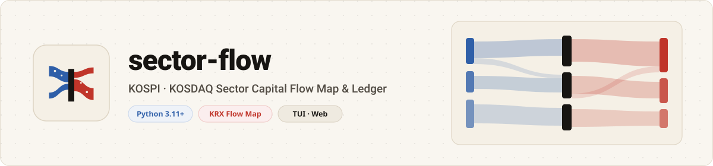
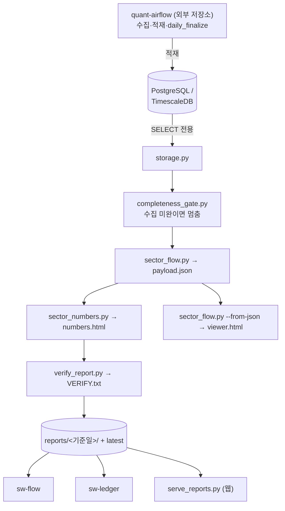

<picture>
  <source media="(prefers-color-scheme: dark)" srcset="docs/images/brand/banner-dark.svg">
  
</picture>

**한국어** · [English](README.en.md)

**오늘 코스피·코스닥 어느 섹터에 누구의 돈이 들어왔는지를 터미널과 브라우저에서 본다.** 일일 배치가
수급 DB 에서 리포트 폴더를 만들고 저장 직후 스스로 검사한다. 화면은 그 폴더만 읽으므로 SSH 에서
바로 뜬다. 숫자는 동시기(同時期) 측정값이고, 돈이 들어온 섹터가 앞으로 오른다는 주장이 아니다([§8](#8-주의--이-숫자들은-예측이-아니다)).

[](https://www.python.org/)

## Quick start

```bash
uv sync
uv run sw-flow --demo      # 섹터 자금 흐름 — DB·데이터 없이 바로 뜬다
uv run sw-ledger --demo    # 자금 원장 — 같은 데모
uv run sector-flow-demo --out ~/sf-demo && uv run python scripts/serve_reports.py --root ~/sf-demo   # 같은 데모를 웹으로 — http://127.0.0.1:8765/
```

**`--demo` 의 숫자와 이름은 전부 난수다.** 실제 시장·종목과 무관하고, 제목 줄 맨 앞과 웹 맨 위에 `[합성 데모]` 가 늘 붙는다.
처음 한 번 수십 초 걸려 `~/.cache/sector-flow/demo` 에 만들고, 그 뒤로는 바로 뜬다.

실제 리포트로 보는 길은 둘이다.

```bash
uv run sw-flow --dir <리포트 폴더>   # 받은 폴더(DB 불요, §4.3)
scripts/daily_report.sh              # 수급 DB 에 접속할 수 있으면 직접 만든다(§4.1) → uv run sw-flow
```

> **리포트 폴더는 제3자에게 넘기지 않는다.** 실제 종목별 수급이 들어 있고, KRX·키움의 데이터 이용 범위상
> 재배포할 수 없다. 본인 기기 사이에서만 옮기고, 남에게 보여 줄 때는 합성 데모를 쓴다(§4.3).
> 섹터 합계로 그린 그림·카드도 같다 — 이 레포의 공개 그림은 전부 합성 데모다.

> **데이터는 어디서 오나.** 일일 배치는 [quant-airflow](https://github.com/younghwan91/quant-airflow) 가 적재한 DB 를 읽기만
> 한다. `src/sectorflow/collect/`(`sector-flow-collect`)는 자기 키움 키로 sqlite 를 채우는 BYO 수집기로, 일일 배치에는
> 쓰지 않는다([`docs/byo/`](docs/byo/)).

## 수급 지도


하루(또는 5·20·60·120거래일) 동안 **누가 어느 섹터를 순매도하고 순매수했나**를 한 장으로 그린다. 띠 하나가 (주체, 섹터) 한 칸이다.
주체 칸을 누르면 그 주체 하나의 섹터별 순매도·순매수만 남고, 기관은 투신·연기금 등 세부로 펼친다. 타임랩스는 최근 60거래일을 하루씩 넘긴다.
섹터와 섹터, 주체와 주체는 잇지 않는다 — 누가 누구에게 넘겼는지는 데이터에 없다([정의](docs/formulas.md#8-수급-지도--sectorflowflowmap)).

```bash
uv run python scripts/sector_map.py --payload <리포트 폴더>/payload.json --html map.html   # 브라우저로 연다
```

일일 배치는 아직 `map.html` 을 만들지 않는다. 실데이터 지도도 리포트 폴더와 같다 — 본인 기기에서만 본다.

**자기 키움 키로 자기 기기에서 지도까지:** [`docs/byo/quickstart.md`](docs/byo/quickstart.md) — 키 발급 → 설치 → 종목 목록 → 지도 전용 수집 → 지도 짓기.

## 목차

- §1 [무엇을 하나](#1-무엇을-하나) · [다른 자료와 무엇이 다른가](#11-다른-자료와-무엇이-다른가)
- §2 [구조](#2-구조)
- §3 [일일 배치 — 언제 무엇이 도나](#3-일일-배치--언제-무엇이-도나) · [장애 대응(운영 런북)](docs/runbook.md)
- §4 [설치와 실행](#4-설치와-실행) · [리포트 폴더를 그대로 주고받는다](#43-리포트-폴더를-그대로-주고받는다) · [웹으로 보기](#44-웹으로-보기)
- §5 [화면 읽는 법](#5-화면-읽는-법) · [수급 관측 읽기 가이드](docs/reading-guide.md) · [용어집](docs/glossary.md)
- §6 [자금 원장 — `sw-ledger`](#6-자금-원장--sw-ledger)
- §7 [숫자의 정의](#7-숫자의-정의)
- §8 [주의 — 이 숫자들은 예측이 아니다](#8-주의--이-숫자들은-예측이-아니다)
- §9 [리포트를 스스로 검증한다](#9-리포트를-스스로-검증한다)
- §10 [개발](#10-개발)
- §11 [문서](#11-문서)

---

## 1. 무엇을 하나

| 명령 | 하는 일 | DB |
|---|---|---|
| `sw-flow` | 첫 화면은 **오늘의 수급** — 기준일 하루 누가 어디서 얼마나 드물게 사고팔았나. 아무 키나 누르면 27개 섹터 칸(벤더 분류 26개 + 미분류) × 5개 구간(1·5·20·60·120거래일) × 3개 시장 × 4개 주체의 표로 간다. 기본 정렬은 금액이 아니라 **가속**(누적 순매수 ÷ 섹터 시총)이라 시총 큰 종목이 있는 섹터가 자동으로 1등이 되지 않는다. `Enter` 로 섹터를 열면 그 흐름을 만든 종목이 보인다 | 불요 |
| `sw-ledger` | 같은 리포트의 회계. 누가 얼마를 넘겼고 얼마가 미분류로 남았나를 원 금액과 잔여만으로 | 불요 |
| 웹 | 같은 리포트의 수치표(`numbers.html`, 맨 위 **오늘 한 장**)와 흐름 뷰어(`viewer.html`)를 Tailscale 로 연다 | 불요 |
| `scripts/daily_report.sh` | DB 에서 리포트 폴더를 만들고 저장 직후 자기 검증 | 읽기 전용 |


*`sw-flow` 첫 화면(160×45, **합성 데모** — 이 문서의 그림은 전부 난수로 만든 가짜 숫자·가짜 이름이다). 점수·순위·추천 없이 사실만 적는다. 아무 키나 누르면 표로 간다.*


*섹터 표(20거래일·전체 시장·기관, 160×45, 합성 데모). 한 행이 한 섹터다.*

### 1.1 다른 자료와 무엇이 다른가

**원자료는 여기서만 보는 것이 아니고, 이 저장소가 더 좋은 데이터를 갖고 있지도 않다.** 무료로 볼 수 있는 곳이 이미 많다.
아래는 2026-11-08~09 에 공개 페이지로 확인한 범위다.

| 자료 | 확인한 것 | 이 저장소와 다른 점 |
|---|---|---|
| 키움 HTS [0789] 투자자별누적순매수 | 업종 하나를 골라 투신·연기금 등 세부 주체의 기간 누적 추이 | 추이는 같은 종류다. 세부 주체를 업종 간에 나란히 놓으려면 업종을 바꿔 가며 본다 |
| 키움 HTS [0797] 업종별투자자별순매수 | 시장을 고르면 업종별 주체 순매수가 한 화면에 나온다 | 업종을 나란히 보는 것 자체는 여기만의 것이 아니다 |
| 키움 HTS [1051] 종목별 투자자별매매추이(잠정) | 장중 5차까지의 잠정치, 종목 단위 | 여기는 장중이 없다 |
| 머니레시피 업종별 투자자 수급 분석 | KRX·WICS 중분류 × 외국인·기관·개인·금융투자·투신·연기금·사모, 12M~1M 누적, 평일 16:10 잠정·21:30 확정 | 잠정 게시가 여기(18:10)보다 빠르고, WICS 분류를 쓴다. 오늘의 강세·약세 Top3 는 있지만 1년 %ile 은 못 찾았다 |
| 코스캐너 `/flow` | KRX+NXT 통합 기준 종목 수급 1·3·7일, 20:00 뒤 확정 | 섹터 집계를 못 찾았다. 여기는 KRX 단독이라 숫자가 다르다 |
| KRX 정보데이터시스템 | 시장·종목 단위 투자자별 거래실적. 업종(지수) 단위 화면이 있는지는 **미검증** | 같은 통계의 익명 프로그램 조회는 `400 LOGOUT` 으로 거부됐다(2026-11-09, `scripts/krx_truth.py`). 로그인 조회는 시험하지 않았다 |
| 네이버 증권 | 시장 단위 개인·외국인·기관 순매수를 프로그램으로 받아 봤다(2026-11-09, 내부 대조). 섹터 단위 화면이 있는지는 **미검증** | 여기서는 시장 합계 대조에만 쓴다 — 약관 미확인이라 기본 꺼짐 |

**조사 범위에서 다른 곳에서 못 찾은 것은 셋이다.** 못 찾았다는 말이지 없다는 말은 아니다.

1. 오늘 순매수를 그 섹터의 **1년(260거래일) 분포 안 %ile** 로 적는다.
2. **연속 일수와 그 길이의 1년 %ile** — 며칠째 같은 방향인가, 그 길이가 1년 안에서 얼마나 드문가. 연속 일수만이면 StockHub·다람티커스에도 있다.
3. **섹터에서 그날 주체별 종목으로** 바로 내려간다 — 첫 화면 `[ ]` 에 그 주체의 그날 상위 종목이 있고 `Enter` 로 전 종목을 연다.

그 밖에 여기서 하는 일은 고유하지 않지만 숫자를 믿는 근거다. 순매수·시총·수익률을 **같은 종목 바구니**에서 재서 가속의
분자와 분모가 어긋나지 않고, 리포트마다 스스로 검증한다([§9](#9-리포트를-스스로-검증한다)). 검증 기록은 아직 밖에 공개하지 않는다.

**못하는 것도 있다.**

- **금액은 근사고 시장 합계는 시장 전체가 아니다.** DB 가 순매매 **수량**만 줘서 수량 × 종가로 환산하고, 수급 자료에 우선주·리츠 등
  139코드가 없어 합계에서 빠진다. 네이버 시장값과의 차이는 거래소 일별 중앙 5.7%, 코스닥 5.5% 다(48일, 내부 대조 — KRX 원표는 미대조,
  [`docs/validation/2026-11-09-market-total-vs-published.md`](docs/validation/2026-11-09-market-total-vs-published.md)).
- **KRX 체결만이다.** 넥스트레이드(NXT) 체결은 없다 — 첫 화면 둘째 줄과 웹 '오늘' 패널 머리에 `자료 범위: KRX 단독·NXT 제외` 로 적는다.
- **장중 실시간이 아니다.** 평일 18:10 에 그날 잠정값으로 만들고, 다음날 아침 확정치로 다시 만든다(§3).
- **섹터는 KRX 공식 업종지수 분류가 아니다.** 벤더 마스터의 섹터 이름을 쓰고 은행 넷은 금융으로 덮었다
  (`sectorflow/sector_override.py`). 같은 이름의 KRX 업종지수 투자자 표와 숫자가 다를 수 있다.
- **앞날 증거가 없다.** 섹터 수급 지표와 섹터 앞날 수익률의 관계를 검정했고 증거가 없었다([§8](#8-주의--이-숫자들은-예측이-아니다)).

## 2. 구조



```
src/sectorflow/
├── storage.py              # 읽기 전용 DB 접근 — 리포트가 쓰는 만큼만
├── demo.py                 # 합성 데모 리포트(실데이터 아님) — sw-flow --demo · sector-flow-demo
├── collect/                # BYO 수집기 sector-flow-collect — 자기 키움 키 → sqlite (일일 배치는 안 쓴다)
└── tui/                    # sw-flow · sw-ledger — 렌더(*_view.py)는 순수함수, curses 는 *_app.py 만
scripts/
├── daily_report.sh         # 배치 입구 — 관문 → 생성 → 검증 → latest 교체
├── cron_run.sh             # 크론 감싸개 — 이상 종료 알림
├── _env.sh · _ledger.sh    # uv·.env 불러오기 · 운영 사건 기록 — 공용 머리말
├── completeness_gate.py    # 수집 완전성 관문
├── finalize_done.py        # 08:20 확정 모드 — daily_finalize 성공 확인
├── sector_flow.py          # DB → payload.json (+ viewer.html)
├── sector_numbers.py       # payload → numbers.html (templates/)
├── sector_map.py           # payload → map.html 수급 지도(templates/, 배치 밖 — 손으로 짓는다)
├── map_video.py            # 수급 지도 타임랩스 → MP4·GIF (ffmpeg, 배치 밖 — 파일은 그 기기에만)
├── verify_report.py        # 리포트 자기 검증 (§9)
├── krx_truth.py            # 네이버 시장값과 시장 합계 대조 (내부 전용)
├── demo_shots.py           # README 그림·화면 예시를 합성 데모로 다시 만든다
├── social_preview.py       # GitHub 소셜 미리보기(1280×640, 합성 데모)
├── krx_calendar.py         # KRX 휴장 달력 — 거래일 판정·SLO 분모
├── digest.py               # (선택) 다이제스트 글·카드 — 폴더에만 쓴다
├── trust_page.py           # 검증·품질 페이지 trust.html
├── rebuild_history.py      # 지난 기준일 여러 날 재구성
├── seed_revisions.py       # 잠정→확정 수정 폭의 시드
├── ops_ledger.py           # 운영 사건 원장 통계 (docs/slo.md)
├── freshness_check.{sh,py} # 20:30 신선도 점검
├── serve.sh · serve_reports.py  # 웹 (§4.4)
├── web_smoke.py            # 웹 두 장을 진짜 브라우저로 여는 검사 (§10)
├── ledger_numbers.py       # sw-ledger 한계 화면의 실측 재현
├── verify_merge.py         # 병합 전 검증 — 실데이터 렌더·pty·변이 (§10)
├── rehearse_merge.py       # 대기 브랜치를 임시 클론에 차례로 합쳐 전체 관문 (docs/merge-rehearsal.md)
├── mutation_sample.py      # 변이 표본으로 검사 강도를 잰다 (docs/validation)
├── memcap.py               # pytest·변이 프로세스의 메모리 상한 (§10)
├── ci_plan.py              # CI 가 이번 커밋에 돌릴 변이 범위를 정한다
├── diff_coverage.py        # 변경 줄 커버리지 관문 (CI)
└── docs_refs.py            # docs/formulas.md 의 `파일:줄` 인용 검사·--fix (§10)
deploy/crontab.simnode      # 크론 정본
site/                       # 공개 랜딩(GitHub Pages) — build.py 가 합성 데모로 _site/ 를 짓는다(생성물은 커밋 안 함)
tests/conftest.py           # 세션 시간·메모리 상한, 겹친 pytest --cov 를 실패로 끝낸다 — 서로의 측정을 지운다
docs/                       # §11 표 참고
research/validation/        # docs/validation 결과의 재현 스크립트 (CI 밖)
```

## 3. 일일 배치 — 언제 무엇이 도나

리포트 폴더는 [`scripts/daily_report.sh`](scripts/daily_report.sh) 가 만들고 크론([`deploy/crontab.simnode`](deploy/crontab.simnode))이
같은 명령을 부른다. 그 기준일 리포트가 이미 있으면 건너뛴다.

| 시각 | 하는 일 |
|---|---|
| 평일 18:10 | 수집이 끝났으면 리포트를 만들어 `latest` 로 건다 |
| 평일 19:10 | 18:10 에 못 만든 날을 다시 시도한다 |
| 화~토 08:20 | **확정 모드**(`KR_QUANT_FINAL=1`). 새벽 `daily_finalize` 가 확정치를 덮은 것을 확인하면(`scripts/finalize_done.py`) 전날 리포트를 확정치로 다시 만든다 — 제목이 `마감·확정`, 폴더에 `FINAL.txt`. 확인이 안 되면 잠정 리포트를 두고 경고(75)로 끝난다 |
| 화~토 10:20 | 확정 모드 재시도. `daily_finalize` 가 늦게 끝난 날을 손 없이 확정한다. 이미 `FINAL.txt` 가 있으면 건너뛴다. 검증에 걸린 확정은 다시 만들고, 첫 확정의 잠정→확정 기록을 믿을 수 있을 때만 잇는다(값이 또 바뀌었으면 1일 칸만 다시 센다) |
| 평일 20:30 | 신선도 점검(`scripts/freshness_check.py`). 오늘 수급이 왔는데 `latest` 가 오늘이 아니거나 달력(`scripts/krx_calendar.py`)상 거래일인데 수급이 없으면 오류, 검증에 걸린 게시·전 거래일 미확정·미게시·원장 공백·프로브 침묵·배포 지연·알림 웹훅 없음은 경고. 리포트·수급·확정·원장이 깨끗하면 하트비트를 보낸다 |
| 5분마다 | 웹 서버(§4.4)가 안 떠 있거나 `/healthz` 에 대답하지 않으면 다시 띄운다 |

상한: 배치 40분(`timeout`), DB 접속 10초, 문장 하나 10분(`statement_timeout`). 두 실행이 겹치면 뒤의 것이
`reports/.report.lock` 을 못 잡고 경고(75)로 물러난다.

**만들기 전에 완전성 관문을 본다**([`scripts/completeness_gate.py`](scripts/completeness_gate.py)). 시장별로 기준일의 수급 종목수와
시총 잡히는 종목수가 직전 5거래일 중앙값의 97% 이상, 조정 종가(`daily_bars_adjusted`)가 있는 종목수가 그날 수급 종목수의
97% 이상이고 시총 합이 0 보다 커야 한다. 관문이 본 수집 행 수는 폴더의 `GATE.txt` 에 남고, 그날 저녁 재시도는 그 뒤 수집이
더 들어왔으면 리포트가 있어도 다시 만든다.

| 폴더에 있는 것 | 뜻 | 화면 |
|---|---|---|
| `INCOMPLETE.txt` 만 | 수집 미완이라 안 만들었다. `latest` 는 전날에 머물고 다음 크론이 다시 만든다 | 전날 리포트 제목에 `⚠ MM-DD 수집 미완` |
| `VERIFY_FAILED.txt` | 만들었지만 검사에 걸렸다(§9). 다음 시도가 다시 만든다. 검증을 통과한 판이 이미 걸려 있으면 그 판을 두고 걸린 판은 `reports/.rejected/` 로 비켜 둔다 | 제목에 `⚠ 검증 실패`, HTML 맨 위에 경고 |
| `FINAL.txt` | 08:20 확정 모드가 확정치로 다시 만들었다 | 제목에 `마감·확정` |

제목의 `마감·잠정` 은 그날 잠정값으로 만든 리포트다. 잠정 리포트의 G 는 확정치에서 자주 바뀐다(게시본과 확정치의
G 순위 ρ≥0.95·통과 변화≤1 기준을 못 넘은 날 37.5%, [`docs/validation/`](docs/validation/)).

종료코드 75 는 경고, 그 밖 비정상은 오류로 [`scripts/cron_run.sh`](scripts/cron_run.sh) 가 알린다(124 는 시간 초과).
기준일이 오늘이 아닌데 아직 미완이면 75 가 아니라 1 로 끝난다.

**알림이 오면** [`docs/runbook.md`](docs/runbook.md) 에 알림 문구별 원인과 할 일이 있다. 운영 사건 원장과 네이버 대조도 거기 적는다.

**디스크가 죽었거나 새 머신이면** 런북의 [복구 절차](docs/runbook.md#디스크-소실새-머신-복구)를 따른다.

## 4. 설치와 실행

**요구사항:** Python 3.11 이상, [uv](https://docs.astral.sh/uv/), 리눅스·macOS 터미널(`curses`). 설치는 `uv sync` 한 줄이다.
화면을 보는 데는 DB 가 필요 없다(`--demo`, §4.2). 리포트를 직접 만들려면 PostgreSQL/TimescaleDB 접속정보가 필요하다. `cp .env.example .env` 뒤 `KR_QUANT_DB` 를 채운다
(옆자리에 quant-airflow 체크아웃이 있으면 그 `.env` 를 불러 쓰므로 필요 없다).

### 4.1 리포트 만들기 (DB 필요)

```bash
scripts/daily_report.sh                      # <저장소>/reports/<기준일> + latest 링크 (KR_QUANT_REPORTS 로 변경)
KR_QUANT_FORCE=1 scripts/daily_report.sh     # 같은 기준일이어도 다시 만든다 (약 5~6분)
```

폴더 이름은 실행일이 아니라 데이터 기준일(`supply_demand` 의 `MAX(date)`)이다. 옆에 새로 지어 마지막에 바꿔 끼우므로
도중에 실패해도 옛 리포트는 남는다. 리포트 형식이 바뀐 뒤 옛 리포트를 열면 새 열이 `—` 이고 제목에 `옛 리포트(새 열 없음)` 가
붙는다 — `KR_QUANT_FORCE=1` 로 다시 만든다.

배치를 손으로 풀면 이렇다.

```bash
set -a; . ~/git/quant-airflow/.env; set +a   # 이 레포에 .env 가 있으면 그것 — 배치가 쓰는 순서다
uv run --extra pg python scripts/sector_flow.py --days 260 --json payload.json
uv run python scripts/sector_flow.py    --from-json payload.json --html viewer.html
uv run python scripts/sector_numbers.py --payload payload.json --html numbers.html
uv run --extra pg python scripts/verify_report.py --dir <리포트폴더> --db-check
```

### 4.2 화면 띄우기 (DB 불요)

```bash
uv run sw-flow --demo                   # 합성 데이터(실데이터 아님) — 폴더가 없어도 뜬다
uv run sw-flow                          # <저장소>/reports/latest 를 연다
uv run sw-flow --dir <리포트 폴더>       # 특정 날짜의 리포트
uv run sw-ledger                        # 자금 원장 (§6)
uv run sw-ledger --dump --width 100     # 색 없는 평문 — 파이프·리다이렉트용
uv run sector-flow-demo --out <폴더>     # 합성 데모 폴더만 만든다 — 웹으로 열어 보거나 --dir 로 띄운다
```

40×10 창에서도 뜬다. 폭이 모자라면 열이 경계에서 통째로 빠진다(숫자가 자릿수 중간에서 잘려 다른 값처럼 보이지 않게).
원장 표만은 71칸 미만이면 아예 안 그리고 그 사실을 적는다 — 4주체와 잔여가 한 덩어리라 일부만 보이면 회계 항등식이
깨진 것처럼 읽힌다. `NO_COLOR` 를 존중한다.

### 4.3 리포트 폴더를 그대로 주고받는다

**받는 쪽에는 DB 도 수집 파이프라인도 필요 없다.** 만드는 쪽이 폴더를 압축해 옮긴다.

> ⚠️ **제3자 전달 금지.** 폴더에는 실제 종목별 수급이 들어 있고 KRX·키움의 데이터 이용 범위상 재배포할 수 없다.
> 본인 기기 사이에서만 옮긴다. 남에게 보여 줄 때는 합성 데모를 쓴다.

```bash
tar czf sector-flow-2026-11-06.tar.gz -C <저장소>/reports 2026-11-06            # 보내는 쪽
mkdir -p ~/reports && tar xzf sector-flow-2026-11-06.tar.gz -C ~/reports         # 받는 쪽
uv run sw-flow --dir ~/reports/2026-11-06
```

| 파일 | 없으면 |
|---|---|
| `numbers.html` | `sw-flow` 가 안 뜬다. 브라우저로 열면 수치표 자체다 |
| `payload.json` | `sw-ledger` 가 안 뜬다 |
| `viewer.html` | 브라우저용 차트 뷰어. 터미널 화면은 이것 없이도 뜬다 |
| `VERIFY.txt` | 검증 결과(§9). 없어도 화면은 뜨지만 받은 숫자가 검사를 통과했는지 알 길이 없다 |

⚠️ `VERIFY_FAILED.txt` 가 같이 들어 있으면 **그 리포트는 검사에 걸린 것이다.** 지우고 보내지 마라.
받은 폴더는 그날의 사진이다. 기준일이 4일 이상 지나면 화면과 HTML 이 `⚠ N일 지난 리포트` 로 말한다.

### 4.4 웹으로 보기

만드는 쪽 서버가 리포트를 웹으로도 연다. 폰·PC 브라우저에서 Tailscale 로 들어간다.

```
http://<서버의 Tailscale 주소>:8765/                    # 기준일 목록 — 최신·확정·검증 실패·수집 미완 표시
http://<서버의 Tailscale 주소>:8765/latest/numbers.html  # 즐겨찾기용 — 늘 최신 수치표
http://<서버의 Tailscale 주소>:8765/latest/viewer.html   #            — 늘 최신 흐름 뷰어
```

`/latest/trust.html` 은 검증·품질 페이지(첫 게시 결과·정정의 크기·지표 검정 결과·알려진 한계)이고 근거 문서 사본이 `/latest/validation/` 에 같이 있다.
`/latest/digest.md`·`/latest/digest.png` 는 그날의 수급 다이제스트다 — 이 비공개 웹에서만 읽고 밖으로 보내는 길은 없다.

[`scripts/serve_reports.py`](scripts/serve_reports.py) 는 표준 라이브러리만 쓰는 읽기 전용 서버다. 화면·문서 사본과 검증 기록만
내보낸다(`payload.json`·`cron.log` 는 안 나간다). 주소는 Tailscale 에만 묶는다. 손으로 띄우려면 `scripts/serve.sh`,
이 컴퓨터에서만 보려면 `python3 scripts/serve_reports.py`(127.0.0.1).

수치표 맨 위 **오늘 한 장** 은 위에서 아래로 읽는다 — 요약 문장(누가 얼마나 · 평소와 다른 곳 · 어제와 바뀐 것, `sw-flow` 첫 화면·
다이제스트와 같은 문장)과 '이 요약이 말하지 않는 것' → 시장 4주체를 지난 1년 하루값(회색 띠 = 평소 범위 5~95%ile 자리) 위의 오늘 점으로,
옆에 %ile·`260일 중 N번째`·`더 큰 날은 며칠 전` → 섹터 × 주체 1년 %ile 칸(섹터를 누르면 그날 종목 막대와 20거래일 누적 선) → 연속 일수 막대와
어제와 부호가 바뀐 섹터. ☆ 로 고른 관심 섹터는 그 브라우저에만 남고 요약에 줄이 생긴다. 예전 '오늘' 패널의 숫자는 지우지 않고 그 아래 **세부 숫자** 로, 구간별 섹터 표·탐색·용어 설명은 그 밑 **섹터별 표** 로 접었다(링크로 들어가면 펼쳐진다).

| 데스크톱 | 모바일 |
|---|---|
|  |  |

## 5. 화면 읽는 법

> 누가 어디서 사고팔았나를 어떤 순서로 읽는지는 [수급 관측 읽기 가이드](docs/reading-guide.md) 를 보라. 낯선 말은 [용어집](docs/glossary.md) 에 있다.
> 고르는 법은 말하지 않는다 — 검정 결과 그럴 근거가 화면에 없다([§8](#8-주의--이-숫자들은-예측이-아니다)).
> 모든 열의 정의와 한계는 화면 안 도움말(`?`)이 원본이고, 아래는 그 축약이다.

### 5.1 키

| 키 | 하는 일 |
|---|---|
| `↑` `↓` `j` `k` | 한 줄 이동. `g`·Home 처음 · `G`·End 끝 · PgUp/PgDn 한 화면 |
| `Enter` `l` `→` | 그 섹터의 전 종목 보기(드릴다운) |
| `h` `←` `Esc` | 드릴다운에서 나가기 |
| `w` `W` | 구간 1 · 5 · 20 · 60 · 120(탐색 모드에서는 종합까지). 대문자는 역방향 |
| `1` | 1일 창으로 바로 간다(드릴다운이면 그날의 종목) |
| `o` | 첫 화면(오늘의 수급)을 다시 연다. 화면보다 길면 `↑` `↓` `PgUp` `PgDn` 으로 훑고, 끝에서 `PgDn`·`Space` 나 그 밖의 키는 표로 간다 |
| `m` `M` | 시장 전체 · 거래소 · 코스닥 |
| `a` `A` | 주체 기관 · 외국인 · 개인 · 기타법인 |
| `s` `S` | 정렬 열 바꾸기. 드릴다운에서는 종목 정렬 |
| `r` | 정렬 역순. 순매도 상위(가장 많이 판 쪽)를 보려면 이걸 켠다 |
| `e` | 탐색 모드 켜기/끄기 — 미실현·풀림가속·dW/dt·G·종목 선정·종합·전 종목(곱)을 보인다. 기본은 꺼짐이고, 켜 있는 동안 제목 줄 맨 앞에 탐색 표지가 붙는다(넓은 화면: `[탐색 — 검정 결과 앞날 증거 없음(G 판정 불가) · 종목 투신+연기금 축은 검정 부호와 반대]`, 좁을수록 줄어 끝내 `[탐색]`) |
| `t` | 탐색 모드에서만 — 전 종목 화면(곱 = 섹터G × 종목선정 순). `t`·`h`·`←`·`Esc` 로 돌아온다 |
| `?` `F1` | 도움말 — 모든 열의 뜻·계산식·증거 표지 |
| `q` | 종료. 도움말 안에서는 닫기만 한다 |

구간·시장·주체를 바꿔도 커서는 보던 섹터에 머문다. 한영 상태에서도 두벌식 같은 자리로 듣는다. Shift 로 다른 글자가 나오는
자리가 q·w·e·r·t 뿐이라 한글에서 대문자 역방향은 W(구간)뿐이다 — 나머지 대문자(M·A·S, 원장의 V)는 소문자 동작으로 떨어진다.
예: `ㅈ`→`w`, `ㅉ`→`W`, `ㅡ`→`m`, `ㅁ`→`a`, `ㄴ`→`s`, `ㄱ`→`r`(역순은 토글이라 소문자 하나로 된다). `sw-ledger` 도 같다.

**첫 화면 — 오늘의 수급.** 기준일 하루의 사실을 이 순서로 적는다. 아무 키나 누르면 표로 넘어가고, `q` 는 바로 끝내며 `?` 는 도움말을 연다.

- 자료 범위 한 줄 — `KRX 단독·NXT 제외`(근거는 도움말 끝). 웹 '오늘' 패널 머리에도 같은 칩이 있다.
- **한눈에** — 웹 '오늘 한 장'·다이제스트와 같은 요약 문장: 그날 가장 큰 주체와 그 1년 %ile·`평소 범위 안/밖`(%ile 5~95 를 말로 옮긴 것, 판정 아님)·
  `260일 중 N번째로 큰 순매도 · 더 많이 판 날은 K거래일 전`, 가장 긴 시장 연속(2일 이상)과 `같은 방향 L일 이상 연속 M번`, 평소 범위 밖 섹터×주체 칸 수(10종목 미만 제외),
  어제와 기관 부호가 바뀐 섹터. 정의는 [docs/formulas.md §2.25](docs/formulas.md).
- 시장 4주체 순매수와 그 1년%ile, 기관 세부(금투·투신·연기금, `금투÷기관` = 기관 중 금투 몫 — 기관이 4주체 총량의 10% 미만이면 안 낸다).
- ⚠ 경고 — `분봉 밖 거래 큼`(거래량 50% 이상이 분봉 밖이고 금액이 시장의 1% 이상인 종목. 이름을 다 적는다. 시간외 대량매매라는 것은 추정이고, 시장 합계와 네이버 시장값의 차이가 정의 차이일 수 있다는 표지다(까닭 미확인, 금액은 따로 틀릴 수 있다). 판정 못 한 종목 수·판정 건너뜀도 적는다), `네이버 시장값과 차이 큼`(대조를 켠 리포트만 — 기본 꺼짐. 네이버 시장값과 5% 초과, KRX 원표 미대조, 수치는 안 싣는다), `종가·VWAP 환산 차 큼`(내부 자료끼리의 값).
- **오늘 달라진 것** — 어제와 부호가 바뀐 섹터(양일 \|금액\| 이 목록의 2% 이상), 직전 거래일 리포트 대비 20일 누적 순매수 상위 5 섹터의 들고 남(직전이 잠정·검증 실패였으면 제목에 적는다), 확정 리포트면 `잠정→확정 변경: N칸` 과 크게 바뀐 1일 칸 셋·%ile 극단 목록의 들고 남(전체 목록은 도움말 맨 끝과 웹 패널).
- 시장 수익률 1·20일 — 자체 바구니와 KRX 종합지수(정규장)를 나란히([§8](#8-주의--이-숫자들은-예측이-아니다)). 잠정 리포트의 마지막 날은 전일 20:00 → 당일 **수집 시각**(애프터마켓 진행 중)이라 라벨이 다르다. `(미분류)` 종목이 남아 있으면 그 수.
- 잠정 리포트면 최근 확정일들의 잠정→확정 수정 폭(1일 섹터 칸 중앙 %, 부호 뒤집힘 수)과 %ile 극단 목록의 `(잠정)` 표지.
- 연속 순매매 — `기관 9일 연속 순매수 누적 +2.2조(69)` 꼴(두 줄을 넘으면 `기관 9일 순매수 +2.2조(69)` 로 줄인다 — 뜻은 줄 머리말이 말한다). 그날까지 순매수 부호가 같은 날이 며칠째인가, 그 기간의 누적 금액, 괄호는 그 연속 길이가 최근 1년의 연속 길이 중 몇 %ile 인가. 시장 합계 4주체(기관·투신+연기금·외국인·개인)를 먼저 적고, 이어서 기관·투신+연기금·그날 최대 순매매 주체의 연속이 가장 긴 섹터를 적는다. |금액| 이 그날 목록 총량의 1% 미만인 날은 연속을 끊는다. 센 값이고 앞날 관계는 검정하지 않았다.
- 거래대금 집중 — 그 시장 거래대금의 20% 이상인 섹터의 상위 2종목 몫과 그 둘을 뺀 순매수[억].
- 기관·투신+연기금(그리고 그날 시장 \|순매수\| 가 가장 큰 주체가 그 밖이면 그 주체 — `최대 순매매 주체`) 순매수 상·하위 3개 섹터(금액 순, 각자의 1년%ile 과 그 섹터의 그날 수익률 — 웹과 같은 반올림)와 섹터마다 그 주체의 그날 상위 종목 1~2개, 1년%ile 이 ≥95·≤5 인 섹터(뒤의 `신규` = 오늘 처음, `N일째` = 그 극단에 연속 며칠째).
- 최근 5일 부호가 직전 15일과 반대인 섹터(판정 불가 라벨, 5일 \|금액\| 이 목록의 2% 이상만).

`today` 가 없는 옛 리포트면 그렇다고 말하고 20일 상·하위만 적는다. `o` 로 다시 열고, 마지막 면책 줄은 어느 높이에서도 남는다.
웹 수치표의 접힌 **세부 숫자** 가 같은 순서이고, 펼치면 패널 위에 이 페이지 안 이동 링크(달라진 것·직전 대비·수익률·섹터 순위·극단·섹터 표·설명)가 있다.

### 5.2 섹터 표의 열

왼쪽부터 화면 순서다. 폭이 모자라면 오른쪽 열부터 통째로 빠진다(섹터·마커·가속·임펄스는 40칸에서도 남는다).
**탐색 모드에서만** 표시한 열은 `e` 를 눌러야 나온다. 1일 구간에는 그날의 사실(순매수·1년%ile·수익률·거래대금)만 있고
가속·추이와 탐색 열은 `—` 다.

| 열 | 뜻 |
|---|---|
| 섹터 | 벤더 분류(`stocks.sector`) 26개와 `(미분류)` 를 합친 27칸. KRX 업종 분류와 다르다. 마스터가 섹터를 비운 은행 넷만 KRX 업종(금융)으로 보정한다(`src/sectorflow/sector_override.py`) |
| (마커) | `~` 는 그 구간에 거래된 종목 10개 미만 — 회색, 정렬과 무관하게 맨 아래(분모가 작아 가속이 쉽게 튄다). 탐색 모드에서는 `*` 가 G 관문 통과 |
| 가속[%p] | 임펄스 ÷ 구간말 섹터 시총 × 100. 기본 정렬 열 |
| 임펄스[억] | 구간 누적 순매수 = Σ(순매매 수량 × 그날 종가) |
| 1년[%ile] | 그 주체의 롤링 N일 순매수 합이 최근 1년 분포에서 몇 등인가. 100 = 1년 최대 매수. 이 표에서 유일한 시계열 맥락이다 |
| 추이[8] | 구간 동안 순매수가 누적된 경로. 높이는 그 행 안에서만 정규화돼 행끼리 비교되지 않는다 |
| 수익률[%] | 그 섹터 자체 바구니의 구간 수익률, 전일 시총 가중. KRX 업종지수가 아니다. 하루는 전일 20:00 → 당일 20:00(§8) — 잠정 리포트의 마지막 날은 당일 수집 시각까지 |
| 투신+연기금5일[억] | 그 섹터 종목들의 **최근 5일** 투신+연기금 순매수 합. 임펄스는 구간 누적이라 "지금도 들어오나" 를 말하지 않는다 |
| 투신+연기금[억] | 같은 합의 **이 창** 값(1일 창이면 그날) |
| 종목[수] | 그 (시장, 섹터)에서 이 구간에 거래된 종목 수. `Enter` 로 여는 목록의 길이와 같다(상장 종목 수와는 다르다) |
| 미실현[%p] | **탐색 모드에서만.** (k×가속 + b) − 실제 수익률, 적합선과의 차. 앞날 증거 없음 — 사실상 섹터 20일 반전(ρ 0.82~0.93)이고 적합 섹터의 합이 0 인 상대 지표다 |
| 풀림가속[%p/일²] | **탐색 모드에서만.** x 의 2차 변화(ẍ, 부호 반전). 구간을 셋으로 갈라 중앙차분한다. 짧은 구간에서 흔들린다 |
| dW/dt[%p/일] | **탐색 모드에서만.** 구간을 반으로 갈라 본 W = 가속 × 수익률 의 전·후반 차를 거래일로 나눈 값 |
| G | **탐색 모드에서만.** 관문(얇지 않고·가속>0·미실현>0·풀림가속>0)을 다 통과한 섹터들 사이의 순위 평균. 어기면 `—`, 통과가 하나뿐이면 0.5. 판정 불가(검정력 없음) |
| 순매수/순매도상위[억] | **선택한 주체**가 그 섹터에서 가장 많이 산/판 종목과 금액. 표는 1개씩, 하단 패널은 3개씩 |

표 아래 패널은 선택한 섹터의 4주체 순매수(`개인 -116 · 외국인 -80 · 기관 +214 · 기타법인 -21 [억]`)와 순매수·순매도 상위
3개씩을 적는다. 4주체 합이 0 에 닫히므로 고른 주체가 판 돈을 누가 받았는지가 이 줄에 있다. 그 아래 힌트바는 지금 정렬한 열의
정의를 한 줄로 적는다.

### 5.3 종목 목록의 열 (`Enter`)


*`Enter` 드릴다운(160×45, 합성 데모). 누적[%] 옆 `-` 마커 위쪽이 그 섹터 순매수의 80%를 채운 종목이다.*

| 열 | 뜻 |
|---|---|
| 종목 · 코드 | 종목명과 6자리 코드 |
| 선정 | **탐색 모드에서만**(코드 오른쪽). 섹터 안 순위 평균. 관문(누적 80% 안·순매수>0·투신≥0·연기금≥0·거래대금≥100억·최근집중·상대수익·참여율이 다 있을 것)을 어기면 `—`, 후보가 하나뿐이면 점수가 없다(5일 창에는 하나도 없다). rank(투신+연기금) 축은 검정 부호와 **반대**다(§8) |
| 순매수[억] | 그 구간 선택된 주체의 순매수. 기본 정렬은 절댓값 순이라 많이 산 종목과 많이 판 종목이 같이 위로 온다 |
| 누적[%] | \|순매수\| 큰 순으로 훑을 때의 누적 기여율. 옆 1칸의 `-` 마커가 80% 지점이다. 순매수 정렬에서만 채운다 |
| 투신[억] · 연기금[억] | 그 구간 투신·연기금의 순매수. 선택 주체와 무관하게 늘 기관 세부다 — 기관 총액이 같아도 이 둘이 채운 것과 금투(헤지·차익이 섞인다)가 채운 것은 다른 이야기다([가이드](docs/reading-guide.md)) |
| 상대수익[%p] | 종목 구간수익률 − 섹터 구간수익률(섹터 표의 `수익률[%]` 과 같은 기준선) |
| 최근집중[%] | 5일 순매수 ÷ 이 창의 순매수 × 100. 20일 화면에서 ≈25 면 고르게, ≈100 이면 최근 5일에 몰림, >100 이면 앞에서 팔다 방향을 튼 것. 분모 1억 미만·1일과 5일 창·목록 Σ\|순매수\| 의 0.5% 미만인 줄에서는 비운다. ±999 를 넘으면 `>999`·`<-999` |
| 참여율[%] · 거래대금[억] | 순매수 ÷ 그 종목 거래대금 × 100 과 그 분모. 둘은 **같이 남거나 같이 빠진다** — 참여율만 남으면 거래대금 3억짜리 스팩과 4조짜리 대형주가 같은 숫자로 보인다 |
| 시총대비[%p] · 시총[억] | 순매수 ÷ 그 종목 시총 × 100 과 그 분모 |

`종합` 화면(탐색 모드)에서 `Enter` 로 들어간 목록은 20일 기준이고 제목에 `20일 기준(종합)` 이라 적는다.

### 5.4 `종합` 구간 (탐색 모드)

탐색 모드에서 `w` 로 끝까지 돌리면 나오는 `종합` 은 20·60·120일 가운데 G 가 나온 창을 섞어, **관문을 통과한 창의 G 만**
평균낸 화면이다. 그래서 1/3 통과가 3/3 통과보다 위에 올 수 있어 `통과[구간]` 열(n/m)을 같이 본다. 5일 창은 풀림(ẍ)이
9거래일 미만에서 계산되지 않아 빠진다. 정렬이 없다 — `종합 G` 내림차순 고정이고 헤더가 `정렬없음[G 순]` 이라 적는다.

![종합 구간 화면. 제목 앞에 탐색 모드 표지가 붙고, 섹터마다 종합 G 와 창별 G(이날은 20·60일), 통과[구간], 종목 수만 있는 좁은 표.](docs/images/kqflow-combined.png)

## 6. 자금 원장 — `sw-ledger`

`sw-flow` 가 섹터의 동역학(임펄스·가속·1년%ile)을 보여준다면, `sw-ledger` 는 회계를 보여준다. 관측되는 것은
(날짜, 시장, 섹터, 주체)의 순매수 금액뿐이고, 4주체 합이 0 이라는 항등식이 주체 수준의 상대방을 준다. 그래서 그리는 것은
주체 ↔ 섹터 이분 그래프이고 간선 하나하나가 실측이다. 세 가지를 그리지 않는다.

| 안 그리는 것 | 이유 |
|---|---|
| 섹터 → 섹터 이동 | 돈에 꼬리표가 없다. 같은 날 A 에서 −1,000억 · B 에서 +1,000억 이어도 같은 돈이라는 증거가 없다 |
| 주체 → 주체 이전 | 주변합이 독립 3식인데 쌍별 이전량은 6개다. 해공간이 3차원 남는 미식별이다 |
| 잔차를 4주체에 안분 | 측정되지 않은 주체가 측정된 주체의 옷을 입는다. `잔여 = −Σ4주체` 를 별도 열로 남긴다 |

첫 번째는 실측도 전제를 부정한다. 개인·기관·외국인의 섹터쌍 순매수 상관에서 음수 쌍의 비율은 순환이동 널(≈50%)보다
낮다 — 섹터가 서로 반대로 움직이지 않고 같이 움직이는 쪽이다. 왜 그런지는 재지 않았고, 이것이 로테이션이 없다는 증명도 아니다.
다만 이 데이터로는 섹터 간 이동을 보일 수 없으므로 그 흐름을 전제한 산키 다이어그램은 그리지 않는다.
`동시성` 화면은 이 비율을 연 리포트에서 다시 재고(β제거를 `d` 로 켜면 널과 구분되지 않는 조합이 생긴다), 재현 스크립트는
[`scripts/ledger_numbers.py`](scripts/ledger_numbers.py) 다.

키: `v` `V` 원장 · 전개 · 동시성 · 한계 화면 돌기, `d` β제거(동시성), `w` `W` 구간 5·20·60·120·260 거래일(1일 창은 없다 —
하루치는 `sw-flow` 첫 화면과 1일 창), `s` `S` 정렬 절대크기·선택주체·섹터명·최대일몫·종목수(역순 `r` 은 없다 — 섹터명만 오름차순),
`m` `a` 와 이동 키는 `sw-flow` 와 같다.


*`sw-ledger` 원장 화면(20거래일·전체 시장·기관, 160×45, 합성 데모). `잔여몫`·`최대일몫` 은 분모(구간 gross)가 1억 미만이면 값을 안 낸다 — 4주체가 상쇄돼
분모가 0 근처면 비율이 폭발한다.*

## 7. 숫자의 정의

시장 관측량을 물리량에 대응시켜 정의한다. 차원을 맞추면 금액의 크기와 밀린 폭이 갈라지고, 임펄스 대신 가속을 쓰게
강제된다. 물리 용어는 비유일 뿐 성립하는 운동방정식이 아니다. 정확한 수식·코드 위치·지표별 근거 수준은
[`docs/formulas.md`](docs/formulas.md) 가 정본이다.

| 기호 | 정의 | 단위 |
|---|---|---|
| m (질량) | 구간말 섹터 시가총액 = 원 종가 × 그날 상장주식수(분할·병합·감자 뒤 다시 센다) | 억원 |
| F (외력) | 그날 주체별 순매매 수량 × 종가 | 억원 |
| J (임펄스) | ∫F dt, 구간 누적 순매수 | 억원 |
| a (가속) | J / m × 100 | %p |
| Δv (수익률) | 섹터 자체 바구니의 구간 수익률, 전일 시총 가중. 종목 수익률은 조정 종가 비(`daily_bars_adjusted`) | % |
| 오늘 %ile | 그날 순매수가 오늘 포함 최근 260거래일 일별 값 중 몇 등. 0 인 날이 75% 를 넘는 줄은 결측 | 0~100 |
| 네이버 시장값 대비 차이 | 시장별 Σ\|근사 − 네이버\| ÷ Σ\|네이버\| (개인·외국인·기관) | % |
| 종가·VWAP 환산 차 | 시장별 \|Σ n·종가 − Σ n·VWAP\| ÷ Σ n·VWAP, n = 종목의 4주체 \|순매수 수량\| 합. 내부 자료끼리의 값이라 실제 오차가 아니다 | % |
| k (강성) | 그 블록 횡단면에서 a → Δv 로 적합한 절편 포함 OLS 기울기. 10종목 미만 섹터는 적합에서 뺀다 | %/%p |
| x (미실현) | (k·a + b) − Δv | %p |
| dW/dt (일률) | 구간을 반으로 갈라 W = a·Δv 의 변화 | %p/일 |
| ẋ, ẍ (풀림) | 구간을 같은 길이의 세 조각으로 갈라 x 를 중앙차분(부호 반전). 3 의 배수가 아니면 가장 오래된 나머지 날을 버린다(20일 → 6·6·6) | %p/일, %p/일² |
| G (탐색 모드) | a·x·ẍ 가 모두 양수인(10종목 이상) 섹터끼리 매긴 세 순위의 평균. 하나뿐이면 0.5. `종합 G` = 통과한 창만의 평균, 종합 `*` = 판정된 모든 창 통과 | 0~1 |

## 8. 주의 — 이 숫자들은 예측이 아니다

> **투자 조언이 아니다.** 화면의 숫자는 동시기 관측이며 예측이 아니다. 데이터는 각자의 이용 조건을 따르고, 권리자 연락은
> GitHub 이슈로 받아 바로 조치한다 — [고지](DISCLAIMER.md) · [보안 정책](SECURITY.md).

**한계를 지표와 같이 싣는다.** 도움말(`?`)에는 열마다 아래 표지가 `증거` 줄로 붙고, 웹 두 장은 열 이름 아래와 범례에 같은
표지를 단다. 근거는 2026-11-08 사전등록 검정([`docs/validation/`](docs/validation/))이다.

| 표지 | 뜻 | 붙는 열 |
|---|---|---|
| `[측정]` | 지금·지난 구간을 잰 값. 앞날을 주장하지 않는다(앞날 검정 안 함) | 1년%ile · 추이 · 수익률 · 풀림가속 · dW/dt · 순매수/순매도상위 · 종목수 · 투신+연기금(5일·창, 금액 — `÷시총 기준으로만 검정(S1)`) · 누적 · 최근집중 · 상대수익 · 참여율 · 거래대금 · 시총 · 개인 · 기타법인 · 종목 순매수 금액(`÷시총 기준으로만 검정(K1/K2/K3)`) · 종목 투신·연기금(개별 금액 — `투신+연기금 합 ÷시총만 검정(K1)`) |
| `[앞날 증거 없음]` | 섹터 앞날 5·20일 수익률과의 순위 관계를 검정함 — 증거 없음 | 가속(기관 20·60일 · 외국인 20일) · 임펄스(기관 20일) — **전체 시장에서만**. 같은 열이라도 다른 창은 `[측정] · 앞날 검정은 N일만`, 거래소·코스닥은 `[측정] · 전체 시장만 검정` · 종목 시총대비(기관 20일 — K2 미확인 · 외국인 20일 — K3 탈락, 다른 창은 `[측정] · 앞날 검정은 20일만`) |
| `[판정 불가: G]` | 관문 통과 섹터가 날마다 2~7개라 검정력이 없다 | G · 종합 G · 통과[구간] · 곱 · 섹터G |
| `[≈섹터 20일 반전: x]` | x 는 섹터 20일 수익률 반전(−Δv)과 ρ 0.82~0.93. 앞날 증거도 없다(전체·20일만 검정) | 미실현 |
| `[음의 순위 정보·쓸 수 없음]` | 종목 투신+연기금 **합** 20일 ÷ 시총의 섹터 안 순위 IC 가 음으로 확인됐다(K1). 그러나 "순매수 상위 회피" 는 확인 구간에서 역효과였다 | 종목 선정(탐색 모드 — 그 합이 한 축) |

- **화면의 값은 관측이다.** 그래서 미실현 계열·G·종목 선정·곱·종합은 `e` 로 켜는 탐색 모드에만 있고 첫 화면은 사실 요약이다.
- **검정은 기술 통계다**(비용·집행 없음). 알파 심사는 swing-it 의 일이다. 그 전 판정인
  [기관 수급 가속 VERDICT](https://github.com/younghwan91/swing-it/blob/main/research/logs/inst_flow_accel/VERDICT.md)
  는 "20일 가속 변화 상위 10% 월 리밸 롱온리" 한 형태의 NO-GO 다.
- **k 는 추정치다.** 창마다·날마다 바뀐다. 그날 블록의 k 와 t 는 탐색 모드(`e`) 헤더 줄과 수치표 탐색 영역에 `[측정]` 으로 적힌다(동시기 적합. \|t\|<2 인 날이 20일·전체 42~47%, 코스닥 60~70% — Q3c 첫 실행 정의). 코스닥 단독은 적합이 약하다.
- **금액은 종가 환산 근사고 시장 합계엔 우선주·리츠가 없다.** DB 는 수량만 준다(참값은 주체별 체결가 합). 코스닥은 섹터 단위로 불안정하다(48일 중 71% 만
  상대차 중앙 5% 이내). 첫 화면·웹 오늘 패널이 분봉 밖 거래 큼과, 대조를 켠 리포트면 네이버 시장값 대비 차이를 표시한다.
- **수익률은 정규장 수익률이 아니다.** 2026-09-14 부터 일별 종가가 KRX 애프터마켓(16:00~20:00)까지 포함한 통합값이라
  리포트의 하루 수익률은 **전일 20:00 → 당일 20:00** 이다. KRX 지수는 정규장(15:30) 값이라 같은 날 갈린다(11-06 거래소 바구니
  −4.37% vs 코스피 −6.02%). 그래서 첫 화면·웹 오늘 패널은 `KRX 지수(정규장)` 를 나란히 적는다. 09-14 전의 날은 정규장 종가다.
- **값 0 은 관망이 아니라 0 또는 미보고다.** 수집기가 파싱 실패를 0으로 준다.
- **그 구간에 거래된 종목이 10개 미만인 섹터는 섹터로 읽지 않는다**(`~` 마커·회색·맨 아래·G 순위 제외). 벤더 분류가 좁아
  사실상 단일종목인 라벨이 있다(부동산 3, 출판/매체복제 2).
- **`잔여몫`·`최대일몫`·`최근집중` 은 뜻을 잃는 자리에서 값을 안 낸다**(분모 1억 미만·작은 몫). 빈 칸은 고장이 아니다.

## 9. 리포트를 스스로 검증한다

**조용히 틀린 리포트가 쌓이는 것이 검증 없이 도는 것보다 나쁘다.** 그래서 배치는 저장 직후 같은 폴더를 검사하고
([`scripts/verify_report.py`](scripts/verify_report.py)), 실패하면 폴더에 `VERIFY_FAILED.txt` 를 남긴다. 그 앞에 수집 미완을 거르는 관문이 있다(§3).

| 계층 | 묻는 것 |
|---|---|
| **A. 수식** | 표의 값이 정의된 항등식을 만족하는가(x = 예상Δv − Δv, G 범위·관문). 전정밀도로 다시 적합해 비교한다 — 소수 3자리 k 로 검산하면 멀쩡한 식이 실패로 뜬다 |
| **A3. 파생** | 구간 수익률·ẋ·ẍ·1년%ile·dW/dt 를 `sector_numbers` 를 부르지 않고 페이로드 일별 배열에서 다시 세면 같은가 |
| **B. 데이터** | 기준일 = DB 최신일, 배열 길이, 4주체 합 ≈ 0, (code, date) 중복, 단위 |
| **C. 계산** | 열 정의 수 = 셀 수, 섹터 중복, Inf/NaN, 템플릿 자리표시자 잔존 |
| **D. 부류** | 계산에 들어가는 두 값이 같은 집합·시점·파라미터에서 나왔는가(분모의 시점·집합 불일치, 라벨과 계산의 불일치) |
| **E. 화면** | 폭 80·120·200 에서 **그려진 글자**가 열 정의가 내는 값과 같은가 |
| **F. 독립** | `scripts/` 함수를 하나도 부르지 않고 DB 원자료에서 SQL 로 다시 집계한 값과 같은가(`--db-check`, 배치는 늘 켠다) |
| **G. 원장** | `sw-ledger` 화면의 값·그림이 맞고 `sw-flow` 와 같은 수를 말하는가 |
| **H. 화면·키** | 듣는 키(`handle_key` 를 실제로 태운다)와 푸터·도움말에 적힌 키가 같은가 |
| **T. 오늘** | `today`·`change`·`final_diff` 의 1일 값·1년%ile·시장 합계·직전 대비를 일별 배열에서 다시 세면 같은가 |
| **W. 웹** | 웹 두 장에 **그려지는 값**(본표·'오늘' 패널·뷰어 표·KPI·랭킹·증거 표지)이 페이로드·TUI 와 같은 글자인가 |

값이 틀린 것만 실패다. 도움말·한계 화면이 인용하는 **실측 주장**이 오늘 데이터에서 어긋난 것은 숫자 결함이 아니라 글이
낡은 것이라 같은 폴더의 `CLAIMS.txt` 에만 적는다. 확정 리포트의 KRX 지수 대조는 정규장 종가가 아직 안 채워진 날 건너뛰는데(SKIP),
옆 기준일 폴더까지 세어 **3번 연달아** 건너뛰면 `[WARN]` 을 남긴다(실패는 아니다). 저녁 신선도 점검이 그 경고를 보고 알린다.

**검사가 살아 있는지도 검사한다.** [`tests/mutations.toml`](tests/mutations.toml) 은 검사마다 그것이 막는 버그를 변이로 적고,
[`scripts/verify_merge.py`](scripts/verify_merge.py) 가 변이를 소스에 실제로 넣어 선언한 검사가 빨개지는지 본다. PR 은 직접 건드린 변이만, main
push 는 전부 돌린다(문서만 바뀌면 건너뛴다). 배포는 main 머리의 체크가 초록일 때만 받으므로 전체를 지나지 않은 코드는 나가지 않는다.

## 10. 개발

```bash
uv run --extra dev pytest -q                  # 네트워크·DB 불요
uv run --extra dev ruff check src/ tests/ scripts/ research/
uv run python -m compileall -q research    # 연구 스크립트는 DB 가 있어야 돌아 문법만 본다
uv run python scripts/verify_merge.py <워크트리> --only render,pty   # TUI 를 고친 뒤 — 실데이터 렌더·pty 구동 (수 분)
uv run python scripts/verify_merge.py <워크트리> --scope changed     # 바뀐 파일에 닿는 변이까지
uv run python scripts/verify_merge.py <워크트리>                     # 변이 전부 (23~47분, 부하에 따라)
```

pytest 와 변이 실행은 프로세스 하나당 `RLIMIT_DATA` 6GiB 안에서 돈다 — 변이의 메모리 폭주가 호스트의 운영 DB 까지 죽이지 않게 하는 상한이다(`scripts/memcap.py`).

렌더는 순수함수(`flow_view.py`·`ledger_view.py`)라 curses 없이 단위테스트한다. 웹 두 장은 진짜 브라우저로도 연다 —
`uv run --with playwright python scripts/web_smoke.py --dir <리포트 폴더>` 가 폭 1440·390 에서 콘솔 오류·가로 넘침·'오늘' 패널을
본다(주간 `harness-selftest` 워크플로가 돌고, 실패해도 배포를 막지 않는다). 새 검사를 넣으면 `tests/mutations.toml` 에
변이도 넣는다. `docs/formulas.md` 의 `파일:줄` 인용은 `tests/test_docs_refs.py` 가 지금 코드와 맞는지 본다 — 어긋나면
`uv run python scripts/docs_refs.py --fix` 가 문서의 기준 커밋(`refs-verified-at`)과 지금 코드를 diff 해 옮기고, 모호한 것만 보고한다.

## 11. 문서

| 문서 | 내용 |
|---|---|
| [`docs/reading-guide.md`](docs/reading-guide.md) | 수급 관측 읽기 가이드 — 누가 어디서 사고팔았나를 읽는 순서와 예. 고르는 법은 말하지 않는다 |
| [`docs/glossary.md`](docs/glossary.md) | 용어집 — 주체 이름·기호·검정 이름·화면 표지 |
| [`docs/formulas.md`](docs/formulas.md) | **수식 정본.** 두 화면의 모든 열·표시의 식과 코드 위치, 지표별 근거 수준 |
| [`docs/validation/`](docs/validation/) | 지표 검증과 수급 쓸모 검정 — 사전등록과 결과. 재현 스크립트는 [`research/validation/`](research/validation/) |
| [`docs/runbook.md`](docs/runbook.md) | 운영 런북 — 알림 문구별 원인과 할 일, 운영 사건 원장 |
| [`docs/slo.md`](docs/slo.md) | 게시 기한의 정의와 재는 법 |
| [`docs/byo/`](docs/byo/) | 자기 키움 키로 수집하는 BYO 조각의 동등성 실측 |

## 후원

sector-flow 는 MIT 오픈소스다. 코드와 유지보수가 쓸모 있었다면 [GitHub Sponsors](https://github.com/sponsors/younghwan91)로 후원할 수 있다.
후원은 코드·유지보수에 대한 것이고 혜택은 없다 — 후원해도 더 보이는 숫자·화면·데이터가 없다. 데이터와 리포트 폴더는 팔지 않는다.

## 라이선스

MIT

## 만든 사람

**채영환 (Younghwan Chae)** · [GitHub @younghwan91](https://github.com/younghwan91) · [LinkedIn](https://www.linkedin.com/in/younghwan-chae/)

전체 오픈소스 퀀트 스택은 [프로필](https://github.com/younghwan91)에서 볼 수 있습니다.

## 기여 및 이슈 제보

- 🐛 버그 제보, 질문, 기능 제안: [GitHub Issues](https://github.com/younghwan91/sector-flow/issues)
- 🔒 보안 문제·권리자 연락: [SECURITY.md](SECURITY.md) · [고지](DISCLAIMER.md)
- 📈 업데이트 소식: [팔로우 @younghwan91](https://github.com/younghwan91)
