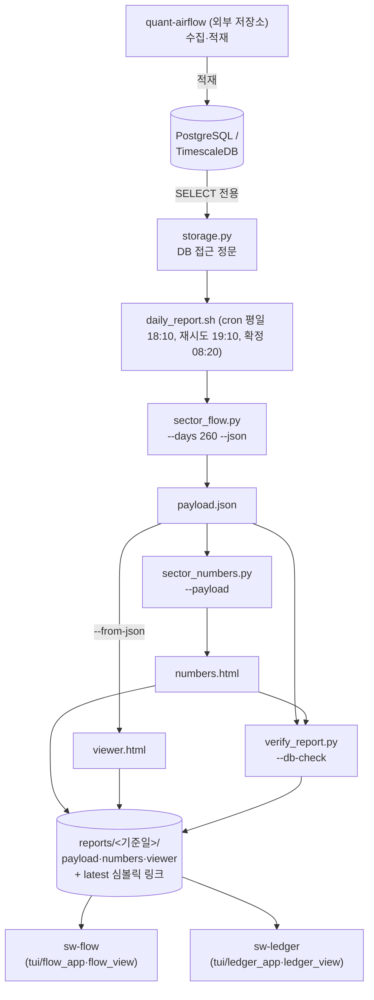

# sector-flow

**오늘 코스피·코스닥 어느 섹터에 누구의 돈이 들어왔는지를 터미널에서 본다.** 일일 배치가
수급 DB 에서 리포트 폴더를 만들고 저장 직후 스스로 검사한다. 화면은 그 폴더만 읽으므로 SSH 에서
바로 뜬다. 숫자는 동시기(同時期) 측정값이고, 돈이 들어온 섹터가 앞으로 오른다는 주장이 아니다([§8](#8-주의--이-숫자들은-예측이-아니다)).

[](https://github.com/younghwan91/sector-flow/actions/workflows/ci.yml)
[](https://www.python.org/)

## Quick start

```bash
uv sync
uv run sw-flow   --dir <리포트 폴더>          # 섹터 자금 흐름
uv run sw-ledger --dir <리포트 폴더>          # 자금 원장
```

**리포트 폴더가 있어야 뜬다.** 둘 중 하나로 구한다.

- 만들어 둔 폴더를 받는다. DB 가 필요 없다([§4.3](#43-리포트-폴더를-그대로-주고받는다)).
- 수급 DB 에 접속할 수 있으면 직접 만든다([§4.1](#41-리포트-만들기-db-필요)). 이 저장소에 샘플 데이터는 없다.

> **데이터 수집은 이 저장소에 없다.** 수급·시세 적재는
> [quant-airflow](https://github.com/younghwan91/quant-airflow) 의 몫이고, 여기서는 그 DB 를 읽기만 한다.

## 목차

- §1 [무엇을 하나](#1-무엇을-하나)
- §2 [구조](#2-구조)
- §3 [일일 배치 — 언제 무엇이 도나](#3-일일-배치--언제-무엇이-도나) · [장애 대응](#31-장애-대응)
- §4 [설치와 실행](#4-설치와-실행) · [리포트 폴더를 그대로 주고받는다](#43-리포트-폴더를-그대로-주고받는다) · [웹으로 보기](#44-웹으로-보기)
- §5 [화면 읽는 법](#5-화면-읽는-법) · [수급 관측 읽기 가이드](docs/trading-guide.md)
- §6 [자금 원장 — `sw-ledger`](#6-자금-원장--sw-ledger)
- §7 [숫자의 정의](#7-숫자의-정의)
- §8 [주의 — 이 숫자들은 예측이 아니다](#8-주의--이-숫자들은-예측이-아니다)
- §9 [리포트를 스스로 검증한다](#9-리포트를-스스로-검증한다)
- §10 [개발](#10-개발)
- §11 [문서](#11-문서)
- §12 [관련 프로젝트](#12-관련-프로젝트--오픈소스-퀀트-스택)

---

## 1. 무엇을 하나

| 명령 | 하는 일 | DB |
|---|---|---|
| `sw-flow` | 27개 섹터 × 4개 구간(5·20·60·120거래일) × 3개 시장 × 4개 주체의 순매매를 한 화면에. 기본 정렬은 금액이 아니라 **가속**(누적 순매수 ÷ 섹터 시총)이라 삼성전자가 있는 섹터가 자동으로 1등이 되지 않는다. `Enter` 로 섹터를 열면 그 흐름을 실제로 만든 종목이 보인다(실측: 전기/전자 386종목 중 7개가 80%) | 불요 |
| `sw-ledger` | 같은 리포트의 회계. 누가 얼마를 넘겼고 얼마가 미분류로 남았나를 원 금액과 잔여만으로. 섹터→섹터 이동 같은 식별 불가능한 그림은 그리지 않는다 | 불요 |
| `scripts/daily_report.sh` | DB 에서 리포트 폴더(`payload.json`·`numbers.html`·`viewer.html`·`VERIFY.txt`)를 만들고 저장 직후 자기 검증 | 읽기 전용 |

<!-- SCREENSHOT: 기본 20일 화면 (120×30) -->


*`sw-flow` 기본 화면(20거래일·전체 시장·기관, 120×30). 한 행이 한 섹터이고 가속 내림차순이다.
순매수 상위 열은 124칸, 순매도 상위 열은 148칸부터 나온다(§5.2).*

<!-- SCREENSHOT: Enter 드릴다운 종목 목록 (120×30) -->


*`Enter` 드릴다운(전기/전자, 20일). 누적[%] 열의 `-` 마커 위쪽 7개가 그 섹터를 실제로
움직인 종목이다. 나머지 379개는 스크롤할 0 이다.*

두 화면은 DB 에 접속하지 않는다. 일일 배치가 만들어 둔 리포트 파일만 읽으므로 SSH 에서 즉시
뜨고, 화면과 HTML 수치표가 같은 숫자를 본다. 표준 라이브러리 `curses` 만 쓴다.

## 2. 구조



```
src/sectorflow/
├── storage.py           # 읽기 전용 DB 접근 — 리포트가 쓰는 만큼만
└── tui/                 # sw-flow · sw-ledger
    ├── flow_view.py     #   렌더는 순수함수 — curses 없이 단위테스트한다
    ├── flow_app.py      #   curses 는 화면 그리기와 키 입력만
    ├── ledger_view.py   #   원장도 같은 규칙 — 폭 자르기·도움말 렌더러는 공용이다
    └── ledger_app.py
scripts/                 # daily_report.sh · sector_flow · sector_numbers · verify_report
                         # ledger_numbers · verify_merge
docs/                    # formulas.md · trading-guide.md · validation/
```

## 3. 일일 배치 — 언제 무엇이 도나

리포트 폴더는 [`scripts/daily_report.sh`](scripts/daily_report.sh) 가 만들고 크론이 같은 명령을 세 번 부른다(`deploy/crontab.simnode`).
리포트가 이미 있으면 기준일만 읽고 건너뛴다.

| 시각 | 하는 일 |
|---|---|
| 평일 18:10 | 수집이 끝났으면 리포트를 만들어 `latest` 로 건다 |
| 평일 19:10 | 18:10 에 못 만든 날을 다시 시도한다(수집이 18:47 까지 간 날이 있었다) |
| 화~토 08:20 | **확정 모드.** 새벽 `daily_finalize`(06:30~07:25)가 확정치를 덮은 것을 확인하면(`scripts/finalize_done.py`) 전날 리포트를 확정치로 다시 만든다 — 제목이 `마감·확정`. 확인이 안 되면 잠정 리포트를 두고 경고(75)로 끝난다. 아직 못 만든 날이면 마지막 기회이기도 하다 |
| 평일 20:30 | 신선도 점검(`scripts/freshness_check.py`). 오늘 수급이 왔는데 `latest` 가 오늘이 아니면 오류, 오늘 수급이 없으면 경고, 알림 웹훅이 비었으면 경고 |
| 5분마다 | 웹 서비스(§4.4)가 안 떠 있거나 `/healthz` 에 대답하지 않으면 다시 띄운다 |

리포트 배치는 40분(`timeout`), DB 문장 하나는 10분(`statement_timeout`), 접속은 10초에서 끊긴다. 두 실행이 겹치면
뒤의 것이 `reports/.report.lock` 을 못 잡고 경고로 물러난다.

**만들기 전에 완전성 관문을 본다**([`scripts/completeness_gate.py`](scripts/completeness_gate.py)). 시장별로 기준일의 수급 종목수와
시총 잡히는 종목수가 직전 5거래일 중앙값의 97% 이상이고 시총 합이 0 보다 커야 한다. 279거래일 실측 최저가 99.1% 여서 평소엔 안 막힌다.

| 폴더에 있는 것 | 뜻 | 화면 |
|---|---|---|
| `INCOMPLETE.txt` 만 | 수집 미완이라 안 만들었다. `latest` 는 전날에 머물고, 다음 크론이 성공하면 폴더가 바뀐다 | 전날 리포트 제목에 `⚠ MM-DD 수집 미완` |
| `VERIFY_FAILED.txt` | 만들었지만 검사에 걸렸다(§9). 다음 시도가 다시 만들어 본다 | 화면 제목에 `⚠ 검증 실패`, HTML 맨 위에 경고 |

종료코드가 75 면 경고, 그 밖 비정상이면 오류로 [`scripts/cron_run.sh`](scripts/cron_run.sh) 가 알림을 보낸다(124 는 시간 초과로 따로 부른다). 기준일이 오늘이 아닌데 아직 미완이면 75 가 아니라 1 로 끝난다.

제목의 `마감·잠정` 은 수집 창이 지난 뒤 그날 잠정값으로 만든 리포트, `마감·확정` 은 다음날 아침 확정치로 다시 만든 리포트다. 잠정 리포트의 G 는 확정치에서 자주 바뀐다(2026-11-08 검증: 게시본과 확정치의 G 순위가 크게 갈린 날이 37%).

### 3.1 장애 대응

알림 제목은 `<작업> 실패 (rc=N)`·`<작업> 경고 (rc=75)`·`<작업> 시간 초과 (rc=124)` 이고 본문은 로그 꼬리 30줄이다.
작업은 `sector-flow-report`(리포트)·`sector-flow-fresh`(신선도)·`sector-flow-web`(웹)이고 아래 표에서는 앞의 `sector-flow-` 를 뗐다. 명령은 저장소 루트
(`~/git/sector-flow`)에서 친다. 기록은 `reports/cron.log`, 웹은 `reports/serve.log`.

| 알림·증상 | 원인 | 할 일 |
|---|---|---|
| `report 경고 (rc=75)`, 본문 `수집 미완` | 오늘 수집이 아직 안 끝났다. 폴더에 `INCOMPLETE.txt`, `latest` 는 전날 | 기다린다 — 19:10·다음날 08:20 이 다시 만든다. 수집이 끝났으면 `scripts/daily_report.sh` |
| `report 실패 (rc=1)`, 본문 `오늘이 아닌데 수집 미완` | 지난 기준일이 아직 미완이다. 다음 거래일 수집이 시작되면 기준일이 넘어가 그 날은 영영 안 만들어진다 | quant-airflow 에서 수집을 메운 뒤 바로 `scripts/daily_report.sh` |
| `report 실패 (rc=1)`, 본문 `검증 실패` · 폴더에 `VERIFY_FAILED.txt` | 게시는 됐지만 자기 검증(§9)에 걸렸다. 화면·HTML 에 ⚠ | `grep FAIL reports/latest/VERIFY_FAILED.txt` 로 걸린 검사를 본다. 원인을 고친 뒤 `scripts/daily_report.sh`(검증 실패 폴더는 다시 만든다. 확정 리포트는 확정으로 남는다) |
| `report 실패 (rc=1)`, 본문 `DB 에서 기준일을 못 읽었다` · `report 시간 초과 (rc=124)` · 본문 `statement timeout` | DB 서버가 죽었거나 접속정보가 틀렸거나 락에 걸렸다 | quant-airflow 의 TimescaleDB 를 살핀다. 접속 확인: `set -a; . ~/git/quant-airflow/.env; set +a; uv run --extra pg python -c "import os; from sectorflow.storage import connect; connect(os.environ['KR_QUANT_DB']).close(); print('ok')"`. 복구 뒤 `scripts/daily_report.sh` |
| `report 경고 (rc=75)` 08:20, 본문 `확정치를 확인하지 못했다` | `daily_finalize` 가 실패·지연됐거나 Airflow 로그 경로가 바뀌었다. 본문의 `[확정치]` 줄이 어느 쪽인지 말한다 | `uv run python scripts/finalize_done.py --asof <기준일>` 로 이유를 본다. 확정이 끝났으면 `KR_QUANT_FINAL=1 scripts/daily_report.sh`. 경로가 바뀌었으면 `finalize_done.py` 의 경로 규칙을 고친다 |
| `report 경고 (rc=75)`, 본문 `다른 리포트 실행이 돌고 있다` | 손으로 돌린 실행과 크론이 겹쳤다 | 앞 실행이 끝난 뒤 필요하면 같은 명령을 다시 |
| `fresh 실패 (rc=1)`, 본문 `오늘 리포트가 안 걸렸다` | 수급은 들어왔는데 리포트가 없다. 크론 줄이 빠졌거나 배포가 깨졌거나 관문이 막았다 | `grep "$(date +%F)" reports/cron.log`, `crontab -l \| grep sector-flow`. 고친 뒤 `scripts/daily_report.sh` |
| `fresh 경고 (rc=75)`, 본문 `supply_demand 가 비었다` | 휴장일이거나 수집이 실패했다(달력이 없어 못 가른다) | 휴장일이면 무시한다. 아니면 quant-airflow `daily_collection` 을 본다 |
| `fresh 경고 (rc=75)`, 본문 `ALERT_WEBHOOK_URL 이 비었다`(평일마다) | 알림 웹훅이 없어 위의 모든 알림이 로그에만 남는다 | 웹훅을 만들어 `~/git/quant-airflow/.env` 의 `ALERT_WEBHOOK_URL=` 에 넣는다 |
| `web 실패 (rc=1)` · 웹이 안 열린다 | Tailscale 이 없거나 포트가 막힌 채 한 시간이 지났다(`reports/.serve.misses` 가 센다). 서버가 죽었다(rc 가 서버 종료코드) | `tail reports/serve.log`, `tailscale ip -4`, `ss -ltnp \| grep 8765`. 손으로 띄우려면 `scripts/serve.sh`. 대답 없는 서버는 크론이 5분 안에 끄고 다시 띄운다 |
| 고친 코드가 다음날에도 안 돈다 · `morning-sync` 알림에 `hold sector-flow` | 07:50 `pull-all --ci-gate` 가 CI 가 초록이 아닌 커밋을 받지 않았다 | GitHub Actions 를 초록으로 고친다. 확인했고 당장 필요하면 `git -C ~/git/sector-flow pull --ff-only` |

## 4. 설치와 실행

**요구사항:** Python 3.11 이상, [uv](https://docs.astral.sh/uv/), 리눅스·macOS 터미널(`curses` 를 쓴다).
설치는 `uv sync` 한 줄이다. DB 없이 화면만 보려면(§4.3) 그걸로 끝이다. 리포트를 직접 만들려면(§4.1)
PostgreSQL/TimescaleDB 접속정보가 필요하다. `cp .env.example .env` 뒤 `KR_QUANT_DB` 를 채운다.
옆자리에 quant-airflow 체크아웃이 있으면 그 `.env` 를 불러 쓰므로 이 단계가 필요 없다.

### 4.1 리포트 만들기 (DB 필요)

화면은 리포트를 읽을 뿐이라 먼저 리포트가 있어야 한다. 배치 한 줄이 전부고 cron 에 그대로 건다.

```bash
scripts/daily_report.sh                      # <저장소>/reports/<기준일> + latest 링크 (KR_QUANT_REPORTS 로 변경)
KR_QUANT_FORCE=1 scripts/daily_report.sh     # 같은 기준일이어도 다시 만든다 (약 5~6분)
```

폴더 이름은 데이터 기준일(`supply_demand` 의 `MAX(date)`)이다. 휴장일에 돌면 이미 있는 폴더를
보고 건너뛴다. 그 건너뛰기 때문에 리포트 형식이 바뀌어도 다음 거래일까지 옛 리포트가 그대로
뜨고(새 열이 통째로 `—`, 제목에 `옛 리포트(새 열 없음)`), 그럴 때 문을 여는 것이 `KR_QUANT_FORCE` 다.
옆에 새로 지어 마지막에 바꿔 끼우므로 도중에 실패해도 옛 리포트는 남는다.

배치가 하는 일을 손으로 풀면 이렇다. 페이로드는 한 번만 만들고 수치표·뷰어가 공유한다.

```bash
set -a; . ./.env; set +a      # 손으로 돌릴 때는 접속정보를 직접 불러온다
uv run --extra pg python scripts/sector_flow.py --days 260 --json payload.json
uv run python scripts/sector_flow.py    --from-json payload.json --html viewer.html
uv run python scripts/sector_numbers.py --payload payload.json --html numbers.html
uv run --extra pg python scripts/verify_report.py --dir <리포트폴더> --db-check
```

### 4.2 화면 띄우기 (DB 불요)

```bash
uv run sw-flow                          # <저장소>/reports/latest 를 연다
uv run sw-flow --dir <리포트 폴더>       # 특정 날짜의 리포트
uv run sw-ledger                        # 자금 원장 (§6)
uv run sw-ledger --dump --width 100     # 색 없는 평문 — 파이프·리다이렉트용
```

새 의존성이 없고 40×10 짜리 창에서도 산다. 폭이 모자라면 열이 경계에서 통째로 빠진다(숫자가
자릿수 중간에서 잘려 다른 값처럼 보이지 않게). 원장 표만은 예외로 71칸 미만이면 아예 안 그리고
그 사실을 적는다. 4주체와 잔여가 한 덩어리라 일부만 보여주면 회계 항등식이 깨진 것처럼 읽힌다.
`NO_COLOR` 를 존중한다.

### 4.3 리포트 폴더를 그대로 주고받는다

**받는 쪽에는 DB 도 수집 파이프라인도 필요 없다.** 데이터는 계정이나 접속정보 없이 폴더 하나
단위로 오간다. 만드는 쪽이 `scripts/daily_report.sh` 로 폴더를 만들고 그 폴더를 보낸다.

```bash
# 보내는 쪽 — 폴더째 압축 (2026-09-01 기준 약 1.9 MB)
tar czf sector-flow-2026-09-01.tar.gz -C <저장소>/reports 2026-09-01

# 받는 쪽 — 풀고 --dir 로 연다. 설치는 clone + uv sync 까지만 하면 된다
mkdir -p ~/reports && tar xzf sector-flow-2026-09-01.tar.gz -C ~/reports
uv run sw-flow   --dir ~/reports/2026-09-01
uv run sw-ledger --dir ~/reports/2026-09-01
mkdir -p <저장소>/reports && ln -sfn ~/reports/2026-09-01 <저장소>/reports/latest    # 이제 --dir 없이 뜬다
```

어떤 화면이 어떤 파일을 읽는지는 다르다. 하나만 보내면 다른 하나가 안 뜬다.

| 파일 | 크기 | 없으면 |
|---|---|---|
| `numbers.html` | 2.0 MB | `sw-flow` 가 안 뜬다 (`리포트를 찾을 수 없다`). 브라우저로 열면 수치표 자체가 된다 |
| `payload.json` | 2.9 MB | `sw-ledger` 가 안 뜬다 (`페이로드를 찾을 수 없다`) |
| `viewer.html` | 2.9 MB | 브라우저용 차트 뷰어. 터미널 화면 둘은 이것 없이도 뜬다 |
| `VERIFY.txt` | 11 KB | 검증 결과(§9). 없어도 화면은 뜨지만 받은 숫자가 검사를 통과했는지 알 길이 없다 |

⚠️ `VERIFY_FAILED.txt` 가 같이 들어 있으면 **그 리포트는 검사에 걸린 것이다.** 파일을 지우고
보내지 마라. 받는 쪽이 알아야 할 사실이다.

**받은 폴더는 그날의 사진이다.** 화면 제목의 날짜(`2026-09-01 마감·잠정`)가 그 사실을 늘 적고,
기준일이 4일 넘게 지나면 화면과 HTML 이 `⚠ N일 지난 리포트` 로 말한다.
매일 보려면 매일 받거나, 만드는 쪽 서버에 SSH 로 들어가 거기서 `sw-flow` 를 띄우는 편이 낫다.
두 화면이 `curses` 만 쓰는 이유가 그것이다.

### 4.4 웹으로 보기

만드는 쪽 서버가 리포트를 웹으로도 연다. 폰·PC 브라우저에서 Tailscale 로 들어간다.

```
http://<서버의 Tailscale 주소>:8765/                    # 기준일 목록 — 최신·검증 실패·수집 미완 표시
http://<서버의 Tailscale 주소>:8765/latest/numbers.html  # 즐겨찾기용 — 늘 최신 수치표로 넘어간다
http://<서버의 Tailscale 주소>:8765/latest/viewer.html   #            — 늘 최신 흐름 뷰어로 넘어간다
```

[`scripts/serve_reports.py`](scripts/serve_reports.py) 는 표준 라이브러리만 쓰는 읽기 전용 서버다. 두 HTML 과 검증 기록만
내보낸다(`payload.json`·`cron.log` 는 안 나간다). 크론이 5분마다 [`scripts/serve.sh`](scripts/serve.sh) 를 불러 안 떠 있으면 띄우므로
재부팅·배포 뒤에도 5분 안에 돌아온다. 주소는 Tailscale 에만 묶는다(집 LAN 에는 안 열린다). 기록은 `reports/serve.log`.

손으로 띄우려면 `scripts/serve.sh`(Tailscale 주소), 이 컴퓨터에서만 보려면 `python3 scripts/serve_reports.py`(127.0.0.1).

## 5. 화면 읽는 법

> 열의 뜻은 아래에 있다. 누가 어디서 사고팔았나를 어떤 순서로 읽는지는
> [수급 관측 읽기 가이드](docs/trading-guide.md) 를 보라. 고르는 법은 말하지 않는다 — 검정 결과
> 그럴 근거가 화면에 없다([§8](#8-주의--이-숫자들은-예측이-아니다)).

### 5.1 키

| 키 | 하는 일 |
|---|---|
| `↑` `↓` `j` `k` | 한 줄 이동. `g`·Home 처음 · `G`·End 끝 · PgUp/PgDn 한 화면 |
| `Enter` `l` `→` | 그 섹터의 전 종목 보기(드릴다운) |
| `h` `←` `Esc` | 드릴다운에서 나가기 |
| `w` `W` | 구간 5 · 20 · 60 · 120(탐색 모드에서는 종합까지). 대문자는 역방향 |
| `m` `M` | 시장 전체 · 거래소 · 코스닥 |
| `a` `A` | 주체 기관 · 외국인 · 개인 · 기타법인 |
| `s` `S` | 정렬 열 바꾸기. 드릴다운에서는 종목 정렬 |
| `r` | 정렬 역순. 순매도 상위(가장 많이 판 쪽)를 보려면 이걸 켠다 |
| `e` | 탐색 모드 켜기/끄기 — G·종목 선정·종합·전 종목(곱)을 보인다. 기본은 꺼짐이고, 켜 있는 동안 제목 줄 맨 앞에 `[탐색 — 검정 결과 앞날 증거 없음(G 판정 불가)]` 가 붙는다 |
| `t` | 탐색 모드에서만 — 전 종목 화면(전 섹터의 종목을 곱 = 섹터G×종목선정 순으로). `t`·`h`·`←`·`Esc` 로 돌아온다 |
| `?` `F1` | 도움말 — 모든 열의 뜻과 계산식이 여기 있다 |
| `q` | 종료. 도움말 안에서는 닫기만 한다 |

`sw-flow` 를 띄우면 먼저 **오늘의 수급**(사실 요약)이 뜬다 — 시장 4주체 합계(최근 5일, 1일 값이 있으면 1일), 기관·투신+연기금 20일 순매수 상·하위 3개 섹터, 1년%ile 이 직전 리포트 대비 새로 ≥95·≤5 에 든 섹터, 최근 5일 부호가 직전 15일과 반대인 섹터(전 섹터). 점수·순위·추천은 없다. 아무 키나 누르면 표로 넘어가고, `q` 는 바로 끝내며 `?` 는 도움말을 연다.
구간·시장·주체를 바꿔도 커서는 보던 섹터에 머문다. 정렬(`s`)만 맨 위로 간다.

한영 상태에서도 위 키가 그대로 듣는다(두벌식 자리를 그대로 대응시킨다: `ㅈ`→`w`,
`ㅡ`→`m`, `ㅁ`→`a`, `ㄴ`→`s`, `ㄱ`→`r`). 다만 두벌식은 이 자리들에서 Shift 를 구분하지
않으므로 대문자 역방향은 `W`·`R` 만 되고 `A`·`S`·`G`·`M` 은 원리적으로 못 받는다
(끝으로 가려면 End). `sw-ledger` 도 같다.

도움말(`?`)이 원본이고 이 README 가 그 축약본이다. 열 하나하나의 정의와 한계가
화면 안에 있어서, 리포트를 보다가 이 숫자가 뭐냐고 물을 자리에 답이 있다.
`sw-ledger` 도 같은 렌더러로 자기 도움말을 그린다.

### 5.2 섹터 표의 열

화면에 나오는 왼쪽부터의 순서다. 폭이 모자라면 오른쪽 열부터 통째로 빠지므로
좁은 터미널에서는 아래 표의 뒤쪽이 없다. 실측한 등장 문턱(터미널 칸, 기본 모드): 1년 49 · 추이 58 ·
수익률 69 · 미실현 80 · 풀림 93 · 순매수상위 117 · 순매도상위 141 · 포텐셜 154 · dW/dt 167 ·
투신+연금5일 184 · 종목[수] 193. 탐색 모드는 풀림 뒤에 G 가 서서(100) 그 뒤가 7칸씩 밀린다.
앞의 넷(섹터·마커·가속·임펄스)은 40칸에서도 남는다. 열마다 증거 표지는 §8 표에 있다.

| 열 | 뜻 |
|---|---|
| 섹터 | 벤더 분류(`stocks.sector`) 27개. KRX 업종 분류와 다르다 |
| (마커) | 섹터 이름 오른쪽의 `~` 는 거래된 종목 10개 미만 — 회색으로 죽이고 정렬과 무관하게 맨 아래로 보낸다(분모가 작아 가속이 쉽게 튄다). 벤더 분류가 좁아 사실상 단일종목인 라벨이 있다(부동산 3, 출판/매체복제 2). 탐색 모드에서는 `*` 가 G 관문 통과(a>0·x>0·ẍ>0)를 표시한다 |
| 가속[%p] | 임펄스 ÷ 구간말 섹터 시총 × 100. 물리로 a = F/m. 기본 정렬 열이다 |
| 임펄스[억] | 구간 누적 순매수 = Σ(순매매 수량 × 그날 종가) |
| 1년[%ile] | 그 주체의 롤링 N일 순매수 합이 최근 1년 분포에서 몇 등인가. 100=1년 최대 매수. 이 표에서 유일한 시계열 맥락이다(나머지는 전부 27개 섹터 사이의 상대순위) |
| 추이[8] | 구간 동안 순매수가 누적된 경로. 오른쪽으로 올라가면 계속 들어오는 중. 높이는 그 행 안에서만 정규화돼 행끼리 비교되지 않는다 |
| 수익률[%] | 그 섹터 자체 바구니의 구간 수익률, 전일 시총 가중. KRX 업종지수가 아니다 |
| 미실현[%p] | (k×가속 + b) − 실제 수익률. `+` 는 적합선 대비 덜 오른 폭(섹터 20일 반전과 ρ 0.82~0.93), `−` 는 더 오른 폭. OLS 잔차의 부호 반전이라 적합 섹터의 합이 0 인 상대 지표다 |
| 풀림[%p/일²] | 미실현이 해소되는 가속(ẍ). 구간을 셋으로 갈라 중앙차분한다. 2차 차분이라 짧은 구간에서 흔들린다 |
| G[0~1] | **탐색 모드에서만.** 관문(얇지 않고·가속>0·미실현>0·풀림>0)을 다 통과한 섹터들 사이의 순위 평균. 하나라도 어기면 `—`, 통과가 하나뿐이면 0.5. 검정함 — 판정 불가(검정력 없음) |
| 순매수/순매도상위[억] | 그 섹터에서 가장 많이 산/판 종목과 금액. 표는 1개씩이고 하단 패널은 3개씩으로, 같은 목록의 위/아래 끝이다 |
| 포텐셜[½kx²] | ½·k·x². k 가 블록당 상수라 k>0 인 블록에서만 \|미실현\| 의 순증가 변환이다(순위가 같다). **k ≤ 0 인 블록에서는 이 열이 통째로 `—` 다** — 그런 블록에서는 포텐셜 큰 순이 \|미실현\| 의 정반대 순서가 된다. 그날 블록의 k·t 는 화면 헤더 줄에 있다 |
| dW/dt[%p/일] | 구간을 반으로 갈라 본 W=가속×수익률 의 전·후반 차를 거래일로 나눈 값 |
| 투신+연금5일[억] | 그 섹터 종목들의 **최근 5일** 투신+연기금 순매수 합. 표의 임펄스는 현재 구간 누적이라 "지금도 들어오나" 를 말하지 않는다 |
| 종목[수] | 그 (시장,섹터)에서 이 구간에 거래된 종목 수. `Enter` 로 여는 목록의 길이와 정확히 같다. 상장 종목 수와는 다르다: 벤더 마스터에는 수급 보고가 두 달 전에 끊긴 이름이 남아 있어, 그걸 세면 표가 387 이라 하고 목록은 386 개가 된다(실측). 오른쪽 끝 열이다 |

`순매수상위`·`순매도상위` 는 **선택한 주체**가 그 섹터에서 가장 많이 산/판 종목이다(금액 순). 웹 뷰어의 섹터 이름 아래 종목도 같은 규칙이다.

표 아래 패널은 선택한 섹터를 세 줄로 푼다.

- **제목** — `부동산 · 종목 3개 · Enter 로 전체`.
- **4주체 순매수** — `개인 -116 · 외국인 -80 · 기관 +214 · 기타법인 -21 [억]`. 화면은
  한 번에 한 주체만 보여주지만 4주체 합이 0 에 닫히므로, 지금 고른 주체가 판(또는 산)
  돈을 누가 받았는지가 이 줄에 다 있다. 잔여(= −Σ4주체)는 여기 안 적고 `sw-ledger` 가
  별도 열로 맡는다. 종합 구간에서는 줄 끝에 `· 20일 기준` 이 붙는다.
- **순매수 상위 / 순매도 상위** — 각각 3개씩. 표의 같은 열이 1개씩만 보여주던 목록의
  위·아래 끝이다.

그 아래 힌트바는 지금 정렬한 열 하나의 정의를 한 줄로 적는다. 분자·분모와 단위까지만
이고, 비유와 한계는 `?` 의 일이다.

### 5.3 종목 목록의 열 (`Enter`)

제목 줄이 먼저 `전기/전자 · 종목 386개 · 20일 기준 · 정렬[순매수]` 라고 어느 섹터·몇
종목·어느 창·어느 정렬인지 적는다. 그 아래 열은 왼쪽부터 이 순서다.

| 열 | 뜻 | 등장 문턱(칸) |
|---|---|---:|
| 종목 | 종목명. 첫 열이라 잘려도 남는다 | 20 |
| 코드 | 6자리 코드 | 22 |
| 선정[0~1] | **탐색 모드에서만**(그때 코드 오른쪽에 선다 — 그 뒤 열 문턱이 5칸씩 밀린다). 이 섹터 안 종목들 사이의 순위 평균으로 섹터 G 와 다른 층이다. 관문(누적 80% 안·순매수>0·투신≥0 이고 연기금≥0·거래대금≥100억·최근집중·상대수익·참여율이 다 있을 것)을 하나라도 어기면 `—` 이고, 후보가 하나뿐이면 점수가 없다(5일 창에는 하나도 없다). rank(투신+연기금) 축은 검정 부호와 **반대**다(§8) | 27 |
| 순매수[억] | 그 구간 선택된 주체의 순매수. 기본 정렬은 이것의 절댓값 순이다. 많이 산 종목과 많이 판 종목이 같이 위로 온다 | 36 |
| 누적[%] | \|순매수\| 큰 순으로 훑을 때의 누적 기여율. 바로 옆 1칸 열의 `-` 마커가 80% 지점이고 그 위가 이 섹터를 움직인 종목이다. 순매수 정렬에서만 채운다. 시총·이름 순의 누적은 뜻이 없다 | 45 |
| 투신[억] | 그 구간 투신(자산운용)의 순매수. 선택 주체와 무관하게 늘 기관 세부다 | 56 |
| 연기금[억] | 그 구간 연기금(국민연금 등)의 순매수 | 67 |
| 상대수익[%p] | 종목 구간수익률 − 섹터 구간수익률. 기준선은 섹터 표의 `수익률[%]` 열과 같은 값이다. 섹터의 미실현(x)을 종목에 내리지 않는다. 그 k·b 는 27개 섹터 횡단면에서 적합된 것이지 2,645종목 위에서 적합된 적이 없다. 뺄셈이 회귀 없이 같은 질문에 답한다 | 80 |
| 최근집중[%] | 5일 순매수 ÷ 이 창의 순매수 × 100. 20일 화면에서 ≈25 면 고르게 분산 · ≈100 이면 20일치가 최근 5일에 몰림 · >100 이면 앞에서는 팔다 최근에 방향을 튼 것 · 음수면 최근 5일이 구간 전체와 반대 방향. 세 자리에서 비운다: 분모 1억 미만 · 5일 창(분자=분모라 늘 100) · 그 목록 Σ\|순매수\| 의 0.5% 미만인 줄(볼 이유가 없는 줄이 화면에서 가장 큰 숫자를 달던 자리다). ±999 를 넘으면 `>999`·`<-999` 로 적는다 | 92 |
| 참여율[%] | 순매수 ÷ 그 종목 거래대금 × 100. 얼마나 붐볐나를 재는 값이 아니라 그 거래의 몇 %가 한 방향이었나를 재는 값이다 | 116 |
| 거래대금[억] | 참여율의 분모. 참여율과 한 짝이라 같이 남거나 같이 빠진다(아래) | 116 |
| 시총대비[%p] | 순매수 ÷ 그 종목 시총 × 100. 시총 작은 스팩이 위로 올라온다 | 129 |
| 시총[억] | 시총대비의 분모 | 143 |

**투신·연기금이 왜 따로 있나.** 기관 총액이 같아도 이 둘이 채운 것과 금투(증권사
자기매매라 헤지·차익이 섞여 방향성이 약하다)가 채운 것은 다른 이야기인데, `기관` 한
덩어리에는 그 구분이 없다. 실측 20거래일: SK하이닉스 기관 −13,157억인데 투신 +1,549 ·
연기금 +4,614 · 금투 −22,611 이다. 총액만 보면 파는 쪽이지만 이 둘은 사고 있었다.

#### 열 순서가 곧 읽는 순서다

위 다섯 덩어리는 화면에서 실제로 훑는 순서와 같다. 각 단계는 **사실을 하나씩 더 묻는 것**이지
거르는 관문이 아니다(종목 단위 수급의 앞날 관계는 §8).

1. **순매수 · 누적** — 순매수 순으로 열고 `-` 마커(누적 80%) 위만 본다. 전기/전자는
   386종목 중 7개다. 아래는 스크롤할 0 이다.
2. **투신 · 연기금** — 자금의 성격을 거른다. 그 7개가 투신·연기금이 채운 것인지
   금투가 채운 것인지로 같은 금액이 다른 이야기가 된다.
3. **최근집중** — 언제. 20일치가 고르게 들어왔나(≈25), 최근 5일에 몰렸나(≈100),
   앞에서 팔다 방향을 틀었나(>100).
4. **상대수익** — 가격이 섹터와 같이 움직였나. 섹터보다 더 올랐나 덜 올랐나.
5. **참여율 + 거래대금** — 그 거래의 몇 %가 한 방향이었고, 그 종목의 거래 규모는 얼마인가.

⚠️ **참여율은 혼자 두면 안 된다.** 비율이라 유동성을 못 말한다. 실측(2026-08-28, 20일)
참여율 11~14% 구간에 DB금융스팩12호(20일 거래대금 3억)와 삼성SDI(43,543억)가 같이
있다. 유동성이 1만 배 넘게 다른데 화면에는 같은 숫자만 남는다. 참여율만 보고 기관이
장악했다고 읽으면 살 수 없는 종목이 상단에 섞인다. 그래서 두 열은 `COL_PAIRS` 로
묶여 통째로 남거나 통째로 빠진다. 폭이 모자라 거래대금이 떨어지면 참여율도 같이
사라진다. 덜 보여주자는 게 아니라 틀리게 읽힐 칸을 안 만든다는 규칙이다.

**`종합` 에서 `Enter` 로 들어간 종목 목록은 20일 기준이다.** 종합은 세 창을 섞은
축이라 이 종목이 얼마를 샀나가 한 값으로 정의되지 않는다. 그래서 드릴다운은 20일
창의 금액을 쓰고, 제목도 `20일 기준(종합)` 이라 적는다(`flow_view.py` 의
`State.COMBINED_WIN = "20"`). 60·120일 금액을 보려면 `w` 로
그 구간에 들어간 뒤 `Enter` 를 눌러라. 종합 화면의 상세 패널도 같은 이유로 4주체 줄
끝에 `· 20일 기준` 을 달고 있다.

### 5.4 `종합` 구간

**탐색 모드(`e`)에서만** `w` 로 끝까지 돌리면 나오는 `종합` 은 20·60·120일 가운데 G 가 나온 창을 섞어,
**관문을 통과한 창의 G 만** 평균낸 화면이다. 그래서 1/3 통과가 3/3 통과보다 위에 올 수 있고,
`통과[구간]` 열(n/m)을 같이 봐야 한다. 5일 창은 빠진다. 풀림(ẍ)이 구간을 셋으로 갈라 중앙차분하는데 9거래일
미만에서는 계산되지 않고, G 가 그 ẍ 순위를 포함하기 때문이다.

<!-- SCREENSHOT: 종합 구간 (120×30) -->
![종합 구간 화면. 헤더가 정렬없음[G 순] · 구간 20·60·120일 등가중 이라 적혀 있고,
섹터마다 종합 G 와 20일·60일·120일 각각의 G, 세 조건을 만족한 창의 수(통과[구간]),
종목 수만 있는 좁은 표.](docs/images/kqflow-combined.png)

*`종합` 화면(탐색 모드). 열이 G 뿐이다 — 금액·수익률은 개별 구간 화면이 답한다. G 는 검정 결과
판정 불가(§8)라 기본 화면에서 뺐다.*

**이 화면에는 정렬이 없다.** `종합 G` 내림차순 고정이고 `s`·`r` 은 듣지 않는다.
화면도 그렇게 말한다. 헤더가 `정렬[가속▼]` 대신 `정렬없음[G 순]` 이라 적고 방향
화살표를 아예 안 그리며, 힌트바 자리에는 `종합 화면은 구간별 G 를 나란히 볼 뿐,
정렬·역순이 없다` 가 뜬다. 창마다 정렬 축이 달라지면 세 창을 나란히 본다는 이 화면의
용도가 무너지기 때문이다. 금액·수익률로 줄을 세우려면 `w` 로 개별 구간에 들어가라.

## 6. 자금 원장 — `sw-ledger`

`sw-flow` 가 섹터의 동역학(임펄스·가속·포텐셜)을 보여준다면, `sw-ledger` 는 회계를
보여준다. 누가 얼마를 넘겼고 얼마가 미분류로 남았나. 파생 지표 없이 원 금액과 잔여만 있다.

관측되는 것은 (날짜, 시장, 섹터, 주체)의 순매수 금액뿐이다. 4주체 합이 0 이라는 회계
항등식이 누가 누구에게 팔았나를 주체 수준에서 준다(잔차/거래대금 0.0076%). 그래서 그리는
것은 주체 ↔ 섹터 이분 그래프이고 간선 하나하나가 실측이다.

세 가지를 그리지 않는다.

| 안 그리는 것 | 이유 |
|---|---|
| 섹터 → 섹터 이동 | 돈에 꼬리표가 없다. 같은 날 A 에서 −1,000억 · B 에서 +1,000억 이어도 같은 돈이라는 증거가 없다 |
| 주체 → 주체 이전 | 주변합이 독립 3식인데 쌍별 이전량은 6개다. 해공간이 3차원 남는 미식별이다 |
| 잔차를 4주체에 안분 | 안분하면 측정되지 않은 주체가 측정된 주체의 옷을 입는다. `잔여 = −Σ4주체` 를 별도 열로 남긴다 |

첫 번째는 원론에 더해 실측이 전제를 부정한다. 섹터쌍 순매수 상관에서 음수 쌍의 비율을
시장 3 × 구간 4 = 12조합 전수로 잰 범위다(2026-09-01, β제거 끈 상태).

| 주체 | 관측(12조합 전수) | 순환이동 널 |
|---|---:|---:|
| 개인 · 기관 · 외국인 | 3 ~ 42% (2026-09-01 페이로드) | 50% |
| 기타법인 | 42 ~ 52% | 50% |

**개인·기관·외국인에서는 섹터가 서로 반대가 아니라 같이 움직인다.** 반대로 간 쌍이 우연보다
드물다. 공통요인(위험선호)이 지배한다는 뜻이고, 로테이션을 전제한 산키 다이어그램은
그 셋에 대해 없는 현상을 그리는 셈이다. 기타법인 42~52% 는 널 50% 와 구분되지 않아 어느
방향으로도 말할 것이 없다.

`sw-ledger` 의 `한계` 화면은 이 표를 외워 적지 않고 **연 리포트에서 다시 잰다** — 그래서 날마다
범위가 조금씩 다르다(예: 2026-11-06 3~40%). **범위에는 조건이 붙는다.** 화면에서 `d` 로 β제거를 켜면 같은 12조합에서 셋도 17~54%
가 되어 널(49~52%)과 구분되지 않는 조합이 생긴다. 그래서 화면은 숫자를 외우게 하지
않고 고른 주체·구간에 대해 상단 판정줄이 그때그때 답한다.

이 실측은 문서에 적어두는 대신 [`scripts/ledger_numbers.py`](scripts/ledger_numbers.py) 로
재현한다. 숫자가 바뀌면 설계도 다시 봐야 하기 때문이다. 한계는 각주로 밀지 않고 모든
화면 최하단에 상주하는 한 줄로 둔다.

<!-- SCREENSHOT: sw-ledger 원장 화면 (120×30) -->


*`sw-ledger` 원장 화면(20거래일·전체 시장·개인, 120×30). `sw-flow` 와 배색·여백·푸터·
힌트바·제목 강조를 공유하고, 도움말도 같은 렌더러가 그린다. `잔여몫`·`최대일몫` 은
분모(구간 gross)가 1억 미만이면 값을 안 낸다. 4주체가 서로 상쇄돼 분모가 0 근처로
내려가면 비율이 폭발해 `최대일몫 33.3!` 같은 뜻 없는 값이 뜬다. `종목[수]` 는
`sw-flow` 와 같은 정의(그 구간에 거래된 종목 수)다. `v` 로 원장 · 전개 · 동시성 ·
한계 네 화면을 돈다. 위 상관표는 `동시성` 화면이고, `d` 가 거기서 β제거를 켠다.*

## 7. 숫자의 정의

시장 관측량을 물리량에 대응시켜 정의한다. 차원을 맞추면 금액의 크기와 밀린 폭이
갈라지고, 임펄스 대신 가속을 쓰게 강제된다. 금액만 쓰면 사이즈 팩터를 잡는다.

| 기호 | 정의 | 단위 |
|---|---|---|
| m (질량) | 구간말 섹터 시가총액 = 원 종가 × 그날 상장주식수(분할·병합·감자 뒤 다시 센다) | 억원 |
| F (외력) | 그날 주체별 순매매 수량 × 종가 | 억원 |
| J (임펄스) | ∫F dt, 구간 누적 순매수 | 억원 |
| a (가속) | J / m × 100. 화면·웹 모두 `가속[%p]` | %p |
| Δv (속도 변화) | 그 섹터 자체 바구니의 구간 수익률, 전일 시총 가중. 종목 수익률은 조정 종가 비(`daily_bars_adjusted`) | % |
| k (강성) | 그 블록 횡단면에서 a → Δv 로 적합한 절편 포함 OLS 기울기. 10종목 미만 섹터는 적합에서 뺀다 | %/%p |
| x (미실현 변위) | (k·a + b) − Δv, 곧 적합선 대비 덜 오른 폭(섹터 20일 반전과 ρ 0.82~0.93) | %p |
| U (포텐셜) | ½·k·x² | — |
| dW/dt (일률) | 구간을 반으로 갈라 W = a·Δv 의 변화 | %p/일 |
| ẋ, ẍ (풀림 속도·가속도) | 구간을 셋으로 갈라 x 를 중앙차분(부호 반전) | %p/일, %p/일² |
| G (관문 점수, 탐색 모드) | a·x·ẍ 가 모두 양수인(10종목 이상) 섹터끼리 매긴 세 순위의 평균. 그런 섹터가 하나뿐이면 0.5. `G 통과` = 관문 통과(`*`), `종합 G` = 통과한 창만의 G 평균 | 0~1 |

정확한 수식은 [`docs/formulas.md`](docs/formulas.md) 가 정본이다. 식마다 계산하는 코드 위치와
지표별 근거 수준(앞날 수익률에 대해 검증된 것이 있나)을 같이 적었다. 물리 용어는 비유일 뿐
성립하는 운동방정식이 아니다.

## 8. 주의 — 이 숫자들은 예측이 아니다

**한계를 지표와 같이 싣는다.** 화면의 도움말(`?`)에는 열마다 아래 표지가 `증거` 줄로 붙고,
웹 두 장은 열 이름 아래와 범례에 같은 표지를 단다. 근거는 2026-11-08 사전등록 검정
([`docs/validation/`](docs/validation/))이다.

| 표지 | 뜻 | 붙는 열 |
|---|---|---|
| `[측정]` | 지금·지난 구간을 잰 값. 앞날을 주장하지 않는다(앞날 검정 안 함) | 1년%ile · 추이 · 수익률 · 풀림 · 포텐셜 · dW/dt · 순매수/순매도상위 · 종목수 · 누적 · 최근집중 · 상대수익 · 참여율 · 거래대금 · 시총 · 개인 · 기타법인 |
| `[앞날 증거 없음]` | 섹터 앞날 5·20일 수익률과의 순위 관계를 검정함 — 증거 없음 | 가속 · 임펄스(기관·외국인) · 투신+연금5일(20일로 검정) · 종목 순매수(기관 미확인·외국인 탈락) |
| `[판정 불가: G]` | 관문 통과 섹터가 날마다 2~7개라 검정력이 없다 | G · 종합 G · 통과[구간] · 곱 · 섹터G |
| `[≈섹터 20일 반전: x]` | x 는 섹터 20일 수익률 반전(−Δv)과 ρ 0.82~0.93. 앞날 증거도 없다(20일 지평은 경계) | 미실현 |
| `[음의 순위 정보·쓸 수 없음]` | 종목 투신+연기금 20일의 섹터 안 순위 IC 가 음으로 확인됐다. 그러나 "순매수 상위 회피" 는 확인 구간에서 역효과였고 정보가 매도 쪽에 몰려 모양이 구간마다 다르다 | 투신 · 연기금 · 종목 선정 |

- **화면의 값은 관측이다.** 누가 무엇을 사고팔았나를 보여줄 뿐, 앞날을 말하지 않는다. 그래서 G·종목
  선정·곱·종합은 `e` 로 켜는 탐색 모드에만 있고, 첫 화면은 사실 요약이다.
- **검정은 기술 통계다**(비용·집행 없음). 알파 심사는 swing-it 의 일이고, 이 검정의 시행 횟수는 그쪽
  원장에 들어간다. 그 전 판정인 [기관 수급 가속 VERDICT](https://github.com/younghwan91/swing-it/blob/main/research/logs/inst_flow_accel/VERDICT.md)
  는 "20일 가속 변화 상위 10% 월 리밸 롱온리" 한 형태의 NO-GO 다.
- **k 는 추정치다.** 창마다·날마다 바뀐다. 그날 블록의 k 와 t 는 화면 헤더 줄과 수치표 위에 적힌다 —
  문서에 숫자로 적어 두면 다음 리포트에서 틀린 말이 된다. 코스닥 단독은 적합이 약하다.
- **U 는 x 의 제곱이라 부호가 없다.** 이걸로 정렬하면 많이 눌린 것과 이미 많이 간 것이
  같이 올라온다.
- **금액은 종가 환산 근사다.** DB 는 수량만 준다(참값은 VWAP 가중).
- **값 0 은 관망이 아니라 0 또는 미보고다.** 수집기가 파싱 실패를 0으로 준다.
- **그 구간에 거래된 종목이 10개 미만인 섹터는 섹터로 읽지 않는다**(`~` 마커·회색·맨 아래·G 순위
  제외). 벤더 분류가 좁아 사실상 단일종목인 라벨이 있다(부동산 3, 출판/매체복제 2).
- **`포텐셜`·`잔여몫`·`최대일몫`·`최근집중` 은 뜻을 잃는 자리에서 값을 안 낸다.** k ≤ 0 인
  블록과 분모 1억 미만이 그렇다. 고쳐 쓰지 않고 결측으로 둔다. 빈 칸은 고장이 아니다.

## 9. 리포트를 스스로 검증한다

**조용히 틀린 리포트가 쌓이는 것이 검증 없이 도는 것보다 나쁘다.** 그래서 배치는 저장 직후
같은 폴더를 검사하고([`scripts/verify_report.py`](scripts/verify_report.py)), 실패하면 그
사실을 폴더에 `VERIFY_FAILED.txt` 로 남긴다. 그 앞에 수집 미완을 거르는 관문이 있다(§3).

| 계층 | 묻는 것 | 예 |
|---|---|---|
| **A. 수식** | 표에 실린 값이 정의된 항등식을 만족하는가 | x = 예상Δv − Δv, U = ½kx², G 범위·별표 조건, 차분 연산자를 x=t² 로 검산 |
| **B. 데이터** | DB 에서 들어온 것이 온전한가 | 페이로드 기준일 = DB 최신일, 배열 길이 = 거래일 수, 4주체 순매수 합 ≈ 0, (code,date) 중복, OHLC 불변식 |
| **C. 계산** | 표의 구조와 값이 정합한가 | 열 정의 수 = 셀 생성 수(헤더가 밀리는 부류), 섹터 중복, Inf/NaN, 템플릿 자리표시자 잔존 |
| **D. 부류** | 두 값이 같은 집합·시점에서 나왔는가 | 월별 시총이 구간말 월을 덮는가, 표의 가속이 그 행의 임펄스/시총과 일치하는가, 창이 다르면 값도 다른가 |

D 계층이 이 저장소의 핵심 습관이다. **증상 하나가 아니라 그 부류를 막는다** — 계산에
들어가는 두 값이 서로 다른 집합·시점·파라미터에서 나오는데 아무도 검사하지 않는 경우
전부를 겨냥한다(분모의 시점 불일치, 분모의 집합 불일치, 라벨과 계산의 불일치 등).

⚠️ **반올림된 값으로 검산하지 않는다.** 페이로드의 k 는 소수 3자리라 그걸로 U=½kx² 를 검산하면
멀쩡한 수식이 실패로 뜬다. 원자료에서 전정밀도로 다시 적합해 비교한다.

## 10. 개발

```bash
uv run --extra dev pytest -q                  # 네트워크·DB 불요
uv run --extra dev ruff check src/ tests/ scripts/
uv run python scripts/verify_merge.py <워크트리>   # TUI 를 고친 뒤 — 실데이터 렌더 스모크·pty 구동·변이 검사 (수 분)
```

렌더는 순수함수(`flow_view.py`·`ledger_view.py`)라 curses 없이 단위테스트한다.

## 11. 문서

| 문서 | 내용 |
|---|---|
| [`docs/trading-guide.md`](docs/trading-guide.md) | 수급 관측 읽기 가이드 — 누가 어디서 사고팔았나를 읽는 순서와 예. 고르는 법은 말하지 않는다 |
| [`docs/formulas.md`](docs/formulas.md) | **수식 정본.** 두 화면의 모든 열·표시의 식과 코드 위치, 지표별 근거 수준 |
| [`docs/validation/`](docs/validation/) | 지표 검증과 수급 쓸모 검정 — 사전등록과 결과 |
| [`docs/kqflow-formulas.pdf`](docs/kqflow-formulas.pdf) | 2026-08-31 판 — 낡음, `docs/formulas.md` 가 정본 |

## 12. 관련 프로젝트 — 오픈소스 퀀트 스택

한국·미국 주식과 암호화폐를 아우르는 오픈소스 스택입니다. 각 저장소는 독립적으로 쓸 수 있습니다.

| 축 | 프로젝트 | 설명 |
|---|---|---|
| 🇰🇷 한국 주식 | **[kiwoom-client](https://github.com/younghwan91/kiwoom-client)** | 키움증권 REST API Python 라이브러리 — 국내주식 엔드포인트 전수·실시간 WebSocket, sync + async (`pip install kiwoom-client`) |
| 🇰🇷 한국 주식 | **[krx-fundamentals-client](https://github.com/younghwan91/krx-fundamentals-client)** | 국내 기업 펀더멘탈 Python 클라이언트 라이브러리 — 재무제표·투자지표·배당·종목 스크리닝 (DART + KRX + 네이버) |
| 🇰🇷 한국 주식 | **[krx-news-client](https://github.com/younghwan91/krx-news-client)** | 한국 주식 뉴스·공시를 한 스키마로 내주는 Python 클라이언트 라이브러리 (DART + 토스증권) |
| 🇰🇷 한국 주식 | **[krx-quant-core](https://github.com/younghwan91/krx-quant-core)** | 한국 주식 퀀트 시스템 공통 Python 코어 — KRX 호가·가격제한폭·세션 규칙, 시행일별 거래세 비용모델, 키움 주문 가드, DART 중대공시 위험 분류, 체결 시뮬레이션, Deflated Sharpe·purged CV 통계 |
| 🇰🇷 한국 주식 | **[fin-checkup](https://github.com/younghwan91/fin-checkup)** | 관심종목 위험 공시 텔레그램 알림 + DART·SEC 재무 건강검진 — 측정값과 사실만 전달한다 |
| 🇰🇷 한국 주식 | **[quant-airflow](https://github.com/younghwan91/quant-airflow)** | 시세·수급·실적을 TimescaleDB 로 수집하는 Airflow 파이프라인 — 상장폐지 종목까지 담아 생존편향을 막는다 |
| 🇺🇸 미국 주식 | **[portfolio-research](https://github.com/younghwan91/portfolio-research)** | 미국주식 팩터 엔진 — point-in-time·생존편향 보정 데이터 위에서 walk-forward 를 Deflated Sharpe·PBO 로 게이팅하고 ETF 전술배분도 같은 관문을 지난다 |
| 🇺🇸 미국 주식 | **[macro-sector-agent](https://github.com/younghwan91/macro-sector-agent)** | 하향식 미국 산업 사이클 리서치 — \"어느 산업이 잊혔나\"를 묻고 기계는 제외만 한다 |
| 🇺🇸 미국 주식 | **[automated-stock-trading-systems](https://github.com/younghwan91/automated-stock-trading-systems)** | Bensdorp 의 7개 비상관 트레이딩 시스템 백테스터 (교육용 재구현) |
| ₿ 암호화폐 | **[binance-quant-engine](https://github.com/younghwan91/binance-quant-engine)** | 암호화폐 선물 백테스트·실행 엔진 — 룩어헤드 0, 백테스트↔실거래 일체화 |
| ₿ 암호화폐 | **[crypto-quant-insights](https://github.com/younghwan91/crypto-quant-insights)** | 실거래 선물 시스템을 검증하며 나온 차트 연구 노트 — 폭락 스트레스 테스트·Kelly 레버리지·체결 간극 |

## 라이선스

MIT

## 만든 사람

**채영환 (Younghwan Chae)** · [GitHub @younghwan91](https://github.com/younghwan91) · [LinkedIn](https://www.linkedin.com/in/younghwan-chae/)

전체 오픈소스 퀀트 스택은 [프로필](https://github.com/younghwan91)에서 볼 수 있습니다.

## 기여 및 이슈 제보

- 🐛 버그 제보, 질문, 기능 제안: [GitHub Issues](https://github.com/younghwan91/sector-flow/issues)
- 📈 업데이트 소식: [팔로우 @younghwan91](https://github.com/younghwan91)

