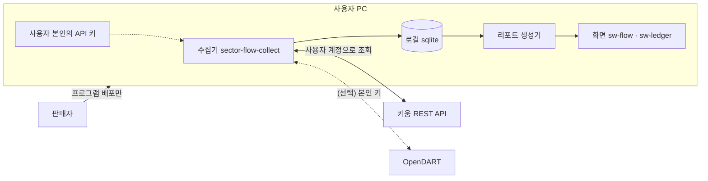

# 첨부 C — BYO 도구 구조 그림 1장

> **법률 검토 전 초안.** 외부에 낸 적이 없다. 아직 판매하지 않고, 수집기는 섹터 몇 개 크기의 조각으로 동등성을 재는 단계다(`docs/byo/`).

- 판매자 서버를 거치지 않는다. 판매자는 사용자의 데이터와 API 키를 받지도 보관하지도 않는다.
- 프로그램이 접속하는 곳은 키움과 (선택) OpenDART 뿐이다. 중계·공유 캐시·텔레메트리가 없다(`tests/test_packaging.py` 가 설치본의 목적지를 검사한다).
- 조회 한도와 계좌 정책은 각 사용자 계정에 적용된다.
